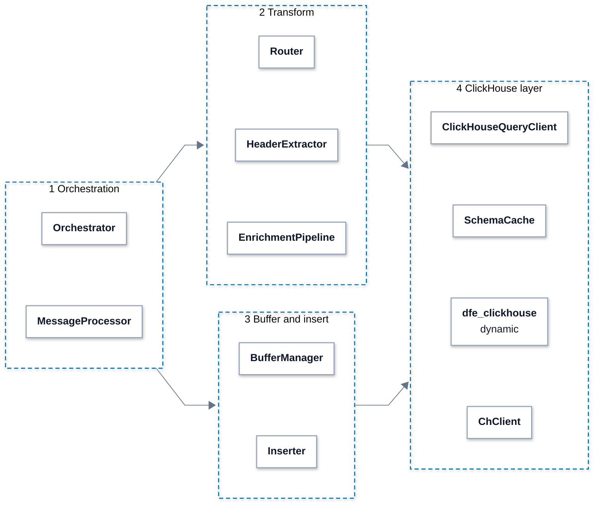

# Contributing

We welcome contributions to this project. By contributing, you agree to the
terms outlined below.

## Commit Message Format

HyperI projects use [Conventional Commits](https://www.conventionalcommits.org/)
and [semantic-release](https://semantic-release.gitbook.io/) for automated
versioning and changelog generation. All commits must follow this format:

```text
<type>(<scope>): <subject>

[optional body]

[optional footer(s)]
```

### Types

| Type | Description | Version Bump |
|------|-------------|--------------|
| `feat` | A new feature | Minor (0.X.0) |
| `fix` | A bug fix | Patch (0.0.X) |
| `docs` | Documentation only | None |
| `style` | Code style (formatting, semicolons, etc.) | None |
| `refactor` | Code change that neither fixes a bug nor adds a feature | None |
| `perf` | Performance improvement | Patch (0.0.X) |
| `test` | Adding or correcting tests | None |
| `build` | Changes to build system or dependencies | None |
| `ci` | Changes to CI configuration | None |
| `chore` | Other changes that don't modify src or test files | None |
| `revert` | Reverts a previous commit | Patch (0.0.X) |

### Breaking Changes

For breaking changes that require a major version bump, add `!` after the type
or include `BREAKING CHANGE:` in the footer:

```text
feat!: remove deprecated API endpoints

BREAKING CHANGE: The /v1/users endpoint has been removed. Use /v2/users instead.
```

### Examples

```text
feat(auth): add OAuth2 support for Google login

fix(api): handle null response from upstream service

docs: update installation instructions for Windows

refactor(core)!: restructure module exports

BREAKING CHANGE: Named exports are now used instead of default exports.
```

### Scope

Scope is optional but recommended. Use it to indicate the area of the codebase
affected (e.g., `api`, `auth`, `core`, `cli`, `docs`).

## Semantic Versioning

This project follows [Semantic Versioning 2.0.0](https://semver.org/):

- MAJOR (X.0.0): breaking changes that require users to modify their code
- MINOR (0.X.0): new features that are backwards-compatible
- PATCH (0.0.X): bug fixes and minor improvements

Versions are automatically determined by semantic-release based on commit
messages. Do not manually update version numbers.

## License for Contributions

All contributions to this project are licensed under the Business Source
License 1.1 (BUSL-1.1), the same license that covers the project.

Each version of the software (including your contributions) will automatically
become available under the Apache License, Version 2.0 on the third
anniversary of its release.

## How to Contribute

1. Fork the repository and create your branch from `main`
2. Make your changes following the commit message format above
3. Test your changes to ensure they work as expected
4. Submit a pull request with a clear description of what you've done

If you have questions about contributing, please open an issue or contact us.

### Pull Request Checklist

- [ ] Commits follow the conventional commit format
- [ ] Tests pass (if applicable)
- [ ] Documentation is updated (if applicable)

## Run the checks locally before you push

HyperI projects gate every push through CI (lint, format, tests, secret scan,
dependency audit, build). Run the SAME checks locally first so your change passes CI
instead of bouncing:

```bash
hyperi-ci check
```

`hyperi-ci` is the HyperI CI CLI (public on PyPI). If you do not have it, install
it once with `uv tool install hyperi-ci` (or `pipx install hyperi-ci`), or run it
ad hoc with `uvx hyperi-ci check`. It runs the project's full local validation --
the same suite CI runs -- and reports what to fix. Run it before every push and before opening a
pull request. It is the single best way to give your change the best chance of
surviving CI.

## CI/CD Workflow

A merge to `main` releases nothing by itself. CI validates the merge, and publishes only when the merge commit has a `Release: true` trailer (`hyperi-ci push --release` adds it) or someone dispatches a release of `main` (`hyperi-ci release`). A release then runs in order:

1. semantic-release analyses the commit messages since the last release
2. It picks the next version from the commit types
3. It renders CHANGELOG.md and tags HEAD
4. hyperi-ci creates the GitHub release and publishes the image and chart

## Context

### What this is

dfe-loader writes the data path's records into ClickHouse, the last hop of the DFE core data path.

NOT a transform stage, NOT a schema manager. Its only outbound topic is the DLQ. dfe-engine creates the destination tables, and the loader holds records pending schema rather than issuing DDL. The dynamic insert comes from `dfe-clickhouse`'s `dynamic` module, because the `clickhouse` crate keeps insertion compile-time typed.

### Where things live

| Path | Holds |
|------|-------|
| `src/main.rs`, `src/config/` | CLI entry, config structs, `Config::validate()`, flat env |
| `src/pipeline/` | Orchestrator and per-message processor -- the hot path |
| `src/routing/`, `src/transform/`, `src/enrich/` | Routing, the header extractor, field mapping, computed columns and timestamp checks, and the enrichment lookups |
| `src/payload/`, `src/kafka/`, `src/column_meta/`, `src/schema/`, `src/metrics/` | The JSON gate and batch split, the transport adapters, column directives, table tags, metrics |
| `src/buffer/`, `src/clickhouse/` | Per-table buffers, and the query client, schema cache and inserter |
| `tests/` | `smoke.rs`, `integration_tests.rs` (`integration/`, `e2e/`, `unit/`) -- see `tests/TESTING.md` |

The code sits in four layers. Orchestration calls the transform and the insert layers, and both call into the ClickHouse layer, never back up.



*Figure 1. L4 Detail -- Loader layers. Each layer calls only the layers to its right.* Up: [L3 Components -- dfe-loader](docs/architecture.md).

| Component | What it does |
|---|---|
| `Orchestrator` | Wiring, shutdown, hot-reload, the flush cycle and the offset commit |
| `MessageProcessor` | The per-message pass, run on the worker pool |
| `BufferManager` | Per-table rows, raw payloads and offsets |
| `Inserter` | Format dispatch, retry and salvage |
| `ClickHouseQueryClient` | Schema, comment and health queries |
| `ChClient` | The official `clickhouse::Client` over HTTP, or `dfe_clickhouse::TcpClient` over native |

A higher layer depends on lower layers, never the reverse. The insert path's
external dependencies are the official `clickhouse` crate's HTTP `Client`, and
`dfe-clickhouse` for the native-protocol `TcpClient` and for reading the
server's exception code out of an HTTP rejection so the inserter can classify it.

### Commands that prove a change

```bash
make check                                  # hyperi-ci check -- the full local gate
cargo nextest run --lib                     # unit, no infra
cargo nextest run --test smoke              # startup smoke, no infra
cargo nextest run --features testcontainers # core, Docker for the shared ClickHouse and Kafka
cargo nextest run --features testcontainers --run-ignored all --ignore-default-filter  # full
```

A passing run lies three ways. `require_clickhouse!()` returns early, and the test passes, when no ClickHouse is set and the build lacks `--features testcontainers`, or when a configured one does not answer outside CI. The e2e and other tests that need a server run only in the full tier. And `default = []` compiles a feature-gated test out and the run still reports a pass. `ci.yml` sets `paths-ignore` for `docs/**` and `**.md`, so a docs-only push runs no jobs, though its pull request still runs CI.

### What tends to bite

| Don't | Do | Why |
|-------|----|-----|
| Bump scalo and leave `release.helm.library` behind | Move `release.helm.library` in `.hyperi-ci.yaml` to the same scalo version | The release assembles the chart from the emitted contract on that scalo-service version, and a scalo-service release ships the schema for only the contract version its scalo release writes |
| Gate a test behind a cargo feature without adding it to `.hyperi-ci.yaml` | Add `default,<feature>` to the feature-set list | `default = []` (`Cargo.toml`), so it compiles out of every CI run and CI still reports a pass. `helm_contract.rs` asserts `transport-memory` and `testcontainers` stay listed |
| Inject a nested config key as `DFE_LOADER_SECTION_FIELD` | `DFE_LOADER__SECTION__FIELD` or `DFE_LOADER_SECTION__FIELD` | `__` separates nested keys. A name with single underscores reaches only a key the flat list names (`apply_flat_env` in `src/config/loader.rs`), and anything else matches no field and is dropped. `tests/integration/config_reachability.rs` checks both nested spellings |
| Set `clickhouse.protocol: native` with `insert_format: json_each_row` | `rowbinary` over native, or `http` for JSONEachRow | JSONEachRow is an HTTP body format. `ClickHouseConfig::validate()` rejects the pair by name when the pipeline starts, and `config-check` does not catch it |
| Name `clickhouse.tls.ca_paths`, `client_cert_path`, `client_key_path`, `skip_verify` or another `tls` key | Set `tls.enabled`, mount the CA into the trust store | Only `enabled` reaches a client, and `validate()` rejects every other `tls` key set, `skip_verify` included, by name |
| Widen the `cel` range past scalo's | Keep it on scalo's range, beside the `cel` entry in `Cargo.toml` | `cel::Program` crosses the scalo boundary. Wider resolves two semver-incompatible `cel` crates and `Program` stops being the same type |
| Take `clickhouse` from git or a `[patch]` | The crates.io release | `deny.toml` allows no git source, and `dfe-clickhouse` builds against the published `clickhouse` only |
| Change a config key and leave `docs/config-schema.*` behind | `dfe-loader config-schema --dir docs` | `test_config_artifacts_do_not_drift` fails on a stale schema, and dfe-engine authors loader configs from the schema in the contract |

### Where this sits

Inbound, declared in `dfe-infra/suite.yaml`:

- scalo-rs -> dfe-loader (`cargo-dep`): `Cargo.toml` takes `scalo` by range for transports, config cascade, CLI, metrics, deployment contract and DLQ. A scalo release reaches this repo here.
- scalo-rs -> dfe-loader (`generated-file`, lockstep): `Dockerfile` is emitted by `scalo::deployment::generate_dockerfile()` at the schema version its header names. Regenerate with `dfe-loader --emit-dockerfile` and commit the diff.

Outbound, so what a change here can break:

- dfe-loader -> dfe-infra (`image-pin`, lockstep): `dfe-infra/versions.yaml` pins this image and the thin chart released here, and Argo deploys that published chart.
- dfe-loader -> dfe-engine: dfe-engine takes a loader config's defaults, types and descriptions from the `config-schema.json` in this repo's contract (dfe-engine `src/dfe_engine/appmgmt/contract.py`).

Runtime, not build edges: dfe-engine applies the dfe-schemas manifest at boot, creating every destination table before the loader can insert. Producers reach the loader over Kafka or direct gRPC (default topic `main_land`): in the suite dfe-receiver and dfe-fetcher produce `*_land` topics, the transforms produce `*_load`, and dfe-receiver and the transforms push over gRPC.
