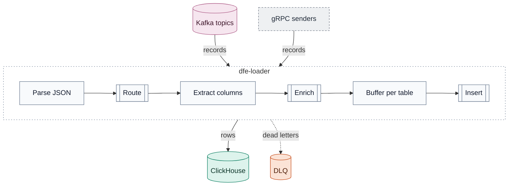

<!--
  Project:      dfe-loader
  File:         docs/README.md
  Purpose:      Documentation index for dfe-loader
  Language:     Markdown

  License:      BUSL-1.1
  Copyright:    (c) 2026 HYPERI PTY LIMITED
-->

# dfe-loader docs

Loads records from Kafka or a gRPC push into ClickHouse. Point it at a topic, give it a routing rule, and it parses, routes, promotes schema columns, enriches, buffers per table, and inserts -- RowBinary by default so ClickHouse parses no row text, with at-least-once Kafka delivery.

[architecture.md](architecture.md) covers the loader's layers, [clickhouse/](clickhouse/) the insert layer and [pipeline/](pipeline/) the hot path.

| You give it | It handles | You don't write |
|-------------|------------|-----------------|
| A Kafka topic or a gRPC push | JSON parse (sonic-rs, SIMD), the payload kept once as `Arc<[u8]>`, anything not JSON dead-lettered | A consumer, a parser, an input gate |
| The routing fields (`table_fields`, `org_routes`) | Pre-flatten routing to `db.table`, dot-notation nested access, the default table on a miss | A router, a dispatch table |
| A ClickHouse table | Schema reflected from `system.columns`, fields promoted to typed columns, the rest kept in `_json` | A schema mapping, an ORM, a migration |
| `insert_format` (default RowBinary) | Dynamic `Map<String,Value>` -> RowBinary over HTTP, or Native blocks over the native protocol, with a JSONEachRow fallback over HTTP | A serialiser, a type encoder, a wire format |
| `capture_mode` (full/raw_only/json_only/extracted_only) | `_json` and `_raw` population per table, overridable per-table and per-DDL | Per-table capture logic |
| Enrichment toggles (geoip/reputation/risk) | Flat enriched columns on the promoted row, never in `_json` | Lookup, caching, CIDR matching |
| Nothing extra | Per-table buffering, batch salvage, held-batch retry, schema-cache recovery, one offset commit per flush cycle | The resilience layer |

## 10,000-foot view

Every record takes the same six steps whichever transport brought it, and normally leaves as a row in a batched ClickHouse insert or as a dead letter.

*Figure 1. L3 Components -- dfe-loader. Double-bordered steps have a diagram each.* Up: top of dfe-loader. Down: [L4 Detail -- Loader table choice](pipeline/routing.md), [L4 Detail -- Enrichment](pipeline/enrichment.md), [L4 Detail -- Insert layer](clickhouse/README.md).

With `kafka.acknowledgements.enabled` (the default) Kafka offsets commit once per flush cycle, never past a row not yet placed. A pre-route filter, a dead letter no DLQ can hold and a revoked partition's rows are the exceptions, each counted, and [operations.md](operations.md) covers them.

The docs, by area:

| Area | Doc | Covers |
|------|-----|--------|
| Architecture | [architecture.md](architecture.md) | Layers, the dynamic insert, the client crates |
| Configuration | [configuration.md](configuration.md) | The cascade and the settings that change behaviour |
| Operations | [operations.md](operations.md) | Running, config-check, metrics/top, hot-reload, DLQ |
| Build features | [feature-flags.md](feature-flags.md) | Cargo features and the ClickHouse client crates |
| Insert layer | [clickhouse/](clickhouse/) | RowBinary vs JSONEachRow, the dynamic insert, schema cache, type handling, TLS, DDL directives |
| Hot path | [pipeline/](pipeline/) | Routing, extraction, enrichment, capture modes, buffering |
| Transports | [transport/](transport/) | The gRPC listener, the common header |
| Deployment | [deployment/](deployment/) | Container + chart publishing, schemas |
| Performance | [performance/](performance/) | Hot-path optimisations, parser-selection history, PGO/BOLT |

dfe-loader inserts through the official `clickhouse` crate from crates.io, with `dfe-clickhouse` reading the server's exception code out of a rejection. The dynamic RowBinary layer the `clickhouse` crate keeps out of scope -- runtime `Map<String,Value>` encoding -- comes from `dfe-clickhouse`'s `dynamic` module. See [clickhouse/clickhouse-ext.md](clickhouse/clickhouse-ext.md).
