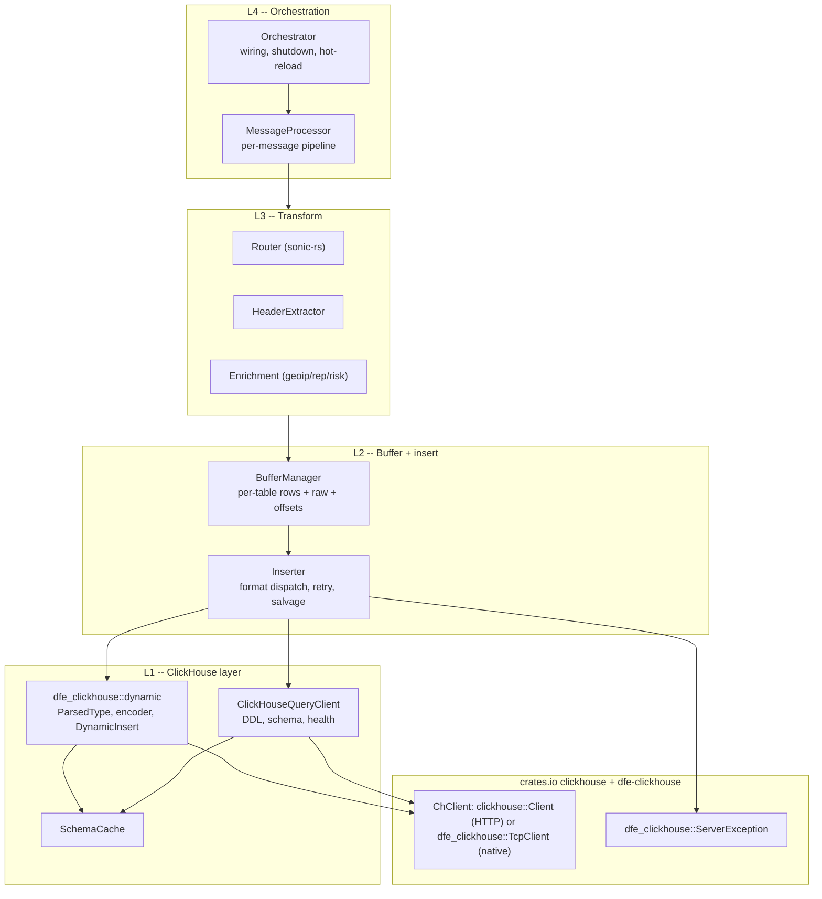
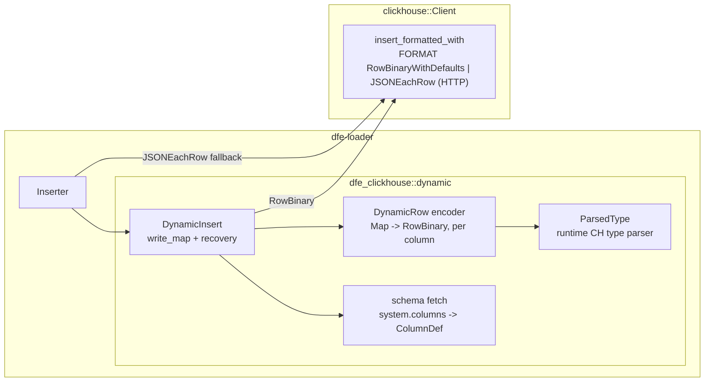
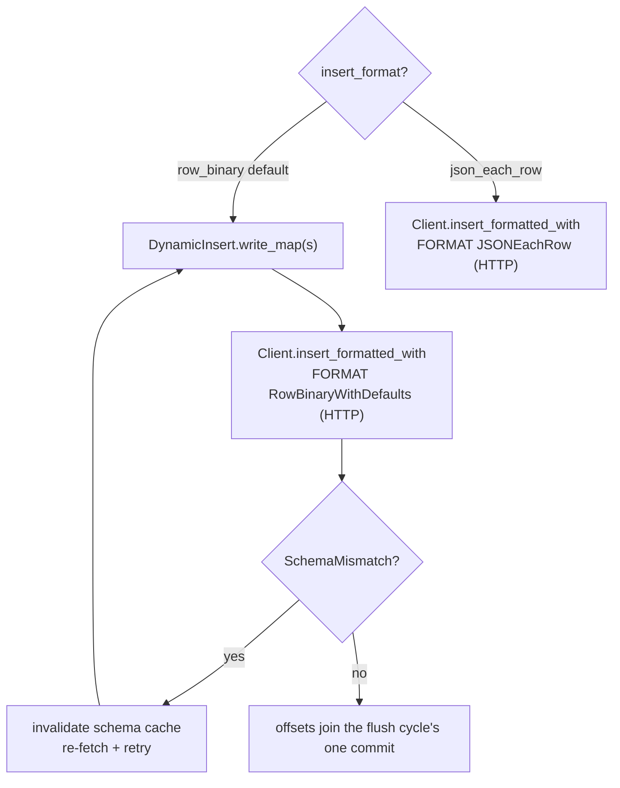

<!--
  Project:      dfe-loader
  File:         docs/architecture.md
  Purpose:      System architecture: layers, the dynamic insert, insert dispatch
  Language:     Markdown

  License:      BUSL-1.1
  Copyright:    (c) 2026 HYPERI PTY LIMITED
-->

# Architecture

dfe-loader is a per-message hot path with a per-table batching tail. A message arrives as bytes, gets routed and promoted into a typed row, accumulates in a per-table buffer, and flushes to ClickHouse as a batch. Kafka offsets commit once per flush cycle, never past a row not placed yet -- at-least-once.

Everything on the hot path is shaped by one rule: do the cheap thing per
message, defer the expensive thing to flush. Parse once (SIMD, zero-copy),
promote only schema columns, keep the full payload as a reference-counted
`Arc<[u8]>`, and splice it as `_json` only at serialise time.

## Layers

A higher layer depends on lower layers, never the reverse. The insert path's
external dependencies are the official `clickhouse` crate's HTTP `Client`, and
`dfe-clickhouse` for the native-protocol `TcpClient` and for reading the
server's exception code out of an HTTP rejection so the inserter can classify it.

## The dynamic insert

The `clickhouse` crate keeps insertion typed (`T: Row`, compile-time schema) --
that is the right upstream default. dfe-loader inserts runtime-shaped
`Map<String,Value>` rows whose columns come from `system.columns` at runtime.
That dynamic layer comes from `dfe-clickhouse`'s `dynamic` module, on top of the upstream
`Client`:

Over HTTP every insert goes through `insert_formatted_with`: one
`FORMAT RowBinaryWithDefaults` INSERT per batch, or `JSONEachRow`. With
`clickhouse.protocol: native` the rows go out as `FORMAT Native` blocks through
`TcpClient::insert_native`, and `JSONEachRow` is refused at startup. See [clickhouse/clickhouse-ext.md](clickhouse/clickhouse-ext.md).

## Insert dispatch

The RowBinary path ships `FORMAT RowBinaryWithDefaults` through
`insert_formatted_with`. A refusal is the rows' own only once a fresh read shows
the table unchanged since they were encoded, and otherwise the retry encodes
against the current schema. Over native the block declares the types.

A rejected insert is classified by the server's exception code, read with
`dfe_clickhouse::ServerException::parse` over HTTP and carried structurally
over native, never by the words of the message:
a parse rejection echoes the offending row back. The loader keeps at most 1 MiB
of any error text, because the client reads a whole error body into memory.

## Capture modes

`capture_mode` decides what gets stored alongside the promoted columns.
Resolution is three-level, highest wins: DDL `@capture_mode` comment >
per-table config > global default.

| Mode | `_json` | `_raw` | Use |
|------|---------|--------|-----|
| `full` (default) | full payload (JSON type) | the record's own raw field, else NULL | path queries + text search |
| `json_only` | full payload (JSON type) | NULL | path queries without the `_raw` overhead |
| `raw_only` | NULL | full Kafka payload (String) | CH CPU saving, no JSON-type overhead |
| `extracted_only` | NULL | NULL | promoted columns only |

All four still promote schema columns; the difference is whether (and where)
the full payload is kept. Under `full` a JSON record is stored once, in `_json`: `_raw` holds only raw data the source sent with it, such as a syslog line the receiver captured.

## Resilience

- **Batch salvage** -- on a data error, binary-split the batch to isolate the
  bad row(s), DLQ only those, keep the good ones.
- **Sink-down gate** -- a flush cycle in which every insert failed opens the
  circuit gate on the KEDA scaling signal, and the next successful insert closes
  it. A failed insert never sends its batch to the DLQ.
- **Schema-cache recovery** -- on `SchemaMismatch` (e.g. `ALTER ... ADD COLUMN`),
  invalidate and re-fetch, then retry.
- **One commit per flush cycle** -- offsets commit once per cycle, and on each partition stop below the lowest offset not placed yet. A failed batch or a dead letter the DLQ refused is held and retried with jittered backoff, and holds its partition's commit until it lands. A dead letter no DLQ backend can ever hold is dropped and counted instead (`pipeline_dead_letters_dropped_total{reason}`). A held batch whose table ClickHouse has since reported absent is retried against the default table.
- **Partition leases** -- rows of a partition a rebalance has moved away are discarded before any write, since the partition's next owner reads them again from the committed offset (`transport_revoke_discarded_total{stage="buffer"}`). See [operations.md](operations.md#rebalances).

## Source of truth

| Data | Source |
|------|--------|
| Version | `git describe --tags` / `VERSION` |
| Tasks | GitHub Issues / `TODO.md` |
| History | `git log` |
| Static context | `CLAUDE.md` |
