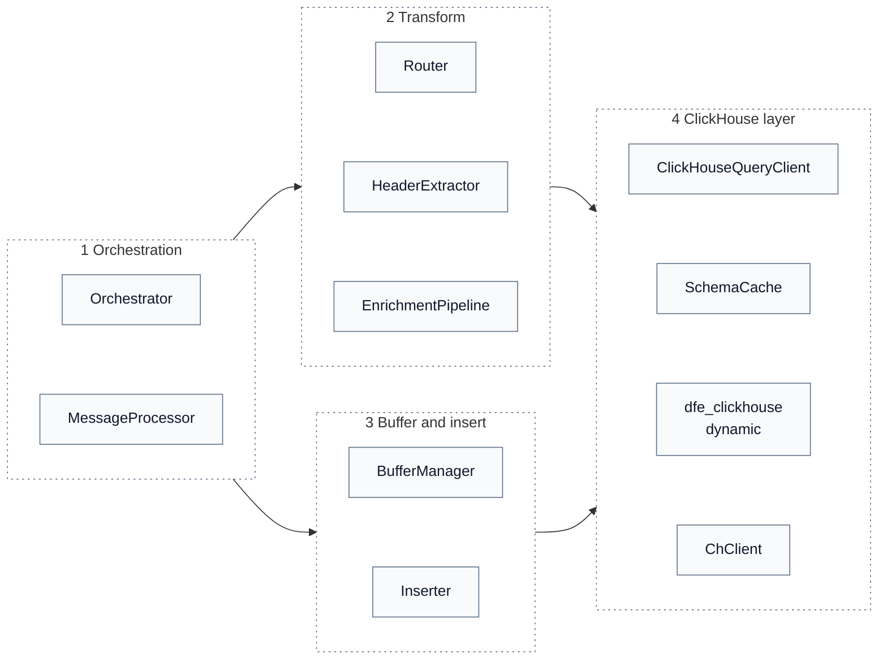
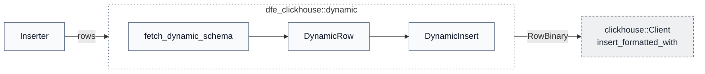
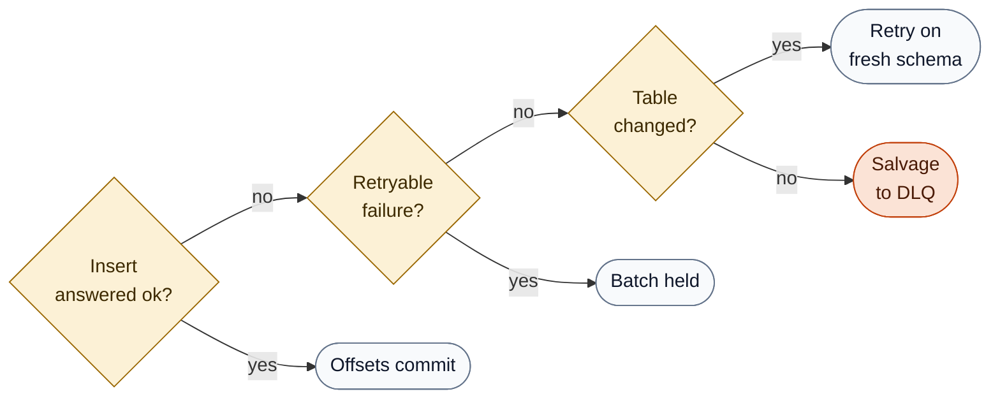

<!--
  Project:      dfe-loader
  File:         docs/architecture.md
  Purpose:      System architecture: layers, the dynamic insert, insert dispatch
  Language:     Markdown

  License:      BUSL-1.1
  Copyright:    (c) 2026 HYPERI PTY LIMITED
-->

# Architecture

dfe-loader is a per-message hot path with a per-table batching tail. A message arrives as bytes, gets routed and promoted into a typed row, accumulates in a per-table buffer, and flushes to ClickHouse as a batch. Kafka offsets commit once per flush cycle, never past a row not placed yet -- at-least-once.

Everything on the hot path follows one rule: do the cheap thing per
message, defer the expensive thing to flush. Parse once (SIMD),
promote only schema columns, keep the full payload as a reference-counted
`Arc<[u8]>`, and splice it as `_json` only at serialise time.

## Layers

The code sits in four layers. Orchestration calls the transform and the insert layers, and both call into the ClickHouse layer, never back up.

*Figure 1. L4 Detail -- Loader layers. Each layer calls only the layers to its right.* Up: [L3 Components -- dfe-loader](README.md).

| Component | What it does |
|---|---|
| `Orchestrator` | Wiring, shutdown, hot-reload, the flush cycle and the offset commit |
| `MessageProcessor` | The per-message pass, run on the worker pool |
| `BufferManager` | Per-table rows, raw payloads and offsets |
| `Inserter` | Format dispatch, retry and salvage |
| `ClickHouseQueryClient` | Schema, comment and health queries |
| `ChClient` | The official `clickhouse::Client` over HTTP, or `dfe_clickhouse::TcpClient` over native |

A higher layer depends on lower layers, never the reverse. The insert path's
external dependencies are the official `clickhouse` crate's HTTP `Client`, and
`dfe-clickhouse` for the native-protocol `TcpClient` and for reading the
server's exception code out of an HTTP rejection so the inserter can classify it.

## The dynamic insert

The `clickhouse` crate keeps insertion typed (`T: Row`, compile-time schema) --
that is the right upstream default. dfe-loader inserts
`Map<String,Value>` rows with columns from `system.columns` at runtime.
That dynamic layer comes from `dfe-clickhouse`'s `dynamic` module, on top of the upstream
`Client`. The rows are encoded against the schema read at runtime, then sent as RowBinary through the official client over HTTP, or as Native blocks through `dfe_clickhouse::TcpClient` over native.

*Figure 2. L4 Detail -- Dynamic insert, over HTTP. The dashed box is the crates.io client.* Up: [L3 Components -- dfe-loader](README.md).

`ParsedType` parses each column's type string for the encoder. A JSONEachRow insert skips the encoder: `shape_for_type` rewrites the values the server would refuse and the rows go straight to `insert_formatted_with`.

Over HTTP every insert goes through `insert_formatted_with`: `FORMAT RowBinaryWithNamesAndTypes`, one INSERT for each set of defaulted columns the batch's rows supply, or `JSONEachRow`. With `clickhouse.protocol: native` the rows go out as `FORMAT Native` blocks through `TcpClient::insert_native`, and `JSONEachRow` is refused at startup. See [clickhouse/clickhouse-ext.md](clickhouse/clickhouse-ext.md).

## Insert dispatch

A failed RowBinary insert ends one of three ways: held for a later flush, retried against a fresh schema, or split so only its bad rows reach the DLQ.

*Figure 3. L4 Detail -- Insert outcome. Orange is the end that dead-letters rows.* Up: [L3 Components -- dfe-loader](README.md).

`Inserter::dynamic_verdict` in `src/clickhouse/inserter.rs` makes the call. Retryable means a timeout, a dropped connection or a code on the retry list in `src/clickhouse/error.rs`. A stale or unreadable cached schema is retried on a fresh read without asking the table, and an encoder refusal of a value goes straight to salvage.

The RowBinary path ships `FORMAT RowBinaryWithNamesAndTypes` through
`insert_formatted_with`, and the header's types make the server refuse rows encoded against a type the column no longer has. A refusal is blamed on the rows once a fresh read shows
the table unchanged since they were encoded, and otherwise the retry encodes
against the current schema. Over native the block declares the types.

A rejected insert is classified by the server's exception code, read with
`dfe_clickhouse::ServerException::parse` over HTTP and carried structurally
over native, never by the words of the message:
a parse rejection echoes the offending row back. The loader keeps at most 1 MiB
of any error text, because the client reads a whole error body into memory.

`capture_mode` decides whether the full payload is kept beside the promoted columns, as `_json`, `_raw` or neither, resolved per table from the DDL tag, then per-table config, then the global default. Under the default `full` a JSON record is stored once, in `_json`. [pipeline/capture-modes.md](pipeline/capture-modes.md) has the four modes.

## Resilience

- A data error binary-splits the batch down to the bad rows, which go to the DLQ, and the rest land.
- A flush cycle in which every insert failed opens the circuit gate on the KEDA scaling signal, and the next successful insert closes it. A failed insert never sends its batch to the DLQ.
- Drift, a column dropped or retyped by `ALTER`, drops the cached schema, and the retry encodes against a fresh read. An added column breaks no insert, because the INSERT names its columns, so it takes its default until the cached schema refreshes.
- Offsets commit once per cycle, and on each partition stop below the lowest offset not placed yet. A failed batch or a dead letter the DLQ refused is held and retried with jittered backoff, and holds its partition's commit until it lands. A dead letter no DLQ backend can ever hold is dropped and counted instead (`pipeline_dead_letters_dropped_total{reason}`). A held batch is retried against the default table once ClickHouse reports its table absent, a batch bound for `dlq_load.table` aside, which waits for its table.
- Rows of a partition a rebalance has moved away are discarded before any write, since the partition's next owner reads them again from the committed offset (`transport_revoke_discarded_total{stage="buffer"}`). See [operations.md](operations.md#rebalances).
