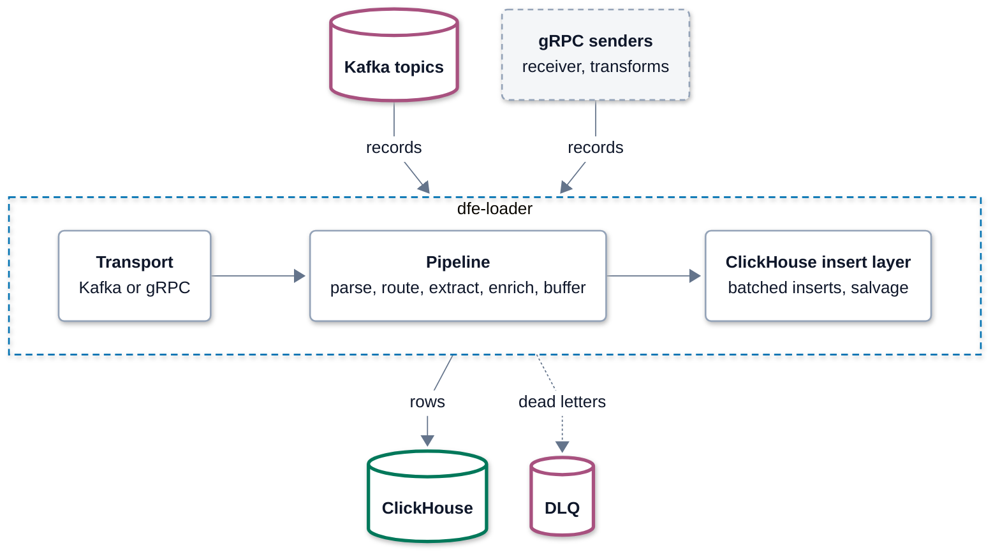

<!--
  Project:      dfe-loader
  File:         docs/architecture.md
  Purpose:      Architecture: the loader's parts, its dependencies and why it is built this way
  Language:     Markdown

  License:      BUSL-1.1
  Copyright:    (c) 2026 HYPERI PTY LIMITED
-->

# dfe-loader architecture

dfe-loader is the last hop of the DFE data path: it takes records from Kafka or a gRPC push and inserts them into ClickHouse tables in batches. It needs no mapping first, because it reads each table's columns from ClickHouse and keeps whatever doesn't fit in `_json`.

*Figure 1. L3 Components -- dfe-loader.* Up: [L2 Services -- DFE deployment](https://github.com/hyperi-io/dfe-infra/blob/main/docs/architecture.md). Down: [L4 Detail -- Transport](transport/README.md), [L4 Detail -- Pipeline](pipeline/README.md), [L4 Detail -- ClickHouse insert layer](clickhouse/README.md).

## How data flows

1. The transport is scalo's. On Kafka it consumes the configured topics. With `transport: grpc` it serves a gRPC listener on port 6000 that dfe-receiver and the transforms push to directly. Both hand the pipeline the same message, so nothing after them knows which one a record came on.
2. The pipeline refuses anything not JSON, parses it once with SIMD and routes it to a `db.table` from its routing fields. It promotes the fields that match the table's columns, adds the enrichment columns and puts the row in that table's buffer.
3. The ClickHouse insert layer flushes each table's buffer as a batched INSERT, RowBinary by default, so ClickHouse parses no row text. Rows ClickHouse refuses for good go to the DLQ.
4. With `kafka.acknowledgements.enabled` (the default) Kafka offsets commit once per flush cycle, never past a row not yet placed. Delivery is at-least-once.

## Components

| Part | Role | Page |
|---|---|---|
| Transport | scalo's Kafka and gRPC transports, adapted to one message type | [transport/README.md](transport/README.md) |
| Pipeline | The per-message pass and the per-table buffers | [pipeline/README.md](pipeline/README.md) |
| ClickHouse insert layer | The dynamic insert, insert formats, the schema cache, retries and salvage | [clickhouse/README.md](clickhouse/README.md) |

## External dependencies

| Dependency | When it's needed | What can stand in |
|---|---|---|
| Kafka | `transport: kafka` (the default), and the default DLQ | Any broker scalo's Kafka transport reaches |
| gRPC senders | `transport: grpc` | dfe-receiver and the transforms, over scalo's Push |
| ClickHouse | Always | A server in the cluster over HTTP or the native protocol, or ClickHouse Cloud, where a host under `clickhouse.cloud` turns TLS on |
| The DFE tables | Always | dfe-engine creates them from the dfe-schemas manifest. The loader never runs DDL |
| GeoIP databases | `geoip.enabled` | MaxMind GeoLite2 or DB-IP files, downloaded at startup or mounted |

A missing GeoIP database leaves enrichment off and never stops the loader. A missing table holds its records until the schema arrives, up to `schema.pending_max_age_secs`, and then dead-letters them.

## Deployment variants

Kafka is the default transport. With `transport: grpc` there are no broker offsets: a held batch is answered `UNAVAILABLE` to its sender instead of holding a partition's commit, and the DLQ is file only.

`kafka.acknowledgements.enabled: false` commits offsets at receipt. The buffered rows are then their only copy, so a kill loses them.

The released chart scales on CPU, with its Kafka lag trigger off, because raw consumer lag rises when a stage downstream breaks. In a DFE deployment, dfe-infra's values set the CPU target to 70% and add the scaling-pressure trigger. The slim profile clears that trigger, so slim scales on CPU alone. [operations.md](operations.md#scaling) has the numbers.

## Design considerations

**Reliability.** The insert tail degrades rather than stalls. A data error splits the batch down to the bad rows, which go to the DLQ, and the rest land. A failed insert never sends its batch to the DLQ: it holds the batch and its partition's commit, and retries with jittered backoff. A cycle in which every insert failed opens the circuit gate on the scaling signal, since more pods can't help a dead ClickHouse. [operations.md](operations.md#when-inserts-fail) has every case.

**Performance.** Everything on the hot path follows one rule: do the cheap thing per message, and defer the expensive thing to flush. The payload is parsed once and kept as a reference-counted `Arc<[u8]>`. Only schema columns are promoted, and the payload is spliced in as `_json` only when the batch is serialised. [performance/overview.md](performance/overview.md) has the rest.

**Operations.** `/readyz` stays 503 until ClickHouse accepts the configured user and answers reads of the database's tables and columns. Until then the loader joins no consumer group and opens no gRPC listener, so a pod with a wrong password takes no partitions from the pods that can write. An outage after that doesn't flip readiness, which would pull every loader out of its Service at once. `clickhouse_connected` reports it instead.

**Security.** The loader has no listener an outsider can reach: its gRPC port takes pushes from dfe-receiver and the transforms. TLS to ClickHouse is `clickhouse.tls.enabled` with the CA in the trust store, and [clickhouse/tls.md](clickhouse/tls.md) has the private-CA case.

## Why it's built this way

**The insert is dynamic.** The `clickhouse` crate keeps insertion typed, with a compile-time schema, and that is the right upstream default. A loader that takes any table can't know its columns at compile time. So rows are `Map<String,Value>`, encoded against the schema read from `system.columns` at runtime by `dfe-clickhouse`'s `dynamic` module.

**RowBinary is the default.** The rows go to ClickHouse already typed, so the server parses no row text. JSONEachRow stays as an HTTP fallback.

**A rejection is read by its code, never its words.** A parse rejection echoes the offending row back, so the message text can carry anything. The loader reads the server's exception code and keeps at most 1 MiB of any error text.

**The engine owns the schema.** The loader never creates or alters a table. A record for a table that isn't there yet waits for it, so a schema change has one owner.

**The payload is stored once.** Under the default `capture_mode: full` a JSON record lands in `_json`, beside the promoted columns, and nowhere else. [pipeline/capture-modes.md](pipeline/capture-modes.md) has the four modes.

## Diagram map

- Figure 1. L3 Components -- dfe-loader (this page)
  - [L4 Detail -- Transport](transport/README.md), with [the gRPC transport](transport/grpc.md) and [the common header](transport/common-header.md)
  - [L4 Detail -- Pipeline](pipeline/README.md), with [the stages](pipeline/overview.md), [routing](pipeline/routing.md), [enrichment](pipeline/enrichment.md), [capture modes](pipeline/capture-modes.md) and [parallelism](pipeline/parallelism.md)
  - [L4 Detail -- ClickHouse insert layer](clickhouse/README.md), with [the dynamic insert](clickhouse/clickhouse-ext.md), [insert formats](clickhouse/insert-formats.md), [the schema cache](clickhouse/schema-cache.md), [DDL directives](clickhouse/ddl-directives.md) and [TLS](clickhouse/tls.md)
- [Configuration](configuration.md), [performance](performance/overview.md), [publishing](deployment/publishing.md) and [shared schemas](deployment/schemas.md) each have a diagram of their own

## What's next

- [configuration.md](configuration.md): the cascade and the settings that change behaviour
- [operations.md](operations.md): running, metrics, failed inserts, the DLQ and scaling
- [config-schema.yaml](config-schema.yaml): every setting and its default
- [CONTRIBUTING.md](../CONTRIBUTING.md#context): where the code lives and what tends to bite
