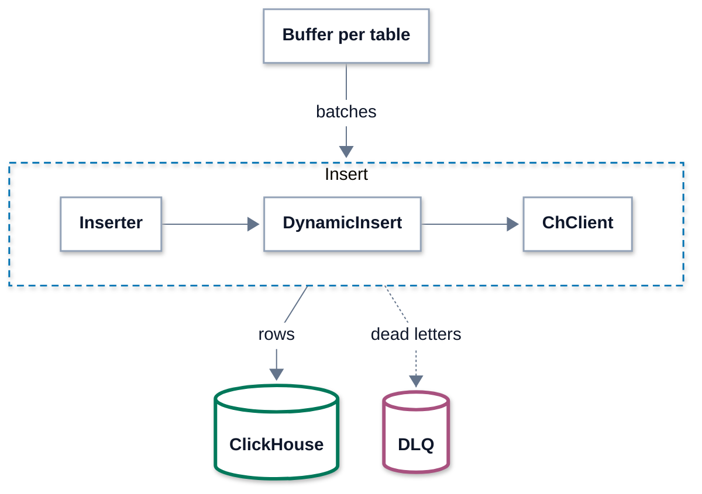
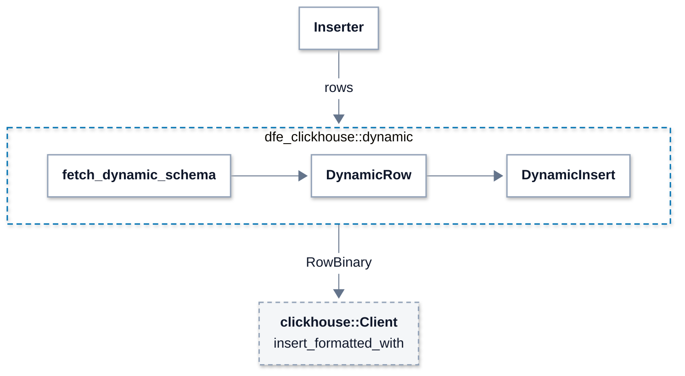
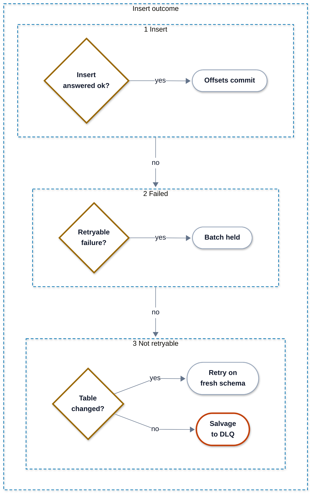

<!--
  Project:      dfe-loader
  File:         docs/clickhouse/README.md
  Purpose:      Index for the ClickHouse insert layer
  Language:     Markdown

  License:      BUSL-1.1
  Copyright:    (c) 2026 HYPERI PTY LIMITED
-->

# ClickHouse insert layer

The ClickHouse insert layer is the last part of [dfe-loader](../architecture.md): it writes each table's batch to ClickHouse and sends the rows ClickHouse refuses for good to the DLQ.

| | |
|---|---|
| Repo | [hyperi-io/dfe-loader](https://github.com/hyperi-io/dfe-loader) |
| Image and chart | `ghcr.io/hyperi-io/dfe-loader`, and the thin chart released beside it |
| Config reference | `clickhouse`, `schema` and `buffer` in [config-schema.yaml](../config-schema.yaml) |
| Endpoints | None of its own. It dials ClickHouse over HTTP, or the native protocol with `clickhouse.protocol: native` |
| Metrics | `rows_inserted_total`, `batches_flushed_total`, `clickhouse_connected`, `scaling_circuit_open`, in [operations.md](../operations.md#observe) |

No `Row` type is compiled in: the schema is read at runtime and each `Map<String, Value>` row is encoded straight to binary.

*Figure 1. L4 Detail -- Insert layer. The arrow to DLQ is the salvage path.* Up: [L3 Components -- dfe-loader](../architecture.md). Down: [L4 Detail -- Dynamic insert](#how-it-works), [L4 Detail -- Insert outcome](#scaling-and-failure).

## How it works

The `clickhouse` crate keeps insertion typed (`T: Row`, compile-time schema) --
that is the right upstream default. dfe-loader inserts
`Map<String,Value>` rows with columns from `system.columns` at runtime.
That dynamic layer comes from `dfe-clickhouse`'s `dynamic` module, on top of the upstream
`Client`. The rows are encoded against the schema read at runtime, then sent as RowBinary through the official client over HTTP, or as Native blocks through `dfe_clickhouse::TcpClient` over native.

*Figure 2. L4 Detail -- Dynamic insert, over HTTP. clickhouse::Client is the crates.io client.* Up: [L4 Detail -- ClickHouse insert layer](README.md).

`ParsedType` parses each column's type string for the encoder. A JSONEachRow insert skips the encoder: `shape_for_type` rewrites the values the server would refuse and the rows go straight to `insert_formatted_with`.

## Interfaces

`ChClient` is the official `clickhouse::Client` over HTTP, or `dfe_clickhouse::TcpClient` with `clickhouse.protocol: native`. The schema cache both clients read is in [schema-cache.md](schema-cache.md).

Over HTTP every insert goes through `insert_formatted_with`: `FORMAT RowBinaryWithNamesAndTypes`, one INSERT for each set of defaulted columns the batch's rows supply, or `JSONEachRow`. With `clickhouse.protocol: native` the rows go out as `FORMAT Native` blocks through `TcpClient::insert_native`, and `JSONEachRow` is refused at startup. See [clickhouse-ext.md](clickhouse-ext.md).

`capture_mode` decides whether the full payload is kept beside the promoted columns, as `_json`, `_raw` or neither, resolved per table from the DDL tag, then per-table config, then the global default. Under the default `full` a JSON record is stored once, in `_json`. [capture-modes.md](../pipeline/capture-modes.md) has the four modes.

## Scaling and failure

A failed RowBinary insert ends one of three ways: held for a later flush, retried against a fresh schema, or split so only its bad rows reach the DLQ.

*Figure 3. L4 Detail -- Insert outcome. Salvage to DLQ is the end that dead-letters rows.* Up: [L4 Detail -- ClickHouse insert layer](README.md).

`Inserter::dynamic_verdict` in `src/clickhouse/inserter.rs` makes the call. Retryable means a timeout, a dropped connection or a code on the retry list in `src/clickhouse/error.rs`. A stale or unreadable cached schema is retried on a fresh read without asking the table, and an encoder refusal of a value goes straight to salvage.

The RowBinary path ships `FORMAT RowBinaryWithNamesAndTypes` through
`insert_formatted_with`, and the header's types make the server refuse rows encoded against a type the column no longer has. A refusal is blamed on the rows once a fresh read shows
the table unchanged since they were encoded, and otherwise the retry encodes
against the current schema. Over native the block declares the types.

A rejected insert is classified by the server's exception code, read with
`dfe_clickhouse::ServerException::parse` over HTTP and carried structurally
over native, never by the words of the message:
a parse rejection echoes the offending row back. The loader keeps at most 1 MiB
of any error text, because the client reads a whole error body into memory.

## Key metrics

- `rows_inserted_total` and `batches_flushed_total`: what landed.
- `dfe_loader_permanent_reject_total`, per table: rows ClickHouse refused for good.
- `clickhouse_connected`: 0 once an insert went unanswered.
- `scaling_circuit_open`: 1 after a cycle in which every insert failed.

## Related

Read in this order:

- [clickhouse-ext.md](clickhouse-ext.md) -- the dynamic insert from
  `dfe-clickhouse`'s `dynamic` module, and how the inserter reads its failures.
- [insert-formats.md](insert-formats.md) -- RowBinary vs JSONEachRow, the
  transport x format matrix, and why RowBinary is the default.
- [schema-cache.md](schema-cache.md) -- reflecting `system.columns`, the TTL
  cache, and mismatch recovery.
- [types.md](types.md) -- the ClickHouse type reference and how each type is
  encoded.
- [ddl-directives.md](ddl-directives.md) -- the `@`-comment directives the
  loader reads off table DDL (capture mode, field mapping).
- [tls.md](tls.md) -- TLS transport security and private-CA trust.
