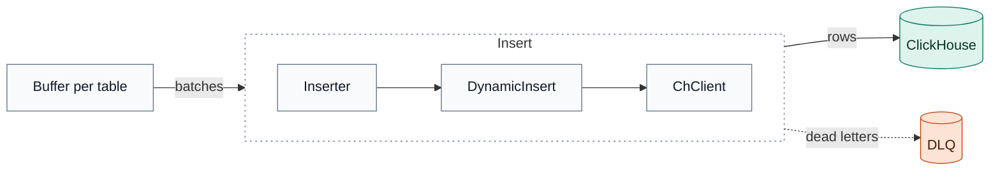

<!--
  Project:      dfe-loader
  File:         docs/clickhouse/README.md
  Purpose:      Index for the ClickHouse insert layer
  Language:     Markdown

  License:      BUSL-1.1
  Copyright:    (c) 2026 HYPERI PTY LIMITED
-->

# ClickHouse insert layer

The dynamic insert path over the official `clickhouse` crate. The loader
reflects each table's schema at runtime and encodes `Map<String, Value>` rows
straight to binary -- no compile-time `Row` types.

The inserter takes each table's batch from its buffer and sends it through the dynamic insert and the client to ClickHouse, and the rows ClickHouse rejects for good are the ones that leave for the DLQ.

*Figure 1. L4 Detail -- Insert layer. The dotted arrow is the salvage path.* Up: [L3 Components -- dfe-loader](../README.md).

`ChClient` is the official `clickhouse::Client` over HTTP, or `dfe_clickhouse::TcpClient` with `clickhouse.protocol: native`. The schema cache both clients read is in [schema-cache.md](schema-cache.md).

Read in this order:

- [clickhouse-ext.md](clickhouse-ext.md) -- the dynamic insert from
  `dfe-clickhouse`'s `dynamic` module, and how the inserter reads its failures.
- [insert-formats.md](insert-formats.md) -- RowBinary vs JSONEachRow, the
  transport x format matrix, and why RowBinary is the default.
- [schema-cache.md](schema-cache.md) -- reflecting `system.columns`, the TTL
  cache, and mismatch recovery.
- [types.md](types.md) -- the ClickHouse type reference and how each type is
  encoded.
- [ddl-directives.md](ddl-directives.md) -- the `@`-comment directives the
  loader reads off table DDL (capture mode, field mapping).
- [tls.md](tls.md) -- TLS transport security and private-CA trust.

dfe-loader inserts through crates.io `clickhouse` and reads rejection codes with `dfe-clickhouse`, with the dynamic encoding layer from `dfe-clickhouse`'s `dynamic` module. See [clickhouse-ext.md](clickhouse-ext.md).
