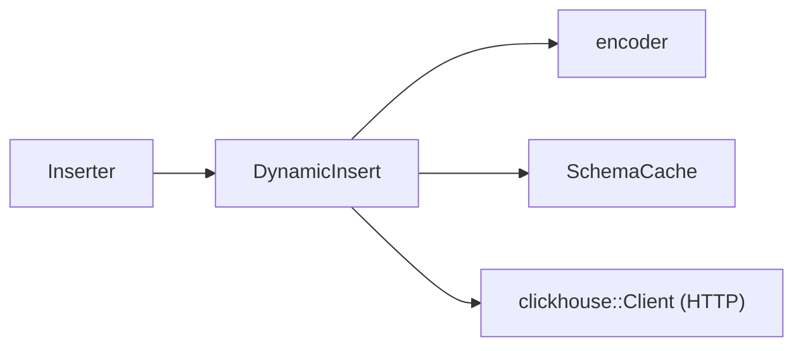

<!--
  Project:      dfe-loader
  File:         docs/clickhouse/README.md
  Purpose:      Index for the ClickHouse insert layer
  Language:     Markdown

  License:      BUSL-1.1
  Copyright:    (c) 2026 HYPERI PTY LIMITED
-->

# ClickHouse insert layer

The dynamic insert path over the official `clickhouse` crate. The loader
reflects each table's schema at runtime and encodes `Map<String, Value>` rows
straight to binary -- no compile-time `Row` types.

## Read in this order

- [clickhouse-ext.md](clickhouse-ext.md) -- the `src/clickhouse_ext/` layer:
  what it is, where it meets the `clickhouse` crate, and what stays the crate's job.
- [insert-formats.md](insert-formats.md) -- RowBinary vs JSONEachRow, the
  transport x format matrix, and why RowBinary is the default.
- [schema-cache.md](schema-cache.md) -- reflecting `system.columns`, the TTL
  cache, and mismatch recovery.
- [types.md](types.md) -- the ClickHouse type reference and how each type is
  encoded.
- [ddl-directives.md](ddl-directives.md) -- the `@`-comment directives the
  loader reads off table DDL (capture mode, field mapping).
- [tls.md](tls.md) -- TLS transport security and private-CA trust.

## The client, in one line

dfe-loader inserts through crates.io `clickhouse` and reads rejection codes with `dfe-clickhouse`, with the dynamic encoding layer kept in this repo at `src/clickhouse_ext/`. See [clickhouse-ext.md](clickhouse-ext.md) for why the split sits where it does.
