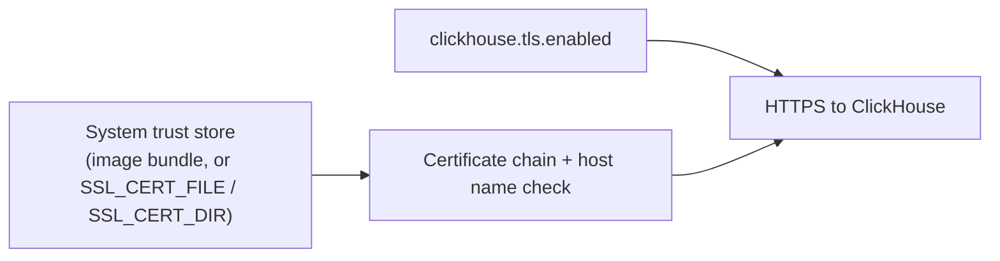

<!--
  Project:      dfe-loader
  File:         docs/clickhouse/TLS.md
  Purpose:      TLS transport security and private-CA trust for ClickHouse
  Language:     Markdown

  License:      BUSL-1.1
  Copyright:    (c) 2026 HYPERI PTY LIMITED
-->

# TLS and private CAs

The loader reaches ClickHouse over HTTP (`clickhouse.protocol: http`; `native` is refused at startup). With TLS on it speaks HTTPS, usually on 8443, and verifies the server's certificate and host name against the container's system trust store.



## Turning TLS on

| Setting | Effect |
|---------|--------|
| `clickhouse.tls.enabled` | HTTPS for the connection |
| `clickhouse.tls` absent | TLS turns on for a host on 8443 or 9440, or under `clickhouse.cloud` |

The SNI name and the name checked against the certificate are the host in `clickhouse.hosts`, so connect by a name (or IP) the certificate lists.

## Private / internal CAs

A private CA is trusted the way the system trusts it: add it to the image's trust store, or point `SSL_CERT_FILE` at a PEM bundle that holds it (`SSL_CERT_DIR` at a directory of them). Either variable replaces the platform store rather than adding to it, so a bundle that must also trust public CAs has to carry them too.

A trust store with no readable CA certificate fails the client at startup instead of connecting unverified.

## What is deliberately not offered

`clickhouse.tls.ca_cert_file`, `cert_file`, `key_file` and `skip_verify` are refused at startup: no client reads them. There is no skip-verify mode, and client-certificate (mTLS) auth is out of scope today.

## Example: private-CA cluster

```yaml
clickhouse:
  protocol: http
  tls:
    enabled: true
  hosts:
    - clickhouse.example.internal:8443
```

```text
SSL_CERT_FILE=/etc/dfe/ca-bundle.pem   # the private CA plus any public roots still needed
```

The CA bundle is non-secret and is distributed with the deployment. The cluster password stays in the git-excluded environment, never in committed config. See [../CONFIGURATION.md](../CONFIGURATION.md) for the cascade and [../deployment/](../deployment/README.md) for how secrets are supplied at runtime.
