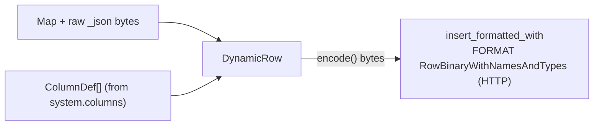

<!--
  Project:      dfe-loader
  File:         docs/clickhouse/clickhouse-ext.md
  Purpose:      The clickhouse_ext layer -- dynamic RowBinary insert over the clickhouse crate
  Language:     Markdown

  License:      BUSL-1.1
  Copyright:    (c) 2026 HYPERI PTY LIMITED
-->

# clickhouse_ext

`src/clickhouse_ext/` is the HyperI dynamic-insert layer over the official `clickhouse` crate from crates.io. Its HTTP `Client` keeps insertion typed (`T: Row`). dfe-loader inserts runtime-shaped `Map<String,Value>` rows, so the dynamic encoding lives here, on top of that `Client`.

## Modules

| Module | Responsibility |
|--------|----------------|
| `parsed_type` | Parse a `system.columns` type string into a structured `ParsedType` (Nullable, LowCardinality, Array, Map, DateTime64, Decimal, Enum, ...) |
| `encode` | `DynamicRow`: a `Map<String,Value>` + its `ColumnDef` schema. Row-wise `encode()` bytes feed the HTTP FORMAT RowBinaryWithNamesAndTypes sink |
| `schema` | Fetch a table's columns from `system.columns`; TTL cache with invalidation |
| `insert` | `DynamicInsert`: lazy schema fetch, `write_map` / `write_map_with_raw`, schema-mismatch recovery |
| `error` | `DynamicError` (`SchemaMismatch`, `UnsupportedType`, ...) |

## The seam

`DynamicInsert` opens its sink on the first row. Over HTTP it is `Client::insert_formatted_with("INSERT ... FORMAT RowBinaryWithNamesAndTypes")`, fed a header of column names and the types they were encoded for, then row-wise `encode()` bytes. Over the native protocol the same row bytes are held until `end()`, transposed into `FORMAT Native` blocks of up to 1 MiB by `dfe_clickhouse::native::encode_columns`, and sent through `TcpClient::insert_native`. One encoder serves both protocols.

JSON columns (including `_json`) are written as a length-prefixed string; on the
RowBinary path the loader sets `input_format_binary_read_json_as_string=1` so
the server reads that string as a JSON value.



## Schema-mismatch recovery

`DynamicInsert` fetches schema lazily and caches it. When ClickHouse rejects an
insert with a drift signal (`TYPE_MISMATCH`, `NO_SUCH_COLUMN`, `CANNOT_PARSE`,
code 117, ...), it surfaces `DynamicError::SchemaMismatch`; the `Inserter`
invalidates the cache so the next attempt re-fetches and re-encodes against the
current schema. A column whose type changed is caught by the header: the server
refuses bytes encoded for the old type (code 117) instead of reading them as
other rows. See [insert-formats.md](insert-formats.md#when-the-schema-drifts).

## The client crates

Both come from crates.io, with no `[patch]` and no git source:

```toml
clickhouse = { version = ">=0.15.3, <0.16", features = ["lz4", "time", "rustls-tls", "rustls-tls-native-roots", "inserter"] }
dfe-clickhouse = { version = ">=0.1.5, <0.2", default-features = false, features = ["ext", "tls"] }
```

From `dfe-clickhouse` the loader takes `ServerException::parse` (`ext`), which reads the code and message out of the `Code: N. DB::Exception: ...` text the HTTP client returns as `Error::BadResponse`, and `TcpClient` with its rustls trust (`tls`, which implies `tcp`) for `clickhouse.protocol: native`. Over native the server's code arrives structurally in `Error::ServerException`. `src/clickhouse/error.rs` renders either as `server error code {code}: {message}`, classifies every insert rejection by that code, and keeps at most 1 MiB of any error text.

The HTTP client is the loader's own. `build_client` in `src/clickhouse/client_http.rs` hands `clickhouse::Client` a hyper client through `Client::with_http_client`, carrying the pool timer that closes idle connections after 2 s, the connect timeout and HTTPS verified against the system trust store. Queries and inserts carry the request and insert timeouts on top.

## What stays out of clickhouse_ext

- The transports and connection pools -- the `clickhouse` crate's and hyper's
  for HTTP, `dfe-clickhouse`'s for native.
- Typed (`#[derive(Row)]`) inserts -- use `Client` directly.
- DDL, queries, schema introspection -- `ClickHouseQueryClient` over `Client`.
