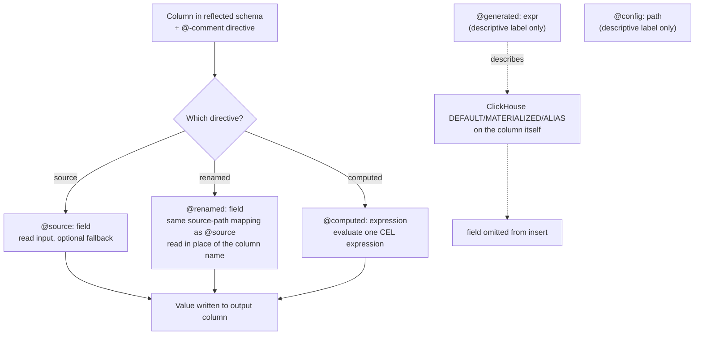

<!--
  Project:      dfe-loader
  File:         docs/clickhouse/ddl-directives.md
  Purpose:      DDL field-mapping expression language and @-comment directives
  Language:     Markdown

  License:      BUSL-1.1
  Copyright:    (c) 2026 HYPERI PTY LIMITED
-->

# DDL field-mapping directives

dfe-loader reads the schema from ClickHouse, not from a config file -- but a
plain `CREATE TABLE` does not say where each column's value comes from. That is
what these `@`-comment directives do. They live in each column's `COMMENT`, which the loader reads from `system.columns`: a SQL `--` line comment never reaches the server. dfe-schemas renders a column's `expr` into that `COMMENT`, and the data-prep stage reads the directives it acts on to decide whether a column is read from a source field path or computed from a CEL expression.

Five directives change loader behaviour: `@skip`, `@default`, `@source`,
`@renamed` and `@computed` (`DIRECTIVE_NAMES` in
[`../../src/column_meta/mod.rs`](../../src/column_meta/mod.rs)). `@coerce` is
parsed but reaches no encoder, which applies fixed coercion rules, so the loader
logs a warning for it and the config's `coerce:` is refused at startup.
`@source` and `@renamed` both map the column to source field path(s): they
resolve to the same `renamed` source-path list, so there is no copy-versus-move
difference between them. `@source` is the form dfe-schemas emits and `@renamed`
the hand-written equivalent. `@computed` evaluates a CEL expression. `@generated` and `@config`, below, are descriptive labels the
loader drops as unknown directives -- the behaviour they describe comes from
elsewhere.
This page is the full reference -- grammar, the directive list, what a
`@computed` expression may use, and table-level tags.

For the column types these directives target, see [types.md](types.md). For how
capture interacts with `_json` and `_raw`, see capture modes in
[../architecture.md](../architecture.md).

## Directive resolution



`@generated` and `@config` sit outside the loader's directive dispatch: the
loader parses neither. They are notes an author leaves in the comment, and the
real mechanism sits elsewhere, covered under each heading below.

## Overview

This expression language describes how source data fields map to destination
columns during the **data preparation stage** of the pipeline. It is used in:

- dfe-schemas YAML definitions, in a column's `expr` field
- The column COMMENTs those become in the deployed DDL
- Any table definition that needs field mapping documentation

## Expression types

### @source

Map the column to a source field path during data prep.

```text
@source: field_name
@source: field_name | fallback
@source: first(field1/field2/field3)
```

| Syntax | Description |
|--------|-------------|
| `@source: field` | Read from source field, NULL if missing |
| `@source: field \| now()` | Read from source, use `now()` if missing or null |
| `@source: field \| "value"` | Read from source with a literal fallback |
| `@source: first(a/b/c)` | First non-null from ordered list (/ separator) |

**Examples:**

```sql
`event_time` DateTime64(3) COMMENT '@source: timestamp | now()',
`user_id` String COMMENT '@source: first(user_id/uid/id)',
`http_status` UInt16 COMMENT '@source: status_code',
```

### @generated

Not a directive the loader parses -- `@generated` is not in `DIRECTIVE_NAMES`,
so `parse_directives` drops it like any other unknown `@` word. It is a label
an author leaves in the comment to say "ClickHouse fills this one in", next to
the DDL clause that actually does the filling.

The loader still omits the field from the insert, but by a different route: it
reads `default_kind` for the column from `system.columns`, and any column
whose kind is `DEFAULT`, `MATERIALIZED`, `ALIAS` or `EPHEMERAL` is marked
`has_default` and can be left out of the row it sends (the dynamic insert in
`dfe-clickhouse`'s `dynamic` module). dfe-schemas' renderer, whose DDL dfe-engine applies, writes that DEFAULT/MATERIALIZED/ALIAS
clause from the schema's own `default:` and `attribute:` fields -- not by
reading the `@generated:` text -- so keep the two in agreement by hand.

```text
@generated: expression
```

| Example | Description |
|---------|-------------|
| `@generated: now64(3)` | Database generates timestamp on insert |
| `@generated: generateUUIDv7()` | Database generates time-ordered UUID |
| `@generated: rowNumberInBlock()` | Database generates row number |

**Examples:**

```sql
`inserted_at` DateTime64(3) DEFAULT now64(3) COMMENT '@generated: now64(3)',
`id` UUID DEFAULT generateUUIDv7() COMMENT '@generated: generateUUIDv7()',
```

### Capture is not a column directive

`_raw` and `_json` are populated by the loader's capture mode, not by a
per-column `@`-comment directive. Capture mode has its own tag, but it is a
**table**-level DDL comment -- `@capture_mode: <mode>` on the `CREATE TABLE`
itself, resolved ahead of any per-table or global config (see
[capture-modes.md](../pipeline/capture-modes.md)). See
[common-header.md](../transport/common-header.md) for what each capture mode
writes to `_raw` and `_json`.

### @config

Not a directive the loader parses either -- same drop-as-unknown path as
`@generated`. It is a note that the field beside it is not hardcoded: some
loader config key decides the actual mapping. Nothing reads the comment text
to resolve that path: the config key is wired up separately, by the column's
special-cased name. `_org_id`, for example, is filled from whichever field
`routing.org_id_field` names, whatever its directive says, and `_tags` from its own `@source` directive, else the first field in `metadata.tags_fields`
(dfe-loader `src/config/pipeline.rs`, `src/routing/router.rs`,
`src/transform/extractor.rs`, `src/transform/transformer.rs`). Change the
config path and the mapping changes. Change the `@config:` comment on its own
and nothing does.

```text
@config: config.path
@config: config.path (default: "value")
```

**Examples:**

```sql
`_org_id` String COMMENT '@source: _org_id @config: routing.org_id_field (default: "_org_id")',
`_tags` JSON COMMENT '@source: first(_tags/tags/meta) @config: metadata.tags_fields',
```

## @computed

A value computed from the record's other fields during data prep, as one CEL
expression.

```text
@computed: expression
```

The loader compiles each expression once per table with scalo's
`scalo::expression::compile` and evaluates it per record, with each of the
record's fields as a variable (`src/transform/computed.rs`). The expression runs in scalo's
restricted CEL profile:

| Category | What it allows |
|----------|----------------|
| Comparison | `==`, `!=`, `<`, `<=`, `>`, `>=` |
| Logical | `&&`, `\|\|`, `!` |
| Membership | `in` (list elements, map keys) |
| String | `contains()`, `startsWith()`, `endsWith()` |
| Existence | `has()` |
| Size | `size()` |
| Ternary | `? :` |
| Type casts | `int()`, `uint()`, `double()`, `string()`, `bool()`, `bytes()` |
| Type introspection | `type()`, `dyn()` |
| Arithmetic | `+`, `-`, `*`, `/`, `%` |

Regex (`matches()`), iteration (`map()`, `filter()`, `exists()`, `all()`,
`exists_one()`) and time (`timestamp()`, `duration()`) are blocked unless
scalo's `expression` config section allows them. Any other function is refused.
There is no GeoIP, hashing or string-rewriting function: GeoIP, reputation and
risk come from the loader's `geoip` and `enrichment` config, not from
`@computed`.

**Examples:**

```sql
`risk_label` LowCardinality(String) COMMENT '@computed: risk_score > 80 ? "high" : risk_score > 40 ? "medium" : "low"',
`is_private_src` Bool COMMENT '@computed: src_ip.startsWith("10.") || src_ip.startsWith("192.168.")',
`bytes_total` UInt64 COMMENT '@computed: bytes_in + bytes_out',
```

**Semantics:**

- A field the record already carries under the column's name is kept, and the
  expression is not run for it.
- An expression that does not compile, a function outside the profile
  included, is logged as a warning and the column is skipped.
- An expression that fails per record, a missing field say, leaves the column
  empty and the record is not dead-lettered. The first failure per table and
  column logs one warning with the error.
- `dfe_loader_computed_eval_failures_total{table, column, stage}` counts every
  failure, `stage` being `compile`, `context` or `eval`.
- A `null` result leaves the column empty too.

The `computed_columns` config section sets or overrides the same expressions:
`columns.<column>` for every table, and `overrides."<db>.<table>".<column>` for
one. A per-table override beats the global entry, which beats the column
comment.

## @renamed

The hand-written form of `@source`: the same source-path mapping, resolved into
the same `renamed` list, with no transformation of the value.

```text
@renamed: original_name
@renamed: first(field1/field2/field3)
```

| Syntax | Description |
|--------|-------------|
| `@renamed: field` | Read from source field, NULL if missing |
| `@renamed: first(a/b/c)` | First non-null from ordered list (/ separator) |

**Semantics:**

- The listed paths are read in place of the column's own name, so a record field named like the column is not read while the directive names others. Only the field-mapping step, which runs after, skips a destination already present.
- With `first()`, fields are tried in order and the first present, non-null one is used.
- `_org_id` and `_timestamp` read fixed fields and ignore the directive, so no column comment can point the tenant at a field a sender writes.

**Examples:**

```sql
`event_time` DateTime64(3) COMMENT '@renamed: timestamp',
`org_name` String COMMENT '@renamed: org',
`_raw` Nullable(String) CODEC(ZSTD(3)) COMMENT '@renamed: first(logoriginal/_raw/raw/raw_log/message)',
```

## Operators

### Fallback operator (`|`)

Provides a fallback when every source path is missing or null:

```text
@source: field | fallback_expression
```

- `now()` - Current timestamp
- `uuid()` - Generate UUID (v7, time-ordered)
- `topic_name` - The source the message's topic names, with a configured
  `routing.topic_suffixes` entry stripped: `cisco-ios_load` resolves to
  `cisco-ios`. A topic with no suffix to strip resolves to the whole topic
  name, so the label is never empty. Both transports resolve it - the gRPC
  topic comes from the request's routing key, falling back to
  `grpc.default_topic`
- `null` - Leaves the column ABSENT from the row, which is not the same as
  writing a NULL. For a Nullable column the result is identical, and for a
  non-Nullable one it lets the column's DEFAULT apply instead of failing the
  row - which an explicit NULL would not
- `"literal"` - String literal (quote it)
- `0`, `false` - Numeric/boolean literals

This vocabulary is closed. A fallback outside it is a field reference the
loader cannot resolve, so it is ignored and the column is left absent rather
than filled with the text of the expression - `@source: first(_source) |
host_name` leaves `_source` absent, it does not write the string `host_name`.
The loader logs the ignored fallback once per five minutes.

`now()`, `uuid()` and `topic_name` are resolved per row in the extractor rather
than at parse time, so they are the three forms `@default:` also accepts as a
bare word.

### List operator (`/`)

Separates alternatives in `first()`:

```text
@source: first(field1/field2/field3)
```

- Tries each field in order
- Uses first non-null value
- Returns NULL if all missing

## Data prep behaviour

dfe-schemas renders the directives into the column `COMMENT`, with the human description after ` - `, which the parser trims:

```sql
CREATE TABLE dfe.main (
    `_timestamp_load` DateTime64(3,'UTC') DEFAULT now64(3) COMMENT '@generated: now64(3) - Insertion timestamp (ms precision)',
    `_timestamp` DateTime64(3,'UTC') COMMENT '@source: timestamp | now() - Event timestamp from source data',
    `_source` LowCardinality(Nullable(String)) COMMENT '@source: first(_source) | topic_name - Data source label (e.g. beats, syslog, crowdstrike-edr)',
    ...
)
```

On the default `json_primary` path the header extractor (`src/transform/extractor.rs`) resolves them, and on `legacy_flatten` the transformer and the field mapping do:

| Expression | Implementation |
|------------|----------------|
| `@source: field`, `@renamed: field` | One entry in the column's `renamed` source-path list |
| `@source: field \| now()` | Fallback to `Utc::now()` when every path is missing or null |
| `@source: first(a/b)`, `@renamed: first(a/b)` | Try each path in order, first non-null wins |
| `@computed: expr` | Compiled once with `scalo::expression::compile`, evaluated per record |

`@generated` and `@config` are dropped as unknown directives. A `@generated` column is still left out of the insert, by the `system.columns` `default_kind` route described under @generated above. A directive names the input field, and the column name is the output: `@source: timestamp` on `_timestamp` reads `timestamp`. With `metadata.remove_routing_fields` (default `true`) the routing fields are removed after extraction.

## Table-level tags

A table `COMMENT` carries tags in the same `@tag: value` syntax, separated by ` | `. The loader reads one, `@capture_mode`, which overrides the configured capture mode for that table (see [capture-modes.md](../pipeline/capture-modes.md)) and ignores the rest. dfe-schemas writes `@profile` and `@profile_version`, naming the common-header profile the table was built from:

```sql
CREATE TABLE dfe.main (...)
...
COMMENT '@profile: timeseries | @profile_version: <version> | @capture_mode: json_only'
```

```sql
SELECT database, name, comment
FROM system.tables
WHERE comment LIKE '%@capture_mode:%';
```

`TableTags` (`src/schema/mod.rs`) parses and builds them:

```rust
use dfe_loader::schema::TableTags;

let tags = TableTags::from_comment("@profile: timeseries | @capture_mode: json_only");
assert_eq!(tags.get("capture_mode"), Some("json_only"));
```
