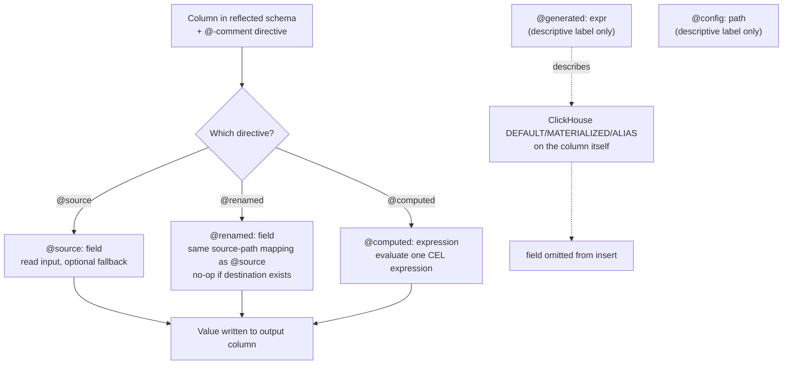

<!--
  Project:      dfe-loader
  File:         docs/clickhouse/ddl-directives.md
  Purpose:      DDL field-mapping expression language and @-comment directives
  Language:     Markdown

  License:      BUSL-1.1
  Copyright:    (c) 2026 HYPERI PTY LIMITED
-->

# DDL field-mapping directives

dfe-loader reads the schema from ClickHouse, not from a config file -- but a
plain `CREATE TABLE` does not say where each column's value comes from. That is
what these `@`-comment directives do. You write them as comments above (or
beside, in CSV) each column, and the data-prep stage reads the ones it acts on
to decide whether a column is read from a source field path or computed from a
CEL expression.

Five directives change loader behaviour: `@skip`, `@default`, `@source`,
`@renamed` and `@computed` (`DIRECTIVE_NAMES` in
[`../../src/column_meta/mod.rs`](../../src/column_meta/mod.rs)). `@coerce` is
parsed but reaches no encoder, which applies fixed coercion rules, so the loader
logs a warning for it and the config's `coerce:` is refused at startup.
`@source` and `@renamed` both map the column to source field path(s): they
resolve to the same `renamed` source-path list, so there is no copy-versus-move
difference between them. `@source` is the form dfe-schemas emits and `@renamed`
the hand-written equivalent. `@computed` evaluates a CEL expression. `@generated` and `@config`, below, are descriptive labels the
loader drops as unknown directives -- the behaviour they describe comes from
elsewhere.
This page is the full reference -- grammar, the directive list, what a
`@computed` expression may use, and table-level tags.

For the column types these directives target, see [types.md](types.md); for how
capture interacts with `_json` and `_raw`, see capture modes in
[../architecture.md](../architecture.md).

## Directive resolution



`@generated` and `@config` sit outside the loader's directive dispatch: the
loader parses neither. They are notes an author leaves in the comment; the
real mechanism sits elsewhere, covered under each heading below.

## Overview

This expression language describes how source data fields map to destination
columns during the **data preparation stage** of the pipeline. It is used in:

- dfe-schemas YAML definitions, in a column's `expr` field
- The column COMMENTs those become in the deployed DDL
- Any table definition that needs field mapping documentation

## Expression types

### @source

Map the column to a source field path during data prep.

```text
@source: field_name
@source: field_name | fallback
@source: first(field1/field2/field3)
```

| Syntax | Description |
|--------|-------------|
| `@source: field` | Read from source field, NULL if missing |
| `@source: field \| now()` | Read from source, use `now()` if missing/invalid |
| `@source: field \| default_value` | Read from source with custom fallback |
| `@source: first(a/b/c)` | First non-null from ordered list (/ separator) |

**Examples:**

```sql
-- @source: timestamp | now()
`event_time` DateTime64(3),

-- @source: first(user_id/uid/id)
`user_id` String,

-- @source: status_code
`http_status` UInt16,
```

### @generated

Not a directive the loader parses -- `@generated` is not in `DIRECTIVE_NAMES`,
so `parse_directives` drops it like any other unknown `@` word. It is a label
an author leaves in the comment to say "ClickHouse fills this one in", next to
the DDL clause that actually does the filling.

The loader still omits the field from the insert, but by a different route: it
reads `default_kind` for the column from `system.columns`, and any column
whose kind is `DEFAULT`, `MATERIALIZED`, `ALIAS` or `EPHEMERAL` is marked
`has_default` and can be left out of the row it sends (the dynamic insert in
`dfe-clickhouse`'s `dynamic` module). The
applier (dfe-engine's schema module) writes that DEFAULT/MATERIALIZED/ALIAS
clause from the schema's own `default:` and `attribute:` fields -- not by
reading the `@generated:` text -- so keep the two in agreement by hand.

```text
@generated: expression
```

| Example | Description |
|---------|-------------|
| `@generated: now64(3)` | Database generates timestamp on insert |
| `@generated: generateUUIDv7()` | Database generates time-ordered UUID |
| `@generated: rowNumberInBlock()` | Database generates row number |

**Examples:**

```sql
-- @generated: now64(3)
`inserted_at` DateTime64(3) DEFAULT now64(3),

-- @generated: generateUUIDv7()
`id` UUID DEFAULT generateUUIDv7(),
```

### Capture is not a column directive

`_raw` and `_json` are populated by the loader's capture mode, not by a
per-column `@`-comment directive. Capture mode has its own tag, but it is a
**table**-level DDL comment -- `@capture_mode: <mode>` on the `CREATE TABLE`
itself, resolved ahead of any per-table or global config (see
[capture-modes.md](../pipeline/capture-modes.md)). See
[common-header.md](../transport/common-header.md) for what each capture mode
writes to `_raw` and `_json`.

### @config

Not a directive the loader parses either -- same drop-as-unknown path as
`@generated`. It is a note that the field beside it is not hardcoded: some
loader config key decides the actual mapping. Nothing reads the comment text
to resolve that path; the config key is wired up separately, by the column's
special-cased name. `_org_id`, for example, is filled from whichever field
`routing.org_id_field` names, and `_tags` from the first field in
`metadata.tags_fields` -- both real, live config
(dfe-loader `src/config/pipeline.rs`, `src/routing/router.rs`,
`src/transform/extractor.rs`, `src/transform/transformer.rs`). Change the
config path and the mapping changes; change the `@config:` comment on its own
and nothing does.

```text
@config: config.path
@config: config.path (default: "value")
```

**Examples:**

```sql
-- @source: _org_id
-- @config: routing.org_id_field (default: "_org_id")
`_org_id` String,

-- @source: first(tags/_tags/meta)
-- @config: metadata.tags_fields
`_tags` JSON,
```

### @computed

A value computed from the record's other fields during data prep, as one CEL
expression.

```text
@computed: expression
```

The loader compiles each expression once per table with scalo's
`scalo::expression::compile` and evaluates it per record, with each of the
record's fields as a variable (`src/transform/computed.rs`). The expression runs in scalo's
restricted CEL profile:

| Category | What it allows |
|----------|----------------|
| Comparison | `==`, `!=`, `<`, `<=`, `>`, `>=` |
| Logical | `&&`, `\|\|`, `!` |
| Membership | `in` (list elements, map keys) |
| String | `contains()`, `startsWith()`, `endsWith()` |
| Existence | `has()` |
| Size | `size()` |
| Ternary | `? :` |
| Type casts | `int()`, `uint()`, `double()`, `string()`, `bool()`, `bytes()` |
| Type introspection | `type()`, `dyn()` |
| Arithmetic | `+`, `-`, `*`, `/`, `%` |

Regex (`matches()`), iteration (`map()`, `filter()`, `exists()`, `all()`,
`exists_one()`) and time (`timestamp()`, `duration()`) are blocked unless
scalo's `expression` config section allows them. Any other function is refused.
There is no GeoIP, hashing or string-rewriting function: GeoIP, reputation and
risk come from the loader's `geoip` and `enrichment` config, not from
`@computed`.

**Examples:**

```sql
-- @computed: risk_score > 80 ? "high" : risk_score > 40 ? "medium" : "low"
`risk_label` LowCardinality(String),

-- @computed: src_ip.startsWith("10.") || src_ip.startsWith("192.168.")
`is_private_src` Bool,

-- @computed: bytes_in + bytes_out
`bytes_total` UInt64,
```

**Semantics:**

- A field the record already carries under the column's name is kept, and the
  expression is not run for it.
- An expression that does not compile, a function outside the profile
  included, is logged as a warning and the column is skipped.
- An expression that fails per record, a missing field say, leaves the column
  empty and the record is not dead-lettered. The first failure per table and
  column logs one warning with the error.
- `dfe_loader_computed_eval_failures_total{table, column, stage}` counts every
  failure, `stage` being `compile`, `context` or `eval`.
- A `null` result leaves the column empty too.

The `computed_columns` config section sets or overrides the same expressions:
`columns.<column>` for every table, and `overrides."<db>.<table>".<column>` for
one. A per-table override beats the global entry, which beats the column
comment.

### @renamed

The hand-written form of `@source`: the same source-path mapping, resolved into
the same `renamed` list, with no transformation of the value.

```text
@renamed: original_name
@renamed: first(field1/field2/field3)
```

| Syntax | Description |
|--------|-------------|
| `@renamed: field` | Read from source field, NULL if missing |
| `@renamed: first(a/b/c)` | First non-null from ordered list (/ separator) |

**Semantics:**

- **No-op if destination exists**: If the destination field is already
  present in the data, the mapping is skipped. This prevents overwriting
  upstream-populated fields.
- **First-match wins**: With `first()`, fields are tried in order and the first
  present one is used.
- **Not on `_org_id` or `_timestamp`**: both read fixed fields and ignore the directive, so no column comment can point the tenant at a field a sender writes.

**Examples:**

```sql
-- @renamed: timestamp
`event_time` DateTime64(3),

-- @renamed: org
`org_name` String,

-- @renamed: first(logoriginal/_raw/raw/raw_log/message)
`_raw` Nullable(String) CODEC(ZSTD(3)),
```

## Operators

### Fallback operator (`|`)

Provides a fallback when the source is missing or invalid:

```text
@source: field | fallback_expression
```

- `now()` - Current timestamp
- `uuid()` - Generate UUID (v7, time-ordered)
- `topic_name` - The source the message's topic names, with a configured
  `routing.topic_suffixes` entry stripped: `cisco-ios_load` resolves to
  `cisco-ios`. A topic with no suffix to strip resolves to the whole topic
  name, so the label is never empty. Both transports resolve it - the gRPC
  topic comes from the request's routing key, falling back to
  `grpc.default_topic`
- `null` - Leaves the column ABSENT from the row, which is not the same as
  writing a NULL. For a Nullable column the result is identical, and for a
  non-Nullable one it lets the column's DEFAULT apply instead of failing the
  row - which an explicit NULL would not
- `"literal"` - String literal (quote it)
- `0`, `false` - Numeric/boolean literals

This vocabulary is closed. A fallback outside it is a field reference the
loader cannot resolve, so it is ignored and the column is left absent rather
than filled with the text of the expression - `@source: first(_source) |
host_name` leaves `_source` absent, it does not write the string `host_name`.
The loader logs the ignored fallback once per five minutes.

`now()`, `uuid()` and `topic_name` are resolved per row in the extractor rather
than at parse time, so they are the three forms `@default:` also accepts as a
bare word.

### List operator (`/`)

Separates alternatives in `first()`:

```text
@source: first(field1/field2/field3)
```

- Tries each field in order
- Uses first non-null value
- Returns NULL if all missing

## CSV schema format

```csv
column,type,default,nullable,codec,source,comment
```

The `source` column contains the expression:

```csv
column,type,default,nullable,codec,source,comment
event_time,DateTime64(3),,false,Delta/ZSTD(1),@source: timestamp | now(),When event occurred
id,UUID,generateUUIDv7(),false,,@generated: generateUUIDv7(),Unique identifier
tags,JSON,,true,ZSTD(3),@source: first(tags/_tags/meta),Event metadata
```

## SQL DDL format

Expressions appear as comments above the column definition:

```sql
CREATE TABLE events (
    -- @generated: now64(3)
    `inserted_at` DateTime64(3) DEFAULT now64(3),

    -- @source: timestamp | now()
    `event_time` DateTime64(3),

    -- @source: user_id
    -- @config: routing.user_id_field
    `user_id` String,

    -- @source: first(tags/_tags/metadata.tags)
    -- @config: metadata.tags_fields
    `tags` JSON
)
```

## Data prep behaviour

### Field extraction

1. **@source** fields are read from input, optionally transformed, written to
   output
2. **@generated** fields are omitted, but not because data prep reads the
   directive -- the column carries a ClickHouse DEFAULT/MATERIALIZED/ALIAS and
   the loader reads that from `system.columns` instead. See the @generated
   section above.
3. **@computed** fields are calculated during transformation
4. **@renamed** fields are read the same way as **@source** (no-op if the
   destination is already present)

### Input vs output names

Expressions document the **input** field name. The column name is the **output**:

```sql
-- @source: timestamp       <- reads "timestamp" from input
`_timestamp` DateTime64(3)  <- writes to "_timestamp" in output
```

### Field removal

By default, routing/extracted fields can be removed after extraction to avoid
duplication. This is configurable per deployment.

## Implementation reference

The data prep stage (transformer) implements these expressions:

| Expression | Implementation |
|------------|----------------|
| `@source: field`, `@renamed: field` | One entry in the column's `renamed` source-path list |
| `@source: field \| now()` | Fallback to `Utc::now()` if missing/invalid |
| `@source: first(a/b)`, `@renamed: first(a/b)` | Try each path in order, first non-null wins |
| `@computed: expr` | Compiled once with `scalo::expression::compile`, evaluated per record |

`@generated: expr` is not in this table because the transformer does not
implement it -- it is dropped as an unknown directive. The column is still
omitted from the insert, by the `system.columns` `default_kind` route
described under @generated above. `@config: path` is absent for the same
reason: the transformer never reads it.

## Table-level tags

Tables support metadata tags stored in the ClickHouse `COMMENT` field, using the
same `@tag: key=value` syntax as column expressions.

### Syntax

Tags are stored in the table COMMENT, separated by ` | `:

```sql
CREATE TABLE common.events (...)
ENGINE = MergeTree()
...
COMMENT '@schema_source: core | @schema_version: 2 | @created_by: dfe-loader'
```

### Standard tags

| Tag | Values | Description |
|-----|--------|-------------|
| `@schema_source` | `core`, `user` | `core` = pre-supplied by dfe-loader, absent/`user` = user-created |
| `@schema_version` | `1`, `2`, ... | Schema version for migrations |
| `@created_by` | string | Tool/user that created the table |

### Querying by tag

```sql
-- Find all core schemas
SELECT database, name, comment
FROM system.tables
WHERE comment LIKE '%@schema_source: core%';

-- Find tables by version
SELECT database, name, comment
FROM system.tables
WHERE comment LIKE '%@schema_version: 2%';

-- Extract tag value using regex
SELECT
    database,
    name,
    extractAll(comment, '@schema_source: ([^|]+)')[1] AS schema_source
FROM system.tables
WHERE comment LIKE '%@schema_source:%';
```

### Rust API

```rust
use dfe_loader::schema::TableTags;

// Build a tag set
let tags = TableTags::new()
    .with("schema_source", "core")
    .with("schema_version", "2");

// Parse tags from an existing table comment
let tags = TableTags::from_comment("@schema_source: core | @schema_version: 2");
assert_eq!(tags.get("schema_source"), Some("core"));
```
