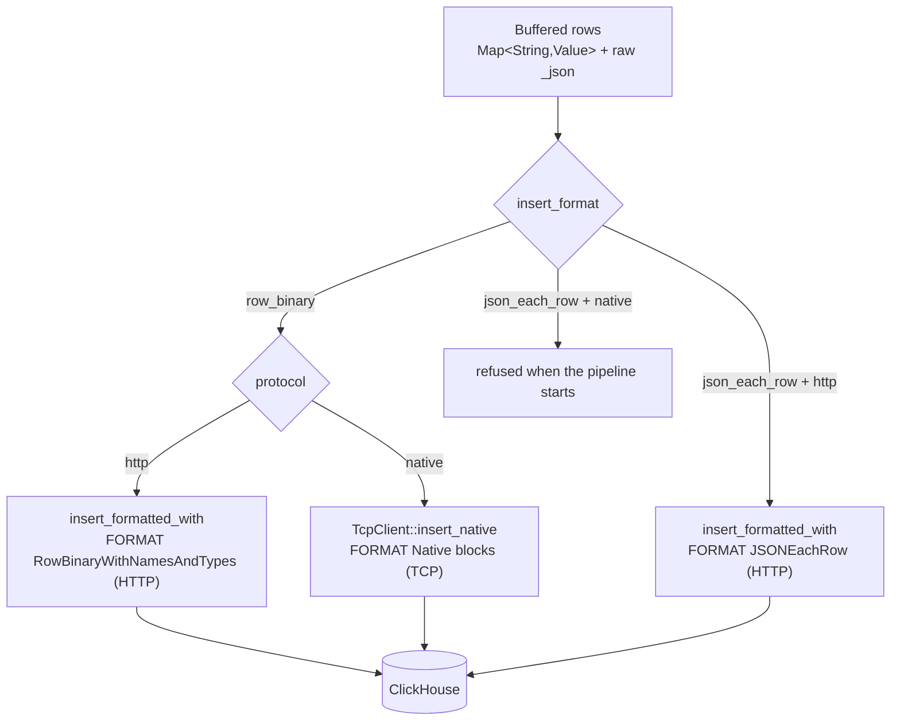

<!--
  Project:      dfe-loader
  File:         docs/clickhouse/insert-formats.md
  Purpose:      Insert formats and transports, and how they compose
  Language:     Markdown

  License:      BUSL-1.1
  Copyright:    (c) 2026 HYPERI PTY LIMITED
-->

# Insert formats and transports

dfe-loader has two knobs for how rows reach ClickHouse: `clickhouse.protocol`
(how the bytes travel) and `clickhouse.insert_format` (how the rows are
encoded). The default `http + row_binary` is the fast path, and `json_each_row` is
a deliberate fallback. `protocol: native` runs the schema fetch, the queries and
`row_binary` inserts over the native protocol through `dfe_clickhouse::TcpClient`.

## The matrix

| `insert_format` | `protocol = http` | `protocol = native` |
|-----------------|--------------------|----------------------|
| `row_binary` (default) | `FORMAT RowBinaryWithNamesAndTypes` via `insert_formatted_with` | `FORMAT Native` blocks via `TcpClient::insert_native` |
| `json_each_row` | `FORMAT JSONEachRow` via `insert_formatted_with` | refused when the pipeline starts, not by `config-check` |

The rejection is deliberate: JSONEachRow is an HTTP body format, and a native client has no HTTP insert endpoint for it. The guard lives in `ClickHouseConfig::validate()`, which the orchestrator runs before the readiness probe, so a bad combination stops the loader with a clear message rather than at first insert. `config-check` runs `Config::validate` only and passes it.

Both protocols check the cached schema against the table. Over HTTP the header declares each column's type and the server refuses a type the column no longer has (code 117). Over native the server answers the INSERT with the table's types, and the insert refuses a difference before sending a row. Either refusal reads as drift. A column whose type `dfe_clickhouse` cannot write fails the insert and the batch is held.

## Why RowBinary is the default

RowBinary ships pre-typed bytes. The server parses no row text and infers no types for the typed columns, reading their values off the wire in the order the INSERT names them. A JSON column is the exception: its value travels as JSON text the server parses. For a high-throughput loader that is the difference between ClickHouse spending CPU on ingest formatting and spending it on merges.

JSONEachRow is kept because it is self-describing and forgiving: the server
coerces types and tolerates schema drift. That makes it the right tool for
diagnostics ("does the row land at all if the server does the typing?") and for
the rare table whose types the dynamic encoder does not yet cover. It is never
the throughput choice.

## How RowBinary is produced

The dynamic encoder in `dfe-clickhouse`'s `dynamic` module turns one `Map<String, Value>` plus its reflected `ColumnDef` schema into RowBinary, sent in 1 MiB chunks as `INSERT INTO db.table (cols) FORMAT RowBinaryWithNamesAndTypes`. An INSERT names the required columns and the defaulted ones its rows supply, and the server fills the rest from their DEFAULT expressions (`_uuid`, `_timestamp_load`). Rows that supply a different set of defaulted columns go to an INSERT of their own: HTTP keeps up to four open at once, and over native a new set commits the rows before it. A row that supplies no column at all goes as `RowBinaryWithDefaults`.

A JSON-typed column (including `_json`) is written as a length-prefixed string.
On the RowBinary path the loader sets
`input_format_binary_read_json_as_string=1` on the insert so the server reads
that string back as a JSON value rather than a literal `String`. The setting is
applied automatically whenever the resolved schema contains a JSON column -- no
configuration needed. See [clickhouse-ext.md](clickhouse-ext.md) for the dynamic insert
and [types.md](types.md) for per-type encoding.

## When the schema drifts

An insert can fail because the cached schema no longer matches the table: a column dropped or retyped by `ALTER`. An added column fails nothing, since the INSERT names its columns. The crate classifies the server
error: a drift code (`TYPE_MISMATCH`, `NO_SUCH_COLUMN_IN_TABLE`, `CANNOT_PARSE_TEXT`, code
117, and friends) surfaces as `DynamicError::SchemaMismatch`, and the cache is
invalidated so the next attempt re-fetches from `system.columns` and re-encodes.
A non-drift error (network, auth) is returned as-is. See
[schema-cache.md](schema-cache.md).

The same codes come back for a row the server can never accept, so the server's code decides, never the words beside it: a code on the retry list holds the batch, and any other refusal against a table unchanged since the rows were encoded is the rows' own, so salvage dead-letters the bad row and the rest land. The list and the reason for each group are in [schema-cache.md](schema-cache.md#mismatch-recovery).

RowBinary is positional, so bytes encoded for a column's old type could parse as other rows. `insert_coercions::type_change_failures`, run on every protocol in the core tier, retypes a column under a cached schema and checks that every row that lands reads back as the value sent.

## Configuring it

| Setting | Values | Default |
|---------|--------|---------|
| `clickhouse.protocol` | `http`, `native` | `http` |
| `clickhouse.insert_format` | `rowbinary` (aliases `row_binary`, `binary`), `jsoneachrow` (aliases `json_each_row`, `json`) | `rowbinary` |

The canonical spellings are the ones `docs/config-schema.json` carries, and the aliases parse identically. `native` is refused as a format, because it names a protocol.

Env form: `DFE_LOADER_CLICKHOUSE__INSERT_FORMAT=json_each_row`. The startup log
line `Insert format configured format=...` reports the value that was applied.

Both are restart-required -- they are baked into the `Client` at build time, so
a hot-reload of either is logged and deferred to the next start. See
[../configuration.md](../configuration.md).
