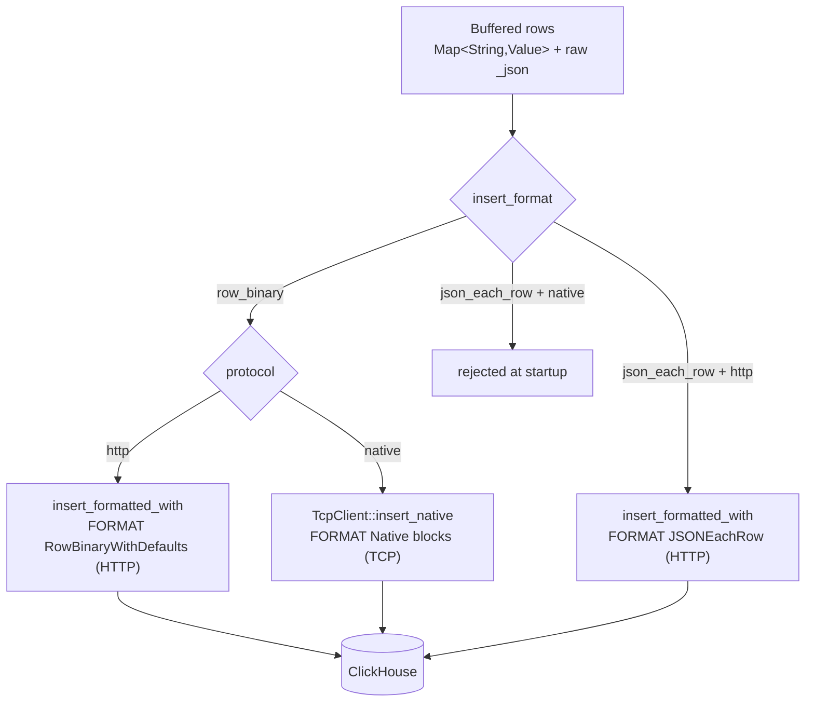

<!--
  Project:      dfe-loader
  File:         docs/clickhouse/insert-formats.md
  Purpose:      Insert formats and transports, and how they compose
  Language:     Markdown

  License:      BUSL-1.1
  Copyright:    (c) 2026 HYPERI PTY LIMITED
-->

# Insert formats and transports

dfe-loader has two knobs for how rows reach ClickHouse: `clickhouse.protocol`
(how the bytes travel) and `clickhouse.insert_format` (how the rows are
encoded). The default `http + row_binary` is the fast path; `json_each_row` is
a deliberate fallback. `protocol: native` runs the schema fetch, the queries and
`row_binary` inserts over the native protocol through `dfe_clickhouse::TcpClient`.

## The matrix

| `insert_format` | `protocol = http` | `protocol = native` |
|-----------------|--------------------|----------------------|
| `row_binary` (default) | `FORMAT RowBinaryWithDefaults` via `insert_formatted_with` | `FORMAT Native` blocks via `TcpClient::insert_native` |
| `json_each_row` | `FORMAT JSONEachRow` via `insert_formatted_with` | rejected at `config-check` |

The rejection is deliberate and surfaced early: JSONEachRow is an HTTP body
format, and a native client has no HTTP insert endpoint for it. The guard lives
in `ClickHouseConfig::validate()` and runs at orchestrator startup, so a bad
combination fails the boot with a clear message rather than at first insert.

A native block declares each column's type, so the server casts a value to a
changed column type instead of refusing the batch the way the HTTP header check
does (code 117). A column whose type `dfe_clickhouse` cannot declare in a block
fails the insert and the batch is held. As of `dfe-clickhouse` 0.1.5 that
includes a parameterised `JSON(max_dynamic_paths = N)` column.

## Why RowBinary is the default

RowBinary ships pre-typed bytes. The server does no JSON parse, no type
inference -- it reads the column values straight off the wire in
`system.columns` order. For a high-throughput loader that is the difference
between ClickHouse spending CPU on ingest formatting and spending it on merges.

JSONEachRow is kept because it is self-describing and forgiving: the server
coerces types and tolerates shape drift. That makes it the right tool for
diagnostics ("does the row land at all if the server does the typing?") and for
the rare table whose types the dynamic encoder does not yet cover. It is never
the throughput choice.

## How RowBinary is produced

The dynamic encoder in `dfe-clickhouse`'s `dynamic` module turns one
`Map<String, Value>` plus its reflected `ColumnDef` schema into RowBinary, sent
in 1 MiB chunks as one `INSERT INTO db.table (cols) FORMAT
RowBinaryWithDefaults` per batch. The INSERT names every column the server takes
a value for. A row that leaves out a defaulted column flags it, and the server
fills its default (`_uuid`, `_timestamp_load`), so rows of any shape share one
INSERT. Over native a row that supplies a different set of defaulted columns
starts a new INSERT.

## JSON columns on the wire

A JSON-typed column (including `_json`) is written as a length-prefixed string.
On the RowBinary path the loader sets
`input_format_binary_read_json_as_string=1` on the insert so the server reads
that string back as a JSON value rather than a literal `String`. The setting is
applied automatically whenever the resolved schema contains a JSON column -- no
configuration needed. See [clickhouse-ext.md](clickhouse-ext.md) for the seam
and [types.md](types.md) for per-type encoding.

## When the schema drifts

An insert can fail because the cached schema no longer matches the table (an
`ALTER ... ADD COLUMN`, a type change). The crate classifies the server
error: a drift signal (`TYPE_MISMATCH`, `NO_SUCH_COLUMN`, `CANNOT_PARSE`, code
117, and friends) surfaces as `DynamicError::SchemaMismatch`, and the cache is
invalidated so the next attempt re-fetches from `system.columns` and re-encodes.
A non-drift error (network, auth) is returned as-is. See
[schema-cache.md](schema-cache.md).

The same codes come back for a row the server can never accept, so the server's code decides, never the words beside it: a code on the retry list holds the batch, and any other refusal against a table unchanged since the rows were encoded is the rows' own, so salvage dead-letters the bad row and the rest land. The list and the reason for each group are in [schema-cache.md](schema-cache.md#mismatch-recovery).

RowBinary is positional, so bytes encoded for a column's old type could parse as other rows. `insert_coercions::type_change_failures`, run on every protocol in the core tier, retypes a column under a cached schema and checks that every row that lands reads back as the value sent.

## Configuring it

| Setting | Values | Default |
|---------|--------|---------|
| `clickhouse.protocol` | `http`, `native` | `http` |
| `clickhouse.insert_format` | `rowbinary` (aliases `row_binary`, `binary`), `jsoneachrow` (aliases `json_each_row`, `json`) | `rowbinary` |

The canonical spellings are the ones `docs/config-schema.json` carries, and the
aliases parse identically -- `row_binary` and `json_each_row` are the spellings
this page used before the key was wired, so both keep working. `native` is not
among them: it names a protocol this config rejects at boot, so accepting it as
a format spelling would have one word mean two opposite things on one page.

Env form: `DFE_LOADER_CLICKHOUSE__INSERT_FORMAT=json_each_row`. The startup log
line `Insert format configured format=...` reports the value that was applied.

Both are restart-required -- they are baked into the `Client` at build time, so
a hot-reload of either is logged and deferred to the next start. See
[../configuration.md](../configuration.md).
