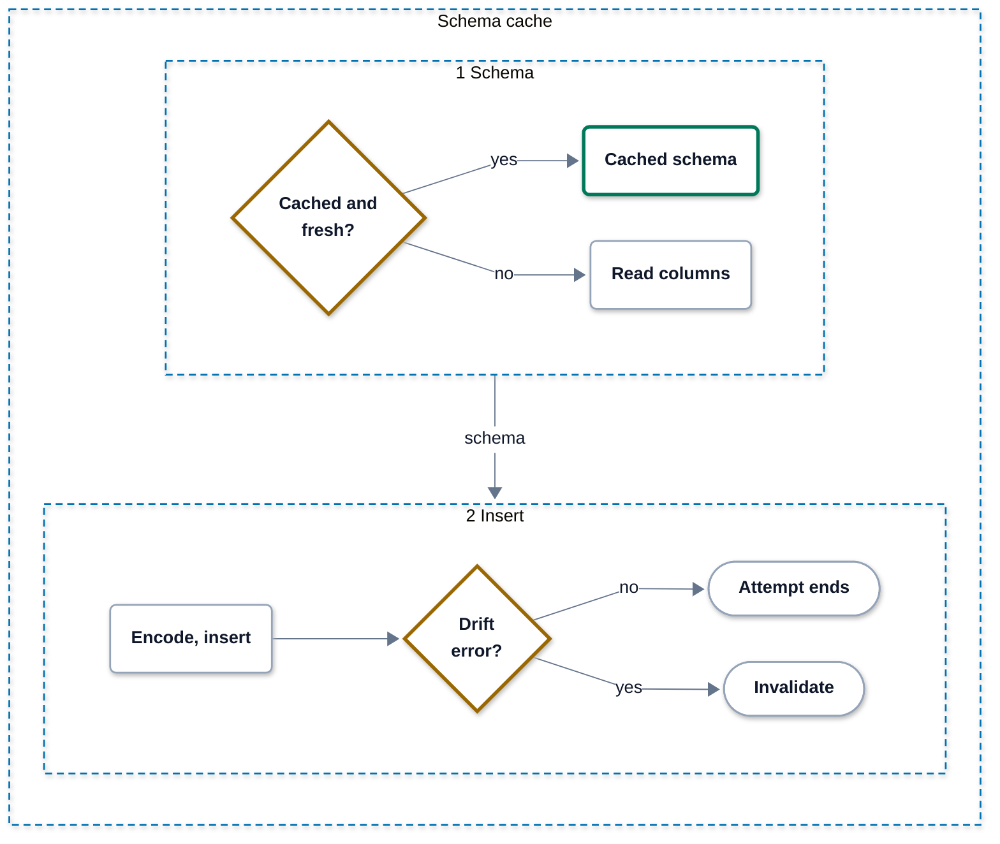

<!--
  Project:      dfe-loader
  File:         docs/clickhouse/schema-cache.md
  Purpose:      Schema reflection, the TTL cache, and mismatch recovery
  Language:     Markdown

  License:      BUSL-1.1
  Copyright:    (c) 2026 HYPERI PTY LIMITED
-->

# Schema reflection and caching

The dynamic insert path needs to know a table's columns and their types before it can encode a row. dfe-loader holds no compile-time schema -- it reflects the live table from `system.columns` and caches the result with a TTL.

A row is encoded against the cached schema until it expires, and with `schema.refresh_on_error` on, the default, a drift error drops the entry so the next attempt reads the table again.

*Figure 1. L4 Detail -- Schema cache read and recovery, with `schema.refresh_on_error` on.* Up: [ClickHouse insert layer](README.md).

## Reflection

`fetch_dynamic_schema` queries `system.columns` for one table and builds a
`DynamicSchema`: the columns in declaration (position) order, each parsed into a
structured `ParsedType` (Nullable, LowCardinality, Array, Map, DateTime64,
Decimal, Enum, ...) that drives encoding. It records, per column, whether
the column has a server-side default -- that is what lets the encoder omit an
absent-but-defaulted column (`_uuid`, `_timestamp_load`) and include every
required one. See [types.md](types.md).

## The cache

`DynamicSchemaCache` is a TTL map keyed by `database.table`, shared across
insert tasks behind an `Arc`. It is lazy, not background-refreshed:

- `get` returns the schema only if it was fetched within the TTL, so an expired
  entry reads as a miss.
- A miss triggers a fetch, and the result is inserted under the key.
- `invalidate(table)` drops one entry, and `invalidate_all` clears the map.

Lazy TTL keeps the steady state cheap (no timer threads, no work for idle
tables) and bounds how long a stale schema can persist after a benign
`ALTER`. The TTL is set once when the cache is constructed, from
`schema.cache_ttl_secs` (default 300 s).

The loader keeps a second cache of the same read, `SchemaCache` in `src/clickhouse/schema.rs`, which decides the fields the header extractor promotes. Its entries live for `schema.cache_ttl_secs` as well, and every 60 s a background task hands each entry within 30 s of expiry to the schema resolver, which re-reads its columns and comments together.

A table `routing.table_schemas` lists starts in `SchemaCache` with the columns dfe-engine sent, in `routing.default_db`, so its first records are promoted without a read ([../pipeline/routing.md](../pipeline/routing.md)). The read still runs and its answer replaces them, and a drift error on insert drops them as it drops any entry. The encoder's cache never takes configured columns: an insert always encodes against `system.columns`.

## Mismatch recovery

A TTL does not cover a schema change that happens mid-batch, so the insert path recovers on error as well. `dfe-clickhouse` reads a drift code, such as `TYPE_MISMATCH`, `NO_SUCH_COLUMN_IN_TABLE` or `INCORRECT_DATA`, as `SchemaMismatch`, and reads the message for drift wording only when the error has no code. The table's cache entry is invalidated, and the retry re-fetches from `system.columns` and re-encodes against the current schema. A non-drift error (network, auth, server down) is returned unchanged, so an outage is not mistaken for schema drift.

A row the server can never accept draws the same signals: an integer no ClickHouse integer type holds, in a JSON column, comes back as code 117 whatever the schema. So the server's code decides, never the words beside it, which echo the row. A code on the retry list in `src/clickhouse/error.rs` (`RETRY_CODES`: a busy or overloaded server, the network, replication and Keeper, the disk or object store under the table, and operator fixes such as a missing table or a refused login) holds the batch for another attempt. Any other code re-reads `system.columns`. A table unchanged since the rows were encoded puts the refusal on the rows: the insert returns it as permanent, salvage isolates the bad row for the DLQ, and the rest land. A changed table is drift, recovered as above. `TOO_MANY_PARTS` for one INSERT over `max_partitions_per_insert_block` is a refusal, not a retry, because salvage's split is what lands it. A server failure with no code never reaches the DLQ. The encoder's refusal of a value does, since it holds the schema it read the value against.

A column dropped or retyped by an out-of-band `ALTER` fails one attempt: the rejection clears the stale entry and the retry succeeds against the altered schema. An added column fails nothing, since the INSERT names its columns, and it fills once the cached schema refreshes.

`schema.refresh_on_error` (default `true`) switches this recovery. With `false`
a drift error leaves both the encoder's entry and the loader's cached schema in
place until they expire, so the retries run against the stale schema. A schema
fetch that failed is still discarded either way.

## Where it lives

`dfe_clickhouse::dynamic` (`DynamicSchema`, `DynamicSchemaCache`,
`fetch_dynamic_schema`, `fetch_dynamic_schema_tcp`), read through the
inserter's widening bound in `src/clickhouse/inserter.rs`. The cache is owned by the `Inserter` and handed to each
`DynamicInsert`. See [clickhouse-ext.md](clickhouse-ext.md).
