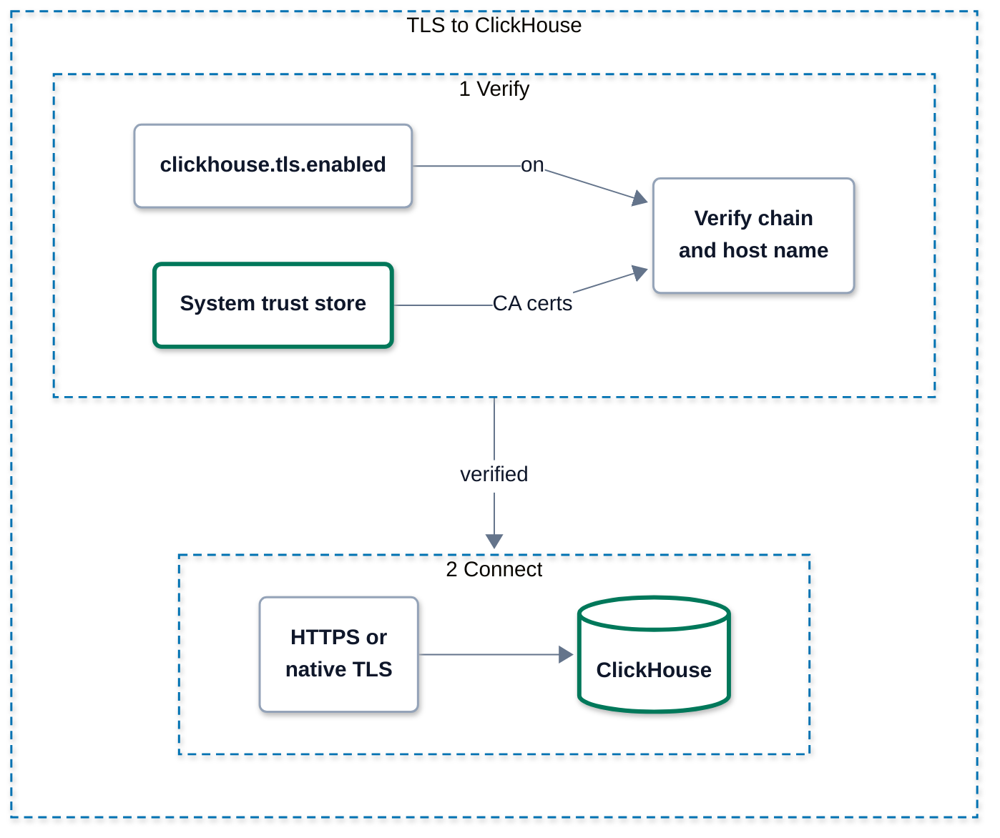

<!--
  Project:      dfe-loader
  File:         docs/clickhouse/tls.md
  Purpose:      TLS transport security and private-CA trust for ClickHouse
  Language:     Markdown

  License:      BUSL-1.1
  Copyright:    (c) 2026 HYPERI PTY LIMITED
-->

# TLS and private CAs

With TLS on the loader speaks HTTPS (`clickhouse.protocol: http`, usually 8443) or native TLS (`native`, usually 9440), and either verifies the server's certificate and host name against the container's system trust store. Native TLS trusts the system store alone, not a compiled-in root bundle, so both protocols accept the same servers.

Turning TLS on is one key, and trust comes from the system store alone, so a private CA is added there rather than set in config.



*Figure 1. L4 Detail -- TLS trust. The store is the image bundle, or what `SSL_CERT_FILE` or `SSL_CERT_DIR` names.* Up: [ClickHouse insert layer](README.md).

| Setting | Effect |
|---------|--------|
| `clickhouse.tls.enabled` | TLS for the connection: HTTPS, or native TLS |
| `clickhouse.tls` absent | TLS turns on for a host on 8443 or 9440, or under `clickhouse.cloud` |

The SNI name and the name checked against the certificate are the host in `clickhouse.hosts`, so connect by a name (or IP) the certificate lists.

## Private / internal CAs

A private CA is trusted the way the system trusts it: add it to the image's trust store, or point `SSL_CERT_FILE` at a PEM bundle that holds it (`SSL_CERT_DIR` at a directory of them). Either variable replaces the platform store rather than adding to it, so a bundle that must trust public CAs as well has to hold them.

A trust store with no readable CA certificate fails the client at startup instead of connecting unverified.

`clickhouse.tls.ca_cert_file`, `cert_file`, `key_file` and `skip_verify` are refused by `config-check` and at startup: no client reads them. There is no skip-verify mode and no client-certificate (mTLS) auth.

A private-CA cluster:

```yaml
clickhouse:
  protocol: http
  tls:
    enabled: true
  hosts:
    - clickhouse.example.internal:8443
```

```text
SSL_CERT_FILE=/etc/dfe/ca-bundle.pem   # the private CA plus any public roots still needed
```

The CA bundle is non-secret and is distributed with the deployment. Keep the cluster password in a Secret, never in committed config: the chart fills `DFE_LOADER__CLICKHOUSE__PASSWORD` from the `clickhouse-password` key the deployment contract declares (`Config::secrets` in `src/config/loader.rs`). See [../configuration.md](../configuration.md) for the cascade.
