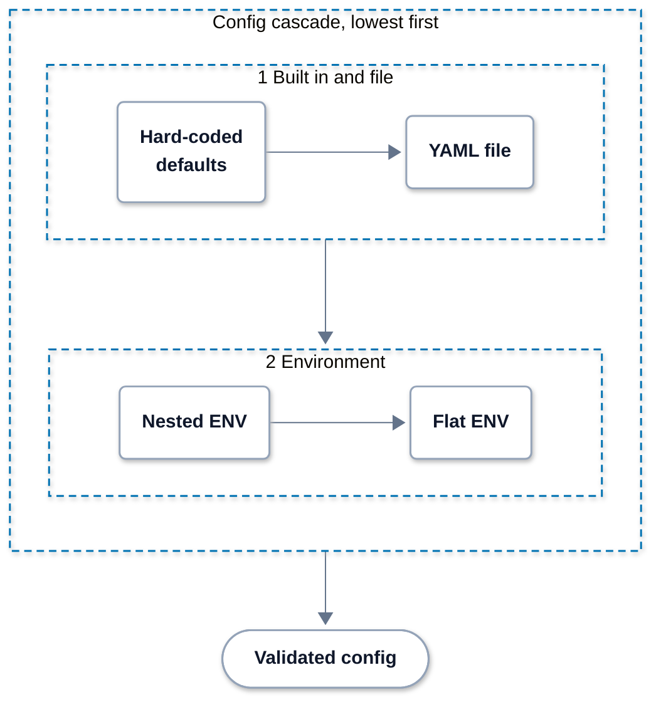

<!--
  Project:      dfe-loader
  File:         docs/configuration.md
  Purpose:      Config cascade and the settings that change behaviour
  Language:     Markdown

  License:      BUSL-1.1
  Copyright:    (c) 2026 HYPERI PTY LIMITED
-->

# Configuration

dfe-loader reads its config in four layers, each applied over the one before, so a flat ENV variable beats a nested one, which beats the file, which beats the defaults. Every setting has a safe default, so a loader started with no config file boots.

*Figure 1. L4 Detail -- Config cascade. Each layer overrides the one to its left.* Up: [dfe-loader docs](README.md).

| Layer | Example |
|---|---|
| YAML file | the file `--config` or `DFE_LOADER_CONFIG` names, else `./config.yaml` or `./config.yml` |
| Nested ENV | `DFE_LOADER_CLICKHOUSE__PROTOCOL=http` |
| Flat ENV | `DFE_LOADER_CLICKHOUSE_HOSTS=a:8123,b:8123` |

Nested ENV names are derived from the key: `clickhouse.protocol` -> `DFE_LOADER_CLICKHOUSE__PROTOCOL` (a double underscore for each level of nesting). A nested ENV value is parsed as a number, bool or list where it looks like one, so `DFE_LOADER_BUFFER__FLUSH_ROWS=50000` is a number. A secret field is the exception and is read as the exact string, so a numeric password or MaxMind account ID arrives as written.

A file that `--config` or `DFE_LOADER_CONFIG` names must exist. A missing one stops startup rather than running on the defaults.

A `.env` is read when `--config` names no file, and then just the one in the working directory, into the environment the two ENV layers read. A `.env` in a parent directory belongs to another project and is never loaded.

scalo's cascade, which builds the scaling engine KEDA reads, takes the `--config` file and the nested ENV form as well (`DFE_LOADER_SCALING__ENABLED` or `DFE_LOADER__SCALING__ENABLED`), so `scaling.enabled` and `scaling.memory_gate_threshold` set either way reach it.

## Settings that change behaviour

### ClickHouse insert path

| Setting | Values | Effect |
|---------|--------|--------|
| `clickhouse.protocol` | `http` (default), `native` | HTTP (8123), HTTPS (8443), or the native protocol (9000, 9440 with TLS) through `dfe_clickhouse::TcpClient` |
| `clickhouse.insert_format` | `row_binary` (default), `json_each_row` | binary, so the server parses no row text, vs self-describing JSON |
| `clickhouse.hosts` | list | `native` fails over across every host, round-robin. `http` uses the first host alone. With TLS, `native` verifies each host against its name |
| `clickhouse.database` | string, `dfe` (default) | database the connection opens on, and the one the readiness probe reads `system.tables` and `system.columns` for |

`clickhouse.database` is the CONNECTION database and is separate from
`routing.default_db` (default `dfe` as well), which is the database a routed row lands in.
Both are cascade-overridable like any other setting -- `DFE_LOADER_CLICKHOUSE__DATABASE`
or `clickhouse.database` in yaml.

The protocol and format compose. The default `http + row_binary` is the fast
path, and `json_each_row` is the diagnostic fallback:

| `insert_format` | `protocol = http` | `protocol = native` |
|-----------------|-------------------|---------------------|
| `row_binary` (default) | `insert_formatted_with` FORMAT RowBinaryWithNamesAndTypes | `FORMAT Native` blocks over the native protocol |
| `json_each_row` | `insert_formatted_with` FORMAT JSONEachRow | refused when the pipeline starts, not by `config-check` |

See [clickhouse/insert-formats.md](clickhouse/insert-formats.md).

### Transport security (TLS, private CAs)

HTTPS verifies the server's certificate and host name against the container's system trust store. A private CA is trusted by adding it to that store, or by pointing `SSL_CERT_FILE` (or `SSL_CERT_DIR`) at a bundle that holds it -- there is no CA path in the loader config and no way to turn verification off.

| Setting | Values | Effect |
|---------|--------|--------|
| `clickhouse.tls.enabled` | bool | TLS for the connection: HTTPS, or native TLS. When `clickhouse.tls` is absent, a host on 8443/9440 or under `clickhouse.cloud` turns it on |
| `clickhouse.tls.ca_cert_file`, `cert_file`, `key_file`, `skip_verify` | -- | refused at startup: no client reads them |

See [clickhouse/tls.md](clickhouse/tls.md).

### ClickHouse timeouts

| Setting | Default | Bounds |
|---------|---------|--------|
| `clickhouse.connect_timeout_ms` | `5000` | opening a TCP connection |
| `clickhouse.request_timeout_ms` | `60000` | the first try of every query (schema reads, health), and an insert waiting to hand over its next chunk. A query that times out doubles the bound for the next one, up to 300 s, so a slow but working ClickHouse still answers. A quick answer narrows it again |
| `clickhouse.insert_timeout_ms` | `60000` | an insert waiting for the server's answer once its rows are sent |

A timed-out insert is held and sent again on a later flush, and its Kafka offset stays uncommitted until it lands. Two rounds of timed-out concurrent inserts still fit the 300 s `max.poll.interval.ms` scalo's Kafka transport sets by default, which a blocked flush cycle counts against. Through a full outage the query bound widens, so an insert that first has to read its table's schema can hold one flush cycle past that limit, and the consumer then rejoins with the batch's offsets still uncommitted.

Idle HTTP connections close on the client side after 2 s.

### Capture (what gets stored)

| Setting | Values | Effect |
|---------|--------|--------|
| `metadata.capture_mode` | `full` (default), `json_only`, `raw_only`, `extracted_only` | `_json` + `_raw` population -- see [pipeline/capture-modes.md](pipeline/capture-modes.md) |
| `metadata.table_capture_modes` | map | per-table override of `capture_mode` |
| DDL `@capture_mode: <mode>` | comment tag | highest-priority override, per table |
| `metadata.capture_raw` | `true` (default), `false` | whether `metadata.raw_source_fields` may fill `_raw` |
| `metadata.capture_json` | -- | read by nothing: `capture_mode` decides `_json`, unless a directive on the column fills it ([pipeline/capture-modes.md](pipeline/capture-modes.md)) |

Precedence, highest wins: **DDL tag > per-table > global**.

### Routing

| Setting | Effect |
|---------|--------|
| `routing.table_fields` | fields with a value that sets the table (dot-notation for nested). A null or empty value counts as absent |
| `routing.default_db` / `default_table` | where a record lands when neither a field nor its topic names a table, or the table it names does not exist |
| `routing.org_id_field` / `default_org_id` | where the `_org_id` tenant is read from, and the tenant a record with none lands in (`default`) |
| `routing.org_routes` | per-org database routing, keyed on the tenant |
| `routing.external_topics` | topics an external pipeline writes directly. A record there keeps its `_org_id` and `_source` when they are the source's configured values or on the topic's allow-list, and has them replaced otherwise ([routing](pipeline/routing.md#external-pipeline-topics)) |

### Loading dead letters

| Setting | Default | Effect |
|---------|---------|--------|
| `dlq_load.topics` | `dfe_receiver_dlq`, `dfe_loader_dlq`, `dfe_archiver_dlq`, `dfe_fetcher_dlq`, `dfe_transform_dlq` | Kafka DLQ topics the loader subscribes to as well as its data topics. An empty list loads none |
| `dlq_load.table` | `dlq` | the table every record from those topics lands in, whatever it names |

A dead letter holds the `_source` of the record it wraps, so routing it by its fields would send it back to the table that refused it. Each `dlq_load` topic routes to `dlq_load.table` instead, in the database `routing` picks for its tenant. The dlq table's `_json` column reads the entry's `_json` key (`@source: _json`), so the original record lands there rather than the whole entry.

A dead letter never falls back to the default table. When `dlq_load.table` does not exist, in the default database or a tenant's database, dead letters wait in the pending-schema buffer with their offsets uncommitted, and a batch of them with a failed insert is held for its table. Each retires at `schema.pending_max_age_secs`: a buffered one like any record with a table that never resolved, and a held batch counted from when it was first held.

`dlq_load.table` holds dead letters alone. A record from any other topic with routing that names it, through `table_fields`, `source_to_table` or its topic, lands in the default table, as one naming an unknown table does. So `routing.default_table` cannot be `dlq_load.table` when `dlq_load.topics` lists a topic. Startup rejects it, and so does a reload, checked against the `dlq_load` the process started with.

A record from a `dlq_load` topic that fails again, or retires that way, is dropped, never dead-lettered. It is counted in `pipeline_dead_letters_dropped_total{reason="dlq_load"}` and `dfe_loader_rows_lost_total`. Its offset commits, and the entry stays on the DLQ topic until retention.

Under auto-discovery each topic is included by name. An exclude that matches one, such as scalo's `_dlq$` or the loader's `routing.dlq.topic`, is narrowed to let exactly those names through, so no other `*_dlq` topic is subscribed. An explicit `kafka.topics` list has each `dlq_load` topic it lacks added.

The gRPC transport reads no Kafka topic, so a gRPC loader loads no dead letters and keeps its file DLQ.

### Enrichment, resilience

| Setting | Effect |
|---------|--------|
| `geoip`, `enrichment.reputation` / `risk_scoring` | inject enriched columns on the promoted row -- see [pipeline/enrichment.md](pipeline/enrichment.md) |
| `buffer.flush_rows` / `flush_bytes` / `flush_age_secs` | per-table flush triggers: 20000 rows, the rows' input bytes reaching 64 MiB, or 5 s since the last flush, whichever comes first |

Insert retry, batch salvage and insert concurrency are not settings. Every build binary-splits a batch with a data error down to the bad rows and runs at most 8 inserts at once. Inside one flush a RowBinary insert retries up to 5 times with jittered backoff, and just to re-read a stale, missing or unreadable schema, and a JSONEachRow insert retries a transient failure the same way. A timeout, a dropped connection or a retryable server code returns the batch at once, and the held batch is retried as described in [operations.md](operations.md).

`schema.refresh_on_error` (default `true`) decides whether a RowBinary insert that fails on schema drift drops the table's cached schema. With `false` the stale schema is kept until it expires -- see [clickhouse/schema-cache.md](clickhouse/schema-cache.md#mismatch-recovery).

## Hot-reload

Config hot-reloads on change: `hot_reload.enabled` is on unless set false, and the loader watches the file `--config` or `DFE_LOADER_CONFIG` names. Some fields are safe to apply live. A change to most others is logged as a restart warning and the running value kept:

- Safe to reload: buffer thresholds, `metadata` (capture modes included), `timestamp_dq`, `field_sanitization`, and `routing` other than `routing.dlq`.
- Restart-required, with a warning: `transport`, `kafka`, `grpc`, `clickhouse` (protocol, hosts, `insert_format`, TLS and the timeouts are built into the client), `payload`, `metrics`, `logging`, `scaling`, `hot_reload`, `schema`, `geoip`, `computed_columns`, `column_directives`, `routing.dlq`, `dlq_load`, `field_mapping` and `enrichment`.
- Restart-required, with no warning: `memory` and `batch_processing`. scalo's runtime builds the memory guard and the batch engine from them once, at startup (`ServiceRuntime` in scalo-rs `src/cli/runtime.rs`).

On Kubernetes the deployment contract lists `routing` and `metadata.table_capture_modes` in `hot_paths`, so the chart leaves both out of the pod's config checksum. An edit to either reaches the running pods through the refreshed ConfigMap, and an edit anywhere else still rolls them.

## Verifying config drives behaviour

Config-loading is necessary but not sufficient -- the ACTION must align with the
setting. dfe-loader's tests assert the observable outcome:

- `capture_mode=raw_only` -> the row actually written has `_raw` = the full
  payload and `_json` NULL (offline processor test).
- `insert_format` + `transport` -> the row actually lands over the configured
  format/transport (live integration test, docker or dev cluster).
- ENV over yaml -> the resolved setting actually changes the behaviour, not just
  the parsed value.

See `src/pipeline/processor.rs` (capture-mode action tests) and
`tests/integration/` (live insert tests).
