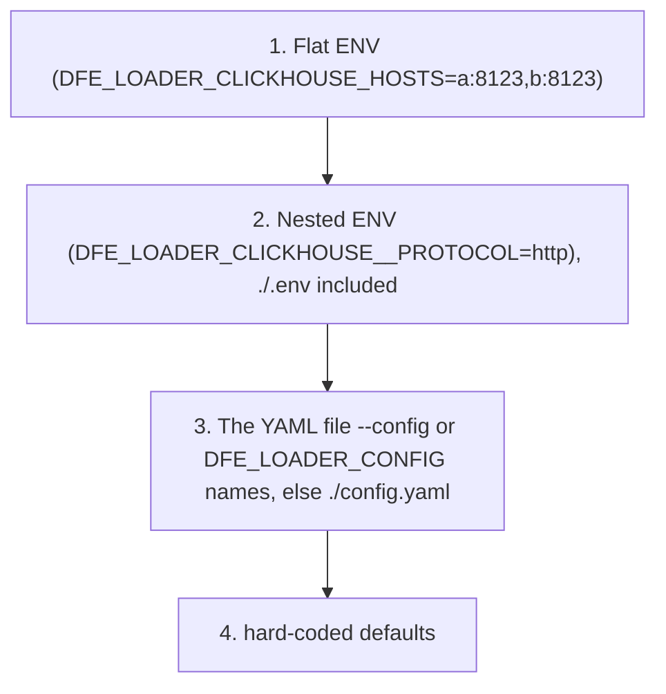

<!--
  Project:      dfe-loader
  File:         docs/configuration.md
  Purpose:      Config cascade and the settings that change behaviour
  Language:     Markdown

  License:      BUSL-1.1
  Copyright:    (c) 2026 HYPERI PTY LIMITED
-->

# Configuration

dfe-loader reads its config in four layers. Higher layers win. Every setting has a safe default, so a loader started with no config file boots.

Nested ENV names are derived from the key: `clickhouse.protocol` -> `DFE_LOADER_CLICKHOUSE__PROTOCOL` (a double underscore for each level of nesting). A nested ENV value is parsed as a number, bool or list where it looks like one, so `DFE_LOADER_BUFFER__FLUSH_ROWS=50000` is a number. A secret field is the exception and is read as the exact string, so a numeric password or MaxMind account ID arrives as written.

A file that `--config` or `DFE_LOADER_CONFIG` names must exist. A missing one refuses startup rather than running on the defaults.

Only the `.env` in the working directory is read. A `.env` in a parent directory belongs to another project and is never loaded.

The scaling gate (`scaling.enabled`, `scaling.memory_gate_threshold`) is read by
scalo's own cascade, which discovers `defaults.yaml` / `settings.yaml` but never
the file named by `--config`, so set it with `DFE_LOADER_SCALING__ENABLED` and
`DFE_LOADER_SCALING__MEMORY_GATE_THRESHOLD`. A value for it in the `--config`
file drives the loader's own weights and is reported as a mismatch at startup.

> A config value is only useful if the ACTION matches it. The integration tests
> assert the observable outcome (the row written, the transport used), not just
> that the value parsed -- see [the test note](#verifying-config-drives-behaviour).

## Settings that change behaviour

### ClickHouse insert path

| Setting | Values | Effect |
|---------|--------|--------|
| `clickhouse.protocol` | `http` (default), `native` | HTTP (8123), HTTPS (8443). `native` is refused at startup: the pinned client has no TCP row fetch, and the native insert sink waits on clickhouse-rs#15 |
| `clickhouse.insert_format` | `row_binary` (default), `json_each_row` | binary (server skips JSON parsing) vs self-describing JSON |
| `clickhouse.hosts` | list | multi-host failover (native pool round-robins, skips a refusing endpoint) |
| `clickhouse.database` | string, `dfe` (default) | database the connection targets -- DDL, schema reflection, and any table name that arrives without a `db.` prefix |

`clickhouse.database` is the CONNECTION database and is separate from
`routing.default_db` (also `dfe`), which is the database a routed row lands in.
Both are cascade-overridable like any other setting -- `DFE_LOADER_CLICKHOUSE__DATABASE`
or `clickhouse.database` in yaml.

The protocol and format compose. The default `http + row_binary` is the fast
path; `json_each_row` is the diagnostic fallback:

| `insert_format` | `protocol = http` | `protocol = native` |
|-----------------|-------------------|---------------------|
| `row_binary` (default) | `insert_formatted_with` FORMAT RowBinaryWithNamesAndTypes | refused at startup |
| `json_each_row` | `insert_formatted_with` FORMAT JSONEachRow | refused at startup |

Both formats insert over HTTP -- see
[clickhouse/insert-formats.md](clickhouse/insert-formats.md).

### Transport security (TLS, private CAs)

HTTPS verifies the server's certificate and host name against the container's system trust store. A private CA is trusted by adding it to that store, or by pointing `SSL_CERT_FILE` (or `SSL_CERT_DIR`) at a bundle that holds it -- there is no CA path in the loader config and no way to turn verification off.

| Setting | Values | Effect |
|---------|--------|--------|
| `clickhouse.tls.enabled` | bool | HTTPS for the connection. When `clickhouse.tls` is absent, a host on 8443/9440 or under `clickhouse.cloud` turns it on |
| `clickhouse.tls.ca_cert_file`, `cert_file`, `key_file`, `skip_verify` | -- | refused at startup: no client reads them |

See [clickhouse/tls.md](clickhouse/tls.md).

### ClickHouse timeouts

| Setting | Default | Bounds |
|---------|---------|--------|
| `clickhouse.connect_timeout_ms` | `5000` | opening a TCP connection |
| `clickhouse.request_timeout_ms` | `60000` | the first try of every query (schema reads, health), and an insert waiting to hand over its next chunk. A query that times out doubles the bound for the next one, up to 300 s, so a slow but working ClickHouse still answers; a quick answer narrows it again |
| `clickhouse.insert_timeout_ms` | `60000` | an insert waiting for the server's answer once its rows are sent |

A timed-out insert is held and sent again on a later flush, and its Kafka offset stays uncommitted until it lands. 60 s is about 270x the ClickHouse CPU cost of the largest default flush (20,000 rows at a measured 91,000 rows per CPU-second), and two rounds of timed-out concurrent inserts still fit Kafka's 300 s `max.poll.interval.ms`, which a blocked flush cycle counts against. Through a full outage the query bound widens, so an insert that first has to read its table's schema can hold one flush cycle past that limit; the consumer then rejoins with the batch's offsets still uncommitted.

Idle connections close on the client side after 2 s.

### Capture (what gets stored)

| Setting | Values | Effect |
|---------|--------|--------|
| `metadata.capture_mode` | `full` (default), `json_only`, `raw_only`, `extracted_only` | `_json` + `_raw` population -- see [architecture.md](architecture.md#capture-modes) |
| `metadata.table_capture_modes` | map | per-table override of `capture_mode` |
| DDL `@capture_mode: <mode>` | comment tag | highest-priority override, per table |

Precedence, highest wins: **DDL tag > per-table > global**.

### Routing

| Setting | Effect |
|---------|--------|
| `routing.table_fields` | fields whose value sets the table (dot-notation for nested). A null or empty value counts as absent |
| `routing.default_db` / `default_table` | fallbacks when no field matches |
| `routing.org_id_field` / `default_org_id` | where the `_org_id` tenant is read from, and the tenant a record with none lands in (`default`) |
| `routing.org_routes` | per-org database routing, keyed on the tenant |

### Enrichment, resilience

| Setting | Effect |
|---------|--------|
| `geoip`, `enrichment.reputation` / `risk_scoring` | inject enriched columns on the promoted row -- see [pipeline/enrichment.md](pipeline/enrichment.md) |
| `buffer.flush_rows` / `flush_bytes` / `flush_age_secs` | per-table flush triggers |

Insert retry, batch salvage and insert concurrency are not settings. Every build retries a transient insert failure up to 5 times with jittered backoff, binary-splits a batch with a data error down to the bad rows, and runs at most 8 inserts at once. A batch that still fails is held and retried as described in [operations.md](operations.md).

`schema.refresh_on_error` (default `true`) decides whether a RowBinary insert that fails on schema drift drops the table's cached schema. With `false` the stale schema is kept until it expires -- see [clickhouse/schema-cache.md](clickhouse/schema-cache.md#mismatch-recovery).

## Hot-reload

Config hot-reloads on change: `hot_reload.enabled` is on unless set false, and the loader watches the file `--config` names. Some fields are safe to apply live. The rest require a restart and are logged as a warning rather than silently applied:

- **Restart-required:** `clickhouse.protocol`, ClickHouse URL/hosts,
  `clickhouse.insert_format`, `clickhouse.tls.enabled`, the
  `clickhouse.*_timeout_ms` bounds, Kafka connection -- all of these are baked
  into the `Client` at build time. Also `routing.dlq`, `field_mapping` and `enrichment`, which are built once at startup.
- **Safe to reload:** buffer thresholds, `metadata` (capture modes included), `timestamp_dq`, `field_sanitization`, and `routing` other than `routing.dlq`.

On Kubernetes the deployment contract lists `routing` in `hot_paths`, so the chart leaves it out of the pod's config checksum. A `routing` edit reaches the running pods through the refreshed ConfigMap, and an edit anywhere else still rolls them.

## Verifying config drives behaviour

Config-loading is necessary but not sufficient -- the ACTION must align with the
setting. dfe-loader's tests assert the observable outcome:

- `capture_mode=raw_only` -> the row actually written has `_raw` = the full
  payload and `_json` NULL (offline processor test).
- `insert_format` + `transport` -> the row actually lands over the configured
  format/transport (live integration test, docker or dev cluster).
- ENV over yaml -> the resolved setting actually changes the behaviour, not just
  the parsed value.

See `src/pipeline/processor.rs` (capture-mode action tests) and
`tests/integration/` (live insert tests).
