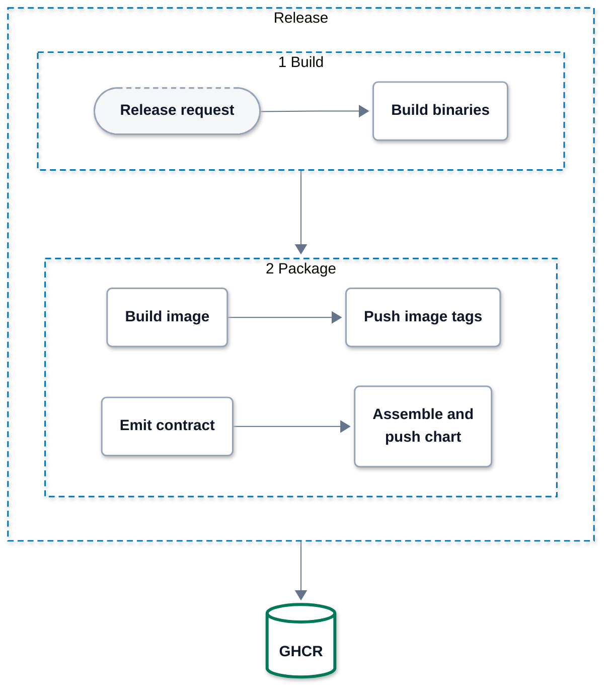

<!--
  Project:      dfe-loader
  File:         docs/deployment/publishing.md
  Purpose:      Container image + Helm chart publishing via CI
  Language:     Markdown

  License:      BUSL-1.1
  Copyright:    (c) 2026 HYPERI PTY LIMITED
-->

# Container and chart publishing

dfe-loader ships as a multi-arch container image and a Helm chart, built and
pushed by CI on every release. dfe-infra's `versions.yaml` pins the image tag, its digest and the chart, and dfe-docker pins the image through `DFE_LOADER_VERSION`, so neither builds from source.

Both artefacts go to GHCR. The image is `ghcr.io/hyperi-io/dfe-loader` and the chart is pushed to `oci://ghcr.io/hyperi-io/charts`. CI authenticates with `GITHUB_TOKEN`, so no registry secret is needed.

One release build feeds both artefacts: the image wraps the built binary, and the chart comes from the deployment contract that binary emits.



*Figure 1. L4 Detail -- Release artefacts. A release request is a merge with a `Release: true` trailer or a release dispatch.* Up: [Deployment](README.md).

## How it works

`.github/workflows/ci.yml` calls hyperi-ci's reusable `rust-ci.yml`. On a release it builds the `Dockerfile` for `linux/amd64` and `linux/arm64` and pushes the image with version tags. CI runs the built binary's `generate-artefacts` to emit the deployment contract as well, assembles a thin chart from it on the scalo-service library chart, and pushes that. No chart is committed to this repo. The `release:` block in `.hyperi-ci.yaml` turns both on:

```yaml
release:
  enabled: true
  helm:
    enabled: true
    contract: emit
    library: "<contract version>"
  container:
    enabled: true
    dockerfile: Dockerfile
    platforms:
      - linux/amd64
      - linux/arm64
```

`library` moves with the scalo version in `Cargo.toml`: a scalo-service release ships the schema for, and renders, only the contract version its scalo release writes. To see the chart a release would ship, build the binary and run `hyperi-ci chart assemble --binary target/debug/dfe-loader --image ghcr.io/hyperi-io/dfe-loader:<tag>@sha256:<digest> --version <version>`. It prints the chart directory it wrote.

The `Dockerfile` is generated from the app's deployment contract by scalo and copies in the binary CI built. Do not edit it by hand. Regenerate it with `dfe-loader --emit-dockerfile`. `tests/integration/helm_contract.rs` fails when the committed `Dockerfile` drifts from the contract.

For a stable release `v<version>`:

- `ghcr.io/hyperi-io/dfe-loader:v<version>`
- `ghcr.io/hyperi-io/dfe-loader:latest`
- `ghcr.io/hyperi-io/dfe-loader:sha-<commit>`

A prerelease (e.g. `v<version>-rc.1`) gets its version tag and `sha-<commit>`
only. It never moves `latest`, and nor does a stable release on an older line when a later one holds it.

After a release, check the tags:

```bash
docker pull ghcr.io/hyperi-io/dfe-loader:v<version>
docker run --rm ghcr.io/hyperi-io/dfe-loader:v<version> --help
docker manifest inspect ghcr.io/hyperi-io/dfe-loader:v<version>
```

- dfe-infra deploys the published chart through Argo CD at the tag and digest `versions.yaml` names.
- dfe-docker's compose service takes `${IMAGE_REGISTRY:-ghcr.io/hyperi-io}/dfe-loader:${DFE_LOADER_VERSION}`, which `make stack VERSION=X.Y.Z` pins, and publishes the metrics port on `${DFE_LOADER_PROMETHEUS_PORT:-9091}`.

The container's entrypoint is `dfe-loader --config /etc/dfe/loader.yaml`, so a consumer mounts the config there.
