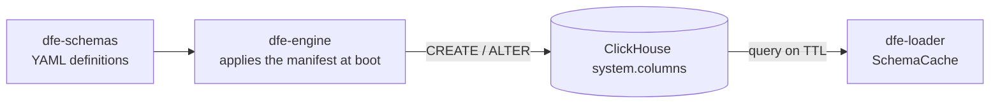

<!--
  Project:      dfe-loader
  File:         docs/deployment/schemas.md
  Purpose:      Loader-side reference for the shared dfe-schemas definitions
  Language:     Markdown

  License:      BUSL-1.1
  Copyright:    (c) 2026 HYPERI PTY LIMITED
-->

# Shared schema definitions

**The loader reads the DEPLOYED schema, never the YAML.** It queries
`system.columns` at startup and on a TTL, and parses the DFE `@directive`
expressions out of each column's COMMENT. So dfe-schemas is upstream of the
loader by two steps, and nothing here needs a checkout of it.

> **Canonical schema documentation:**
> [`dfe-schemas`](https://github.com/hyperi-io/dfe-schemas)



That is why the loader has no submodule and no bundled profile copies: whatever
the applier put in the table IS the contract, and a second copy on disk could
only disagree with it.

## What the loader takes from a column

A schema YAML's `expr` becomes part of the column COMMENT in the deployed DDL,
alongside any human-readable description:

```sql
COMMENT '@renamed: client_ip - Source address of the connection'
```

The parser ends a source path at the first ` - `, so the description after it is never read as part of the path.

The loader reads the directives it acts on and ignores the rest. Config always
wins over a COMMENT -- the exact resolution order is in
[`src/column_meta/mod.rs`](../../src/column_meta/mod.rs).

| Directive | Config field | Action |
|-----------|--------------|--------|
| `@skip` | `skip: true` | Omit the column from the insert |
| `@default:value` | `default:` | Substitute when the column is null or absent |
| `@source:path` | `renamed:` | Source field path(s) for this column, and a `\|` fallback also fills `default:` |
| `@renamed:path` | `renamed:` | Source field path(s) for this column |
| `@computed:expr` | `computed:` | CEL expression producing the value |
| `@coerce:category` | `coerce:` | None: the encoder's coercion rules are fixed. The DDL directive logs a warning, the config key is refused |

`@generated` and `@config` are descriptive only: the loader drops both as
unknown directives (`DIRECTIVE_NAMES` in
[`src/column_meta/mod.rs`](../../src/column_meta/mod.rs) lists only the six
directives above). What makes the loader omit a value for a `@generated`
column is ClickHouse's own DEFAULT/MATERIALIZED/ALIAS clause on it, reported
as `default_kind` in `system.columns` -- dfe-schemas' renderer writes that clause from
the schema's `default:` and `attribute:` fields, not by parsing the
`@generated:` text. `@config: path` documents that a mapping is driven by
loader config (for example `routing.org_id_field`) rather than hardcoded, and
nothing reads the comment text itself. See
[ddl-directives.md](../clickhouse/ddl-directives.md) for the whole expression
language.

## Getting the tables there in the first place

dfe-engine applies the dfe-schemas manifest at boot: it takes the schema lock, renders the manifest for the platform it reaches, and creates what is absent or additively changed. Nothing else creates a DFE table, no Job and no init container. A loader pointed at a database the engine has not applied finds no columns: records wait in the pending-schema buffer, and a missing default table is logged at `warn`.

## Related docs

- [common-header.md](../transport/common-header.md) -- the header columns and what the loader writes into each
- [ddl-directives.md](../clickhouse/ddl-directives.md) -- field mapping expression language
- [dfe-schemas](https://github.com/hyperi-io/dfe-schemas) -- canonical schema documentation
