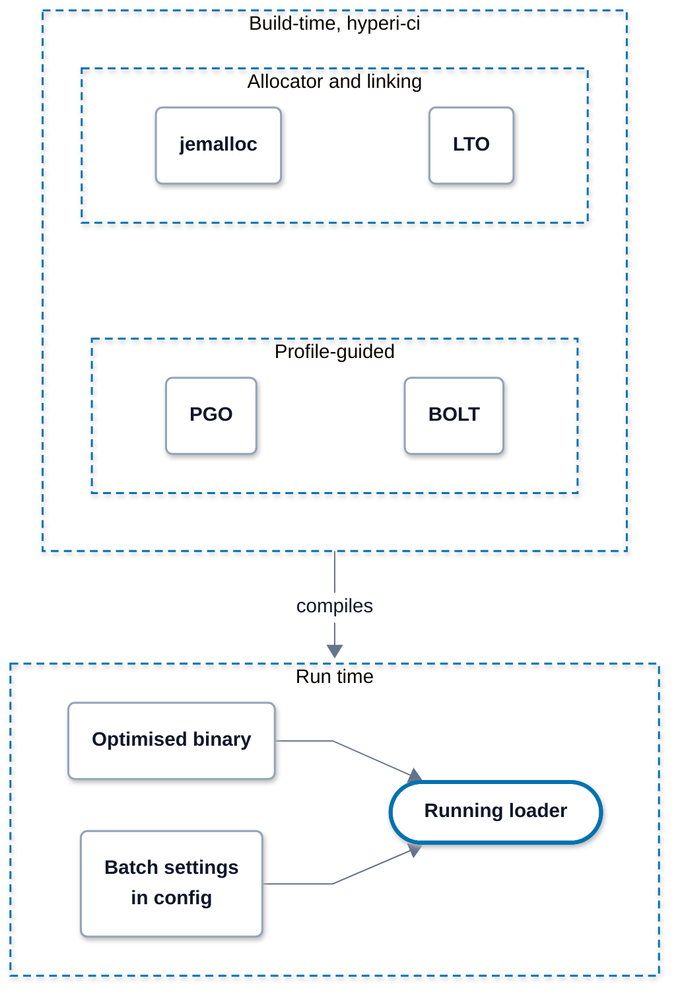

<!--
  Project:      dfe-loader
  File:         docs/performance/overview.md
  Purpose:      Performance optimisation guide: build optimisations and runtime tuning
  Language:     Markdown

  License:      BUSL-1.1
  Copyright:    (c) 2026 HYPERI PTY LIMITED
-->

# Performance optimisation

Performance work splits in two: build-time optimisations (allocator, LTO, PGO, BOLT) that hyperi-ci applies, and runtime tuning (batch sizes) that lives in config. This page covers both, plus the tools for finding where the time goes.

The build-time choices go into the binary once, and the batch settings tune the running loader without a rebuild.



*Figure 1. L4 Detail -- Where performance is set. BOLT runs on the PGO build.* Up: [Performance](README.md).

## What CI builds

hyperi-ci picks the optimisations by release channel (`src/hyperi_ci/languages/rust/optimize.py` in hyperi-ci):

| Channel | Allocator | LTO | PGO and BOLT |
|---|---|---|---|
| alpha | jemalloc | thin | no |
| beta | jemalloc | fat | no |
| release | jemalloc | fat | PGO when the repo has a workload, BOLT with it unless `build.rust.optimize.bolt.enabled: false` |

This repo's workload is `scripts/pgo-workload.sh`, and `.hyperi-ci.yaml` builds its `pgo-driver` before the workload clock starts. The workload must exercise the hot path a running loader takes: parse, transform, serialise and insert. Port checks, health probes and startup paths mislead the compiler and can make PGO a net loss. Confirm what shipped from the published artefact, not from the build log. hyperi-ci's guide is `docs/runtime/pgo-bolt.md` in its repo.

`Cargo.toml` sets `lto = "thin"` and `codegen-units = 1` for `release`, and CI overrides the LTO mode per channel through `CARGO_PROFILE_RELEASE_LTO`, leaving `Cargo.toml` untouched.

The `jemalloc` feature installs `tikv-jemallocator` as the `#[global_allocator]` in `src/main.rs`. `default = []`, so a local build opts in:

```bash
cargo build --release --features jemalloc
```

Release builds set `strip = true`, so `nm` sees no allocator symbols. `strings` does:

```bash
strings target/release/dfe-loader | grep -ciE 'jemalloc|je_mallctl'
```

`tikv-jemallocator` prefixes jemalloc's symbols, so its options are read from `_RJEM_MALLOC_CONF`, not `MALLOC_CONF`. Heap profiling needs the crate's `profiling` feature, which this build does not enable, and symbols to read the profile with: the `profiling` cargo profile keeps them.

## Runtime tuning

| Setting | Default | Tuning guidance |
|---------|---------|-----------------|
| `buffer.flush_rows` | 20,000 | Increase for throughput, decrease for latency |
| `buffer.flush_bytes` | 64 MiB | A ceiling for oversized rows: at 1-2 KB rows the 20,000-row trigger fires first |
| `buffer.flush_age_secs` | 5 | Lower for real-time, higher for batch |

Insert concurrency is not a setting: at most 8 inserts run at once. RowBinary over HTTP (`FORMAT RowBinaryWithNamesAndTypes`) is the default, and `clickhouse.protocol: native` sends `FORMAT Native` blocks instead. dfe-clickhouse's [insert-formats.md](https://github.com/hyperi-io/dfe-clickhouse-rs/blob/main/docs/insert-formats.md) measures the two against each other. `insert_format: json_each_row` falls back to `FORMAT JSONEachRow` over HTTP.

To find where the time goes:

```bash
# CPU, with perf
perf record -g ./target/release/dfe-loader --config config.yaml
perf report

# Flame graph
cargo install flamegraph
cargo flamegraph --bin dfe-loader -- --config config.yaml
```

For a local PGO or BOLT run, [cargo-pgo](https://github.com/Kobzol/cargo-pgo) builds the instrumented binary (`cargo pgo build`), takes the profile from a workload run, and rebuilds with it (`cargo pgo optimize`, then `cargo pgo bolt optimize --with-pgo` for BOLT, Linux only). Further reading: [The Rust Performance Book](https://nnethercote.github.io/perf-book/), [LLVM BOLT](https://github.com/llvm/llvm-project/tree/main/bolt) and [jemalloc tuning](https://github.com/jemalloc/jemalloc/wiki/Getting-Started).
