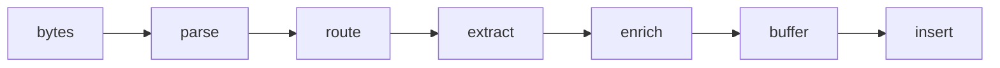

<!--
  Project:      dfe-loader
  File:         docs/pipeline/README.md
  Purpose:      Index for the per-message pipeline
  Language:     Markdown

  License:      BUSL-1.1
  Copyright:    (c) 2026 HYPERI PTY LIMITED
-->

# Pipeline

The hot path: bytes in, ClickHouse row out, one pass per message, batched per
table on the way out.

## Docs

- [overview.md](overview.md) -- the six stages, in order.
- [routing.md](routing.md) -- choosing `db.table` from message fields.
- [capture-modes.md](capture-modes.md) -- what is stored as `_json` / `_raw`,
  and the three-level precedence.
- [enrichment.md](enrichment.md) -- GeoIP, reputation, risk scoring.
- [parallelism.md](parallelism.md) -- the parallelisation playbook.

For the buffer-and-insert tail see
[../clickhouse/insert-formats.md](../clickhouse/insert-formats.md) and the
resilience model in [../architecture.md](../architecture.md#resilience).
