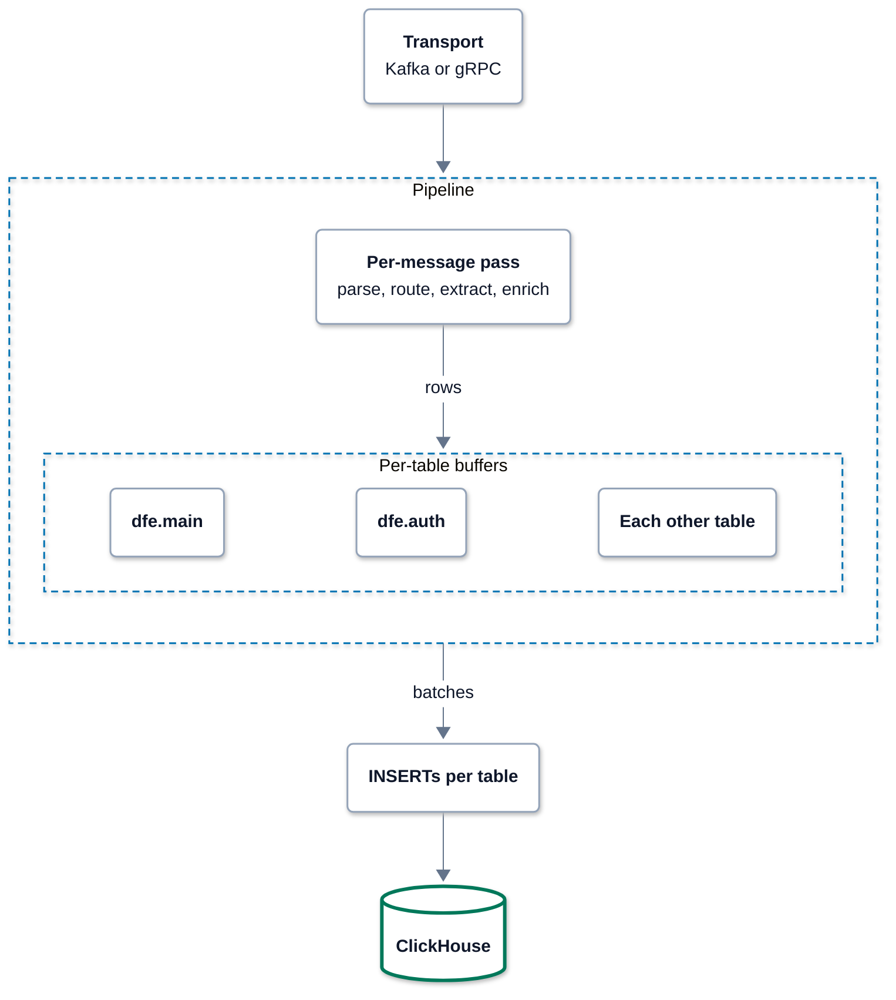

<!--
  Project:      dfe-loader
  File:         docs/pipeline/README.md
  Purpose:      Index for the per-message pipeline
  Language:     Markdown

  License:      BUSL-1.1
  Copyright:    (c) 2026 HYPERI PTY LIMITED
-->

# Pipeline

The pipeline is the hot path of [dfe-loader](../architecture.md): bytes in, a typed row in its table's buffer out.

| | |
|---|---|
| Repo | [hyperi-io/dfe-loader](https://github.com/hyperi-io/dfe-loader) |
| Image and chart | `ghcr.io/hyperi-io/dfe-loader`, and the thin chart released beside it |
| Config reference | `payload`, `routing`, `field_mapping`, `computed_columns`, `enrichment`, `geoip`, `metadata` and `buffer` in [config-schema.yaml](../config-schema.yaml) |
| Endpoints | None of its own |
| Metrics | `messages_received_total`, `loader_messages_by_table_total`, `loader_buffer_rows_by_table`, `dfe_loader_unknown_table_fallback_total`, in [operations.md](../operations.md#observe) |

The pass runs per message, and the batching is per table: each table has a separate buffer, flushed as INSERTs of its rows.

*Figure 1. L4 Detail -- Per-message pass, per-table batches. Each buffer flushes on a row, byte or age trigger.* Up: [L3 Components -- dfe-loader](../architecture.md).

## How it works

1. A message carrying several records, a JSON array or newline-separated objects, splits into one message per record. Each keeps its topic, partition and offset, so a batch still commits as one unit.
2. The pass parses each record once with sonic-rs and keeps the bytes as one reference-counted `Arc<[u8]>`. Anything not JSON is dead-lettered.
3. Routing picks `db.table` from `routing.table_fields` before any flattening, and falls back to `routing.default_table`.
4. The fields the table declares are promoted to typed columns. The rest stay in the payload, written as `_json` at serialise time.
5. Enrichment adds flat GeoIP, reputation and risk columns to the row, never to `_json`.
6. The row lands in its table's buffer, which flushes on `buffer.flush_rows`, `flush_bytes` or `flush_age_secs`.

[overview.md](overview.md) has each step, and [parallelism.md](parallelism.md) which parts of a batch run in parallel.

## Interfaces

In: message bytes from the transport, with their topic, partition and offset. Out: per-table batches of typed rows for the ClickHouse insert layer, and dead letters for the DLQ. A record goes to the DLQ when it isn't JSON, is nested deeper than 64 levels, has `_org_id` or `_source` twice, or waits longer than `schema.pending_max_age_secs` for its table.

## Scaling and failure

The pass scales with the worker pool and with pods. Under memory pressure the loader pauses the consumer before the next Kafka poll rather than risk an OOM kill mid-batch. A routing miss is never a dead letter: it lands in the default table. [operations.md](../operations.md#memory-pressure) has the memory guard.

## Key metrics

- `messages_received_total`: records in, after batches are split.
- `loader_messages_by_table_total` and `loader_buffer_rows_by_table`: where records went, and what's waiting to flush.
- `dfe_loader_unknown_table_fallback_total`: records sent to the default table because theirs is gone.

## Related

- [overview.md](overview.md) -- the stages, in order.
- [routing.md](routing.md) -- choosing `db.table` from message fields.
- [capture-modes.md](capture-modes.md) -- what is stored as `_json` / `_raw`,
  and the three-level precedence.
- [enrichment.md](enrichment.md) -- GeoIP, reputation, risk scoring.
- [parallelism.md](parallelism.md) -- the parallel and sequential phases of a batch.

For the buffer-and-insert tail see
[../clickhouse/insert-formats.md](../clickhouse/insert-formats.md) and the
failure handling in [../operations.md](../operations.md#when-inserts-fail).
