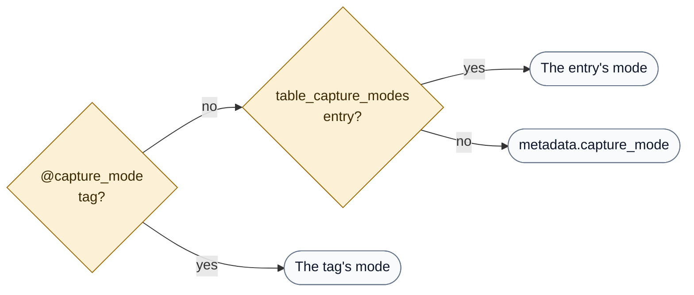

<!--
  Project:      dfe-loader
  File:         docs/pipeline/capture-modes.md
  Purpose:      capture_mode: what is stored, and the 3-level precedence
  Language:     Markdown

  License:      BUSL-1.1
  Copyright:    (c) 2026 HYPERI PTY LIMITED
-->

# Capture modes

`capture_mode` decides what is stored alongside the promoted columns: the full
payload as `_json` (native JSON type, path-queryable), the raw bytes as `_raw`
(String), or neither. Promoted columns are always written -- capture mode only
governs the two payload-retention columns.

| Mode | `_json` | `_raw` | Use |
|------|---------|--------|-----|
| `full` (default) | full payload (JSON) | a raw field the record sent, else NULL | path queries plus text search |
| `json_only` | full payload (JSON) | NULL | path queries, never a `_raw` copy |
| `raw_only` | NULL, unless a directive fills it | full source payload (String) | save ClickHouse CPU, no JSON-type overhead |
| `extracted_only` | NULL, unless a directive fills it | NULL | promoted columns only |

`_raw` and `_json` are not copies of each other. `_json` is the parsed payload
as a native ClickHouse JSON value (path-based queries). `_raw` is the original
bytes as received (the tailed log line, DB row, or raw syslog). A table can keep
one, both, or neither.

Under `full`, a JSON record fills `_raw` from a raw field it sent (`raw` or `_raw`), kept as sent, such as a line the receiver captured. Any other JSON record is kept once, in `_json`, and `_raw` stays NULL. A text field such as `logoriginal` is not copied into `_raw` by default, because `_json` stores its text. To promote one for a source that needs it, name it in `metadata.raw_source_fields` (first match wins) or in an `@renamed` directive on the `_raw` column.

`metadata.capture_raw` (default `true`) is what lets `raw_source_fields` fill `_raw`. `metadata.capture_json` is read by nothing: `capture_mode` decides `_json`.

A directive on the `_json` column itself, such as `@source: record`, makes `_json` a promoted column. It then holds that field's value, or an empty object when the record has none, under every mode, `raw_only` and `extracted_only` included, and the payload is not spliced in. The DLQ table dfe-schemas renders uses `@source: _json` to keep a dead letter's original payload.

## Precedence

Capture mode is resolved per table: the table's DDL tag wins, then a per-table config entry, then the global default.

*Figure 1. L4 Detail -- Capture mode precedence. The first question answered yes decides.* Up: [Pipeline](README.md).

- A `@capture_mode: <mode>` tag in the table's `COMMENT` wins over any config, since the table owns its capture policy. See [../clickhouse/ddl-directives.md](../clickhouse/ddl-directives.md#table-level-tags).
- `metadata.table_capture_modes` maps a `db.table` to a mode.
- `metadata.capture_mode` applies to any table without a more specific setting.

The processor tests in `src/pipeline/processor.rs` check the row each mode writes, on a table with no directive on `_json`:

- `full` -> the written row has `_json` populated, and `_raw` when the record sent a raw field.
- `json_only` -> the written row has `_json` populated and `_raw` NULL, always.
- `raw_only` -> the written row has `_raw` = the full payload and `_json` NULL.
- `extracted_only` -> the written row has neither `_json` nor `_raw`, just the promoted columns.
