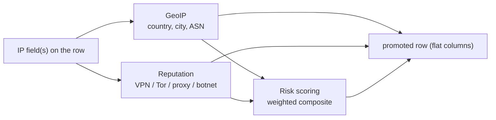

<!--
  Project:      dfe-loader
  File:         docs/pipeline/enrichment.md
  Purpose:      IP enrichment: GeoIP, reputation, risk scoring
  Language:     Markdown

  License:      BUSL-1.1
  Copyright:    (c) 2026 HYPERI PTY LIMITED
-->

# Enrichment

Enrichment adds derived columns to a row from its IP fields: geographic data,
reputation flags, and a composite risk score. Each provider is an independent
toggle, off by default. Enriched values are written as flat columns on the
promoted row only -- never folded into `_json`, so the payload stays the payload
and the enrichment stays queryable.

## Providers

| Provider | Config | What it adds |
|----------|--------|--------------|
| GeoIP | `geoip` | geographic lookup (country, city, ASN) from a local database under `geoip.auto_download.data_dir` |
| Reputation | `enrichment.reputation` | flags for VPN, Tor, proxy, and botnet membership |
| Risk scoring | `enrichment.risk_scoring` | weighted composite score from geo + reputation, with a selectable country-risk preset |

Risk scoring is a composite: it needs at least GeoIP or reputation enabled to
have anything to weigh. Enabling it alone does nothing useful, which the config
documents at the field.

## Where the GeoIP databases come from

With `geoip.enabled` on, startup provisions the MMDB files through scalo's `geoip_download`, then opens them with `maxminddb`. An explicit `geoip.city_db_path` or `asn_db_path` is used as given. Otherwise a file in `geoip.auto_download.data_dir` (default `/var/lib/dfe/geoip`, the volume the deployment contract mounts) younger than `max_age_days` is kept, a missing or older one is downloaded, and a failed download falls back to the old file. A download larger than `max_database_bytes` (default 512 MiB), or one that does not read as an MMDB, is refused. A missing database leaves enrichment inactive and never stops the loader.

| `geoip.provider` | City | ASN | Credentials |
|------------------|------|-----|-------------|
| `db_ip_lite` (default) | yes | yes | none |
| `max_mind_geo_lite2` | yes | yes | `auto_download.maxmind_account_id`, `maxmind_license_key` |
| `ip_info_lite` | yes | no | `auto_download.ipinfo_token` |
| `ip_locate` | no | yes | none |
| `sapics` | no | yes, DB-IP's ASN data, saved as `sapics-dbip-asn.mmdb` | none |
| `custom` | the explicit paths | the explicit paths | none |

The credentials are redacted in logs and config dumps. Supply them through the secrets layer, never as literals.

## Cost and placement

Enrichment runs after extraction and before buffering, on the promoted row. The
lookups are cached, so a hot IP is resolved once and reused. Because the columns
are flat and additive, a table opts in simply by declaring the enrichment
columns in its schema -- an enriched value is written only where the target
table has a column for it, the same promotion rule the rest of the pipeline
follows.

## The setting drives the action

Like every config-cascade switch in the loader, an enrichment toggle is only
meaningful if the row that lands reflects it: enable GeoIP and the geo columns
on the written row are populated; leave it off and they are not. See
[../configuration.md](../configuration.md) and the hot-path context in
[overview.md](overview.md).
