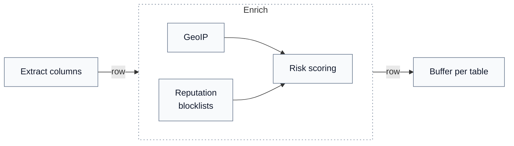

<!--
  Project:      dfe-loader
  File:         docs/pipeline/enrichment.md
  Purpose:      IP enrichment: GeoIP, reputation, risk scoring
  Language:     Markdown

  License:      BUSL-1.1
  Copyright:    (c) 2026 HYPERI PTY LIMITED
-->

# Enrichment

Status: each provider is off by default and turned on by its setting, `geoip.enabled`, `enrichment.reputation.enabled` or `enrichment.risk_scoring.enabled`. Reputation reads operator blocklists alone, so of its flags only `rep_is_malicious` is ever set ([#342](https://github.com/hyperi-io/dfe-loader/issues/342)).

Enrichment adds columns to a row from the first IP field it has (`enrichment.ip_fields`, default `src_ip`, `client_ip`, `ip`, `source_ip`): GeoIP columns `geo_*`, reputation columns `rep_*` and a risk score in `risk_*`. They are written as flat columns on the promoted row, never folded into `_json`, so the payload stays as it arrived and the enrichment is queryable.

The lookups key on the first IP field present, and risk scoring weighs what GeoIP and reputation found, so it adds nothing by itself.

*Figure 1. L4 Detail -- Enrichment. Each provider is off until its setting turns it on.* Up: [L3 Components -- dfe-loader](../README.md).

## Providers

| Provider | Config | What it adds |
|----------|--------|--------------|
| GeoIP | `geoip` | geographic lookup (country, city, ASN) from a local database under `geoip.auto_download.data_dir` |
| Reputation | `enrichment.reputation` | `rep_is_malicious` for an address on a file `blocklist_files` names, one IP or CIDR a line. No feed is loaded for the VPN, Tor, proxy and botnet flags, so nothing derives them, and a value the record sent is kept |
| Risk scoring | `enrichment.risk_scoring` | weighted composite score from geo + reputation, with a selectable country-risk preset |

Risk scoring runs only when GeoIP or reputation returned a result for the row, so enabling it alone writes nothing.

Every value the scorer uses is config under `enrichment.risk_scoring`, with the shipped values as defaults. `config.example.yaml` lists them all.

| Key | What it sets | Default |
|-----|--------------|---------|
| `preset` | the entry in `presets` with the country lists that apply | `global` |
| `presets` | `high` and `medium` country lists by name | `global`, `us_enterprise`, `eu_enterprise`, `apac_enterprise`, `high_security` |
| `weights` | `geo`, `reputation`, `privacy`, `threat` share of the composite | 15, 25, 25, 35 |
| `scores` | what each signal adds to its component: country class, VPN, proxy, Tor, datacenter, relay, anonymiser count, botnet, malicious, spam, scanner, and the `high_abuse_score` threshold | `config.example.yaml` |
| `levels` | lowest composite score of `low`, `medium`, `high`, `critical` | 20, 40, 60, 80 |

A `presets` entry in config replaces the shipped preset of that name, or adds one, and the rest stay as shipped. Startup and a reload refuse a `preset` that `presets` does not hold, naming the valid ones, as well as a score over 100 and level bands that do not rise strictly within 1-100.

## Where the GeoIP databases come from

With `geoip.enabled` on, startup provisions the MMDB files through scalo's `geoip_download`, then opens them with `maxminddb`. An explicit `geoip.city_db_path` or `asn_db_path` is used as given. Otherwise a file in `geoip.auto_download.data_dir` (default `/var/lib/dfe/geoip`, the volume the deployment contract mounts) younger than `max_age_days` is kept, a missing or older one is downloaded, and a failed download falls back to the old file. A download larger than `max_database_bytes` (default 512 MiB), or one that does not read as an MMDB, is refused. A missing database leaves enrichment inactive and never stops the loader.

| `geoip.provider` | City | ASN | Credentials |
|------------------|------|-----|-------------|
| `db_ip_lite` (default) | yes | yes | none |
| `max_mind_geo_lite2` | yes | yes | `auto_download.maxmind_account_id`, `maxmind_license_key` |
| `ip_info_lite` | yes | no | `auto_download.ipinfo_token` |
| `ip_locate` | no | yes | none |
| `sapics` | no | yes, DB-IP's ASN data, saved as `sapics-dbip-asn.mmdb` | none |
| `custom` | the explicit paths | the explicit paths | none |

The credentials are redacted in logs and config dumps. Supply them through the secrets layer, never as literals.

Enrichment runs after extraction and before buffering, on the promoted row. The
lookups are cached, so a hot IP is resolved once and reused. Because the columns
are flat and additive, a table opts in by declaring the enrichment
columns in its schema -- an enriched value is written only where the target
table has a column for it, the same promotion rule the rest of the pipeline
follows.
