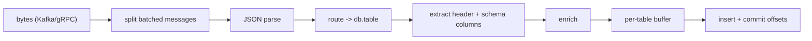

<!--
  Project:      dfe-loader
  File:         docs/pipeline/overview.md
  Purpose:      The per-message hot path, stage by stage
  Language:     Markdown

  License:      BUSL-1.1
  Copyright:    (c) 2026 HYPERI PTY LIMITED
-->

# The pipeline

A message becomes a ClickHouse row in one pass. The hot path does the cheap
work per message and defers the expensive work to flush: parse once, promote
only the columns the table declares, keep the full payload as a
reference-counted `Arc<[u8]>`, and splice it in as `_json` only at serialise
time. The tail batches per table and inserts.

The stages, in order, all in `src/pipeline/` (`MessageProcessor::process` is the
per-message entry point):

## 0. Split batched messages

Every stage below this takes one message to be one record, so a message
carrying several is split into one message per record before anything else
runs. Two wire formats are batches, counted apart so a dashboard says which
producer is batching:

| Format | Producer it came from | Counters |
|-------|----------------------|----------|
| a non-empty JSON array of objects | dfe-receiver forwarding a batched POST | `dfe_loader_batched_array_messages_total` / `dfe_loader_batched_array_records_total` |
| newline-separated JSON objects | dfe-transform-elastic emitting its output | `dfe_loader_batched_ndjson_messages_total` / `dfe_loader_batched_ndjson_records_total` |

Each element keeps its source message's topic, partition and offset, so a batch
still commits as one unit. What is not a batch of records goes through
untouched, so the format check and the DLQ see exactly what arrived: a scalar
array, an empty array, a single object however it is formatted, a truncated
tail, and any body whose elements are not all objects.

The split belongs at the consumer, so a producer's choice of wire format cannot lose records. An array that reaches the processor unsplit is refused as `payload is a JSON array, not a record object` rather than coming back as a ClickHouse encode error on an empty column.

## 1. Parse

A payload must open a JSON object or array (`{` or `[` after any leading
whitespace) and is parsed with sonic-rs (SIMD). The original bytes are kept once as `Arc<[u8]>`, so the full payload can be written as `_raw` or `_json` later without re-serialising. Anything else is dead-lettered as `payload is not JSON` with its first 8 bytes in hex, and a payload that opens like JSON but does not parse is dead-lettered with the parse error.

JSON is the only payload format. MessagePack, which DFE/XDR 2.0 and 2.1 accepted, was removed in DFE 2.2, and a MessagePack record is dead-lettered as not JSON: the JSON path (SIMD parsing with sonic-rs, zstd on the wire) is fast enough that MessagePack gave no CPU saving.

## 2. Route

Routing picks `db.table` from the message before any flattening, using the configured `routing.table_fields` (dot-notation for nested access). No field carrying a value falls back to the topic's source, then `routing.default_table`, and a table ClickHouse says does not exist falls back to `routing.default_table` too. The database is `routing.default_db` unless `routing.org_routes` lists the record's `_org_id` tenant. See [routing.md](routing.md).

## 3. Extract

The target table's schema (reflected and cached, see
[../clickhouse/schema-cache.md](../clickhouse/schema-cache.md)) decides which
fields are promoted to typed columns. The header extractor pulls the common
header fields, and the rest of the declared columns are pulled from the payload by
name. Anything not promoted stays in the payload, available as `_json`.

## 4. Enrich

Optional enrichment (`geoip`, `reputation`, `risk`) injects flat columns onto
the promoted row only -- never into `_json`. Each is a toggle, and the lookups are
cached. See [enrichment.md](enrichment.md).

## 5. Buffer and capture

The promoted row, plus whatever `capture_mode` dictates for `_json` and `_raw`,
lands in the per-table buffer (rows + raw payloads + Kafka offsets). Capture
mode is resolved per table with a three-level precedence (DDL directive >
per-table config > global). See [capture-modes.md](capture-modes.md).

## 6. Insert and commit

The encoder reshapes only the values ClickHouse cannot take as sent: epoch vs ISO timestamps, hyphen-less UUIDs, integer IPv4, every geo_point form for a `Point`, and a single value for an `Array` (see [../clickhouse/types.md](../clickhouse/types.md)). Each table's buffer flushes on its own triggers (`flush_rows` / `flush_bytes` / `flush_age_secs`). The batch is encoded and inserted through `dfe-clickhouse`'s `dynamic` module (RowBinary by default). Kafka offsets commit once per flush cycle, and on each partition stop below the lowest offset not placed yet -- at-least-once. Batch salvage isolates a row ClickHouse rejects for good and sends it to the DLQ. A batch that fails for any other reason is held and retried with jittered backoff until it lands. See [../architecture.md](../architecture.md#resilience) and [../clickhouse/insert-formats.md](../clickhouse/insert-formats.md).

## Parallelism

The hot path scales across a worker pool with per-table batching downstream. [parallelism.md](parallelism.md) describes the parallel and sequential phases.
