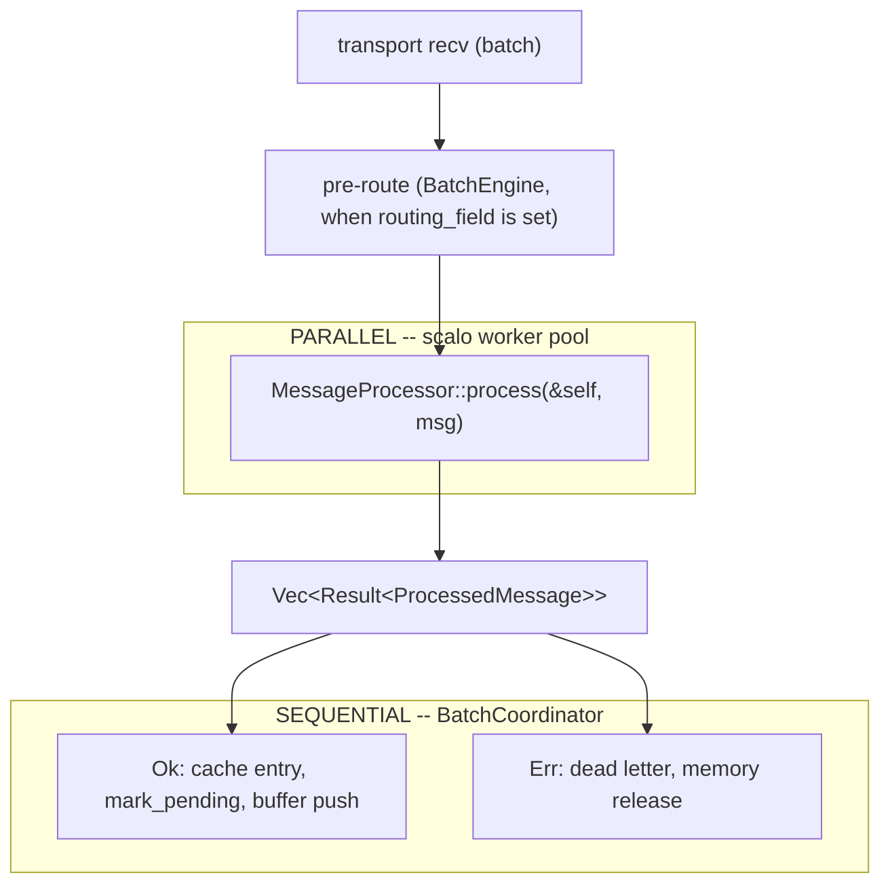

<!--
  Project:      dfe-loader
  File:         docs/pipeline/parallelism.md
  Purpose:      Pipeline parallelisation playbook (parallel-then-sequential)
  Language:     Markdown

  License:      BUSL-1.1
  Copyright:    (c) 2026 HYPERI PTY LIMITED
-->

# Pipeline parallelism

Each received batch goes through two phases in `src/pipeline/orchestrator.rs`. Per-message work with no shared mutable state runs in parallel. Everything that mutates state runs after it, in one thread.

`MessageProcessor` (`src/pipeline/processor.rs`) holds only shared references, and its `process` method does no I/O and no `.await`. For one message it refuses a payload that does not open a JSON object or array, parses it with sonic-rs, holds an external topic's record to its own tenant, routes it to a table, then extracts and transforms the fields. It goes on to derive the capture settings, apply the field mapping, evaluate computed columns and CEL expressions, and run enrichment. The result is a `ProcessedMessage` (`src/pipeline/types.rs`) or an error.

What it reads is safe to share. `CaptureOverrides::derive_config` (`src/pipeline/capture.rs`) is a pure `&self` method. Enrichment (`src/pipeline/enrichment.rs`) is in-memory GeoIP, reputation and risk lookups, with the GeoIP cache behind a `parking_lot::RwLock`.

The orchestrator runs `process` over the batch on the first pool it has: the `BatchEngine`'s pool, then the runtime's `AdaptiveWorkerPool`, then a plain sequential loop. When the `BatchEngine` has a `routing_field`, its pre-route filters run first and only the passing messages are processed.

## The sequential phase

`BatchCoordinator` (`src/pipeline/coordinator.rs`) holds the mutable references: the buffer manager, the capture, field-mapping and computed-column caches, the pending-schema buffer, metrics and the memory guard. `apply_results` walks the results in order. An `Ok` marks the table pending, ensures its cache entry and pushes the row into the table's buffer. A `SchemaPending` error parks the message in the pending-schema buffer, and any other error becomes a dead letter and releases the message's memory. It returns a `BatchOutcome` with the counters, the tables that need a schema resolution and the dead letters, which the orchestrator hands to the DLQ.

The coordinator is built only after the processor is dropped, so the borrow checker keeps the two phases apart.

The pool and the engine are scalo's `AdaptiveWorkerPool` and `BatchEngine` (scalo-rs `src/worker/`, the `worker-batch` feature). The runtime builds both, and `src/main.rs` hands them to the orchestrator and gives the pool the orchestrator's memory guard. The pool reads the cascade's `worker_pool` section, whose keys and defaults are `WorkerPoolConfig` in scalo-rs `src/worker/config.rs`: thread bounds, the CPU thresholds it grows and shrinks at, a memory pressure cap, the scale interval and the async concurrency limit. [../architecture.md](../architecture.md) covers the layers around this hot path.
