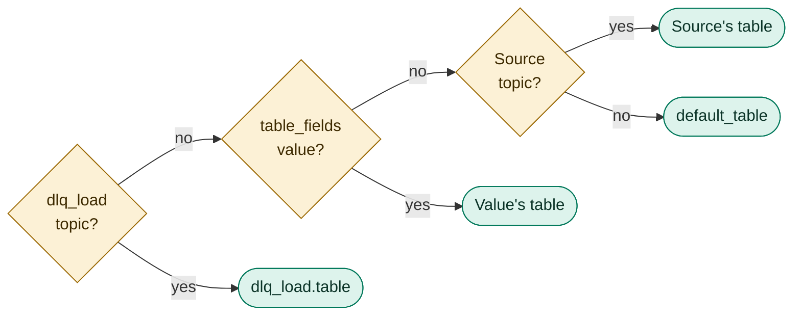

<!--
  Project:      dfe-loader
  File:         docs/pipeline/routing.md
  Purpose:      How a message is routed to a database and table
  Language:     Markdown

  License:      BUSL-1.1
  Copyright:    (c) 2026 HYPERI PTY LIMITED
-->

# Routing

Routing picks the `db.table` a message lands in, before any flattening, from fields in the message itself. The first hop (dfe-receiver or dfe-fetcher) sets `_source` and `_org_id` with its rules, so the loader reads those two header fields and evaluates no rules itself.

The table is the first of four answers that holds: a `dlq_load` topic's table, a `table_fields` value, the source a topic names, then `default_table`.



*Figure 1. L4 Detail -- Loader table choice. Green ends are tables.* Up: [L3 Components -- dfe-loader](../README.md).

The database is the org's database when `org_routes` lists the tenant, else `default_db`. `source_to_table` then maps whichever table was chosen, a `dlq_load` one aside, and a table ClickHouse reports absent falls back to `default_table` as well.

## Settings

| Setting | Effect |
|---------|--------|
| `routing.table_fields` | fields with a value that selects the table, the first one holding a value winning. Dot-notation reaches nested fields (`event.category`). Default `["_source"]` |
| `routing.default_db` | database for every org `org_routes` does not list -- default `dfe` |
| `routing.default_table` | table used when neither a `table_fields` value nor the topic names one, or the table it names does not exist -- default `main`, so an unrouted message lands in `dfe.main` |
| `routing.source_to_table` | maps a source value to the table its records land in, `{cisco-ios: network}` say -- default `{}`, so a source lands in the table of the same name |
| `routing.topic_suffixes` | suffixes that mark a topic as one source's topic -- default `_land` / `_load`, so `cisco-ios_load` names the source `cisco-ios`. With `kafka.topics` and `kafka.topic_regex` unset, auto-discovery subscribes to the topics ending in one, so an empty list or an empty suffix is refused |
| `routing.org_id_field` | field the tenant is read from -- default `_org_id`, the common-header field the first hop stamps |
| `routing.default_org_id` | tenant for a record that has none -- default `default`, the deployment's default org |
| `routing.org_routes` | orgs that get a separate database, keyed on the tenant: `[{org_id: acme, database: acme_dfe}]` |
| `routing.external_topics` | topics an external pipeline writes straight to, each with the tenant policy below |

## How a field is resolved

`table_fields` is an ordered list. The first field carrying a value wins, and the value is the table name. A null or empty value counts as absent, so `{"_source": ""}` falls through to the next field, then the topic, then `default_table`. It never reaches the DLQ. Dot-notation walks nested objects, so `table_fields = ["event.category"]` reads `category` inside the `event` object.

A record read from a `dlq_load` topic skips `table_fields` and lands in `dlq_load.table`. A dead letter holds the `_source` of the record it wraps, which would send it back to the table that refused it. Any other record that resolves to `dlq_load.table` lands in `default_table` instead. See [configuration](../configuration.md#loading-dead-letters).

The `_org_id` column takes the record's `org_id_field` value and nothing else: no column directive and no sender field such as `org_id` can set it. An absent, null or empty value lands in `default_org_id`, so every row belongs to an org. The database is `default_db` unless `org_routes` lists that tenant.

## External pipeline topics

An external pipeline is a customer's Vector, Fluentd or Logstash writing a source's Kafka topics directly. No dfe-receiver sits in front, so nothing has stripped a forged `_org_id` or `_source`, and the loader would write the record into whatever tenant and table it names. List the topic under `routing.external_topics` and the loader holds each record to the source's configured values:

```yaml
routing:
  external_topics:
    - topic: cisco-ios_land
      org_id: acme                # the source's own tenant
      allowed_org_ids: []         # empty = only org_id
      source: cisco-ios           # the source's own name
      allowed_sources: []         # empty = only source
```

On a listed topic:

- `_org_id` absent, null, empty or outside `[org_id] + allowed_org_ids` is set to `org_id`.
- `_source` absent, null, empty or outside `[source] + allowed_sources` is set to `source`.
- A value inside the list is kept.
- Nothing is rejected or dead-lettered. The record lands, in the source's configured tenant and table.

Each replacement increments `loader_external_org_id_replaced_total{topic}` or `loader_external_source_replaced_total{topic}`, so a pipeline that keeps sending the wrong value shows up as a rate. A topic not listed behaves as before.

The tenant is replaced at `org_id_field`. The source is replaced in `_source` and in every field `metadata.source_fields` and `table_fields` name, so changing those lists does not open a way round the policy. The `_json` and `_raw` captures hold the payload as the sender wrote it, forged values included. The columns hold the replaced ones.

## A routing edit applies without a restart

The loader watches its config file (`hot_reload.enabled`, on unless set false). On a change it rebuilds the router, the header extractor and the default table from the edited `routing` and `metadata`. Startup pre-warms the schemas of the default table and every `source_to_table` target. A reload pre-warms the ones it holds no fresh schema for, and leaves a table held absent to the recheck described below. A source table the pre-warm finds absent is not recorded absent: the engine writes a source's routing and creates its table together, so the source's first batch resolves the table from the pending-schema buffer instead. An absent default table is reported at once. Rows in the buffers keep the table they were routed to, and no offset is committed for them until they land. `routing.dlq` is the exception: the DLQ is opened at startup, so a change there logs a restart warning. The deployment contract lists `routing` in `hot_paths`, so on Kubernetes an edit there reaches the running pods without rolling them.

## The topic names the source when the record does not

A transform emits ECS. `_source` is a DFE header field the loader itself adds,
so nothing inside the document names the source and the topic name is the only
thing that does. `cisco-ios_load` is the output topic of exactly one source, so
a record arriving there with no `table_fields` value routes to `dfe.cisco-ios`.

A topic names a source only when one of `routing.topic_suffixes` strips off it
AND what is left does not resolve to `default_table`. Both halves matter:
`main_land` strips to the landing table, so its records have no
source of theirs and keep the default fallback. A topic with no suffix to
strip is not `{source}_land` or `{source}_load` and names no source at all.
`source_to_table` is applied before the comparison, so a source mapped onto the
landing table is landing traffic as well.

Routing by topic covers for the producer but does not hide it: the record still
gave no table, so `dfe_loader_routing_field_absent_total` increments and a
warning names the topic, the table and how many records it stands for, once a
minute per topic.

A record routed to a table ClickHouse confirms does not exist lands in `default_table` instead, counted in `dfe_loader_unknown_table_fallback_total{table}`. The answer is held, then the table is resolved again, so a table created later starts receiving its data without a pod restart: after 60 seconds, or for a `source_to_table` target the routing names, after 1 second doubling up to 30. The warning names the move into absence and not the state, so a dead source name is announced once rather than once a minute for the life of the deployment.

The default table is never held absent, because nothing falls back from it. A record routed to it before it exists waits in the pending-schema buffer and is resolved again as it waits, until the table exists or the record reaches `schema.pending_max_age_secs` and is retired like any record with a schema that never arrived.

Routing is config-cascade behaviour, so it is tested by outcome, not by parse:
the processor tests assert the row is actually buffered against the table the
config selects (`process_routes_to_table_from_event_category`,
`process_routes_to_default_when_no_table_field`,
`process_nested_table_field_via_dot_notation`,
`routing_config_drives_actual_table`,
`a_record_with_no_routing_field_on_a_source_topic_lands_in_that_source_table` in
`src/pipeline/processor.rs`). Change the routing fields and the destination
table the row lands in changes with it. See
[../configuration.md](../configuration.md#routing).
