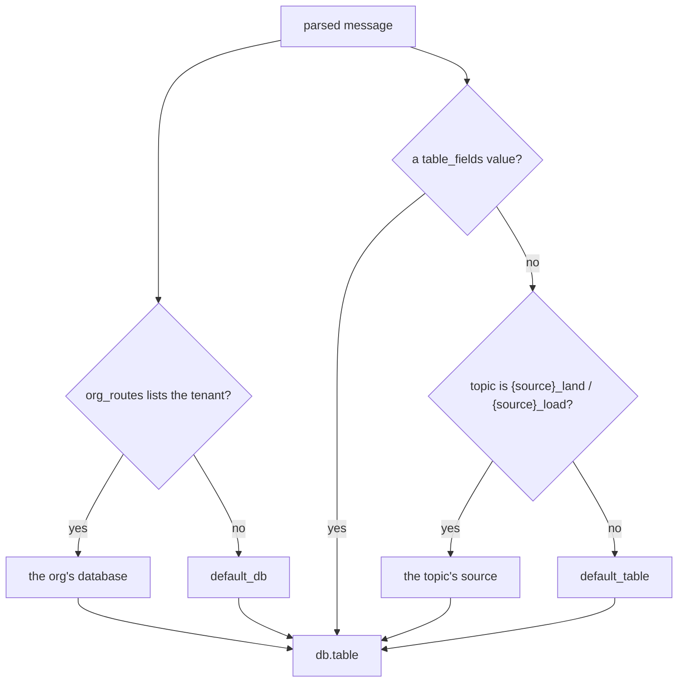

<!--
  Project:      dfe-loader
  File:         docs/pipeline/routing.md
  Purpose:      How a message is routed to a database and table
  Language:     Markdown

  License:      BUSL-1.1
  Copyright:    (c) 2026 HYPERI PTY LIMITED
-->

# Routing

Routing picks the `db.table` a message lands in, before any flattening, from fields in the message itself. The first hop (dfe-receiver or dfe-fetcher) sets `_source` and `_org_id` with its rules, so the loader reads those two header fields and evaluates no rules of its own.

## Settings

| Setting | Effect |
|---------|--------|
| `routing.table_fields` | fields whose value selects the table, first one carrying a value wins. Dot-notation reaches nested fields (`event.category`). Default `["_source"]` |
| `routing.default_db` | database for every org `org_routes` does not list -- default `dfe` |
| `routing.default_table` | table used when neither a `table_fields` value nor the topic names one -- default `main`, so an unrouted message lands in `dfe.main` |
| `routing.topic_suffixes` | suffixes that mark a topic as one source's own -- default `_land` / `_load`, so `cisco-ios_load` names the source `cisco-ios` |
| `routing.org_id_field` | field the tenant is read from -- default `_org_id`, the common-header field the first hop stamps |
| `routing.default_org_id` | tenant for a record that carries none -- default `default`, the deployment's default org |
| `routing.org_routes` | orgs that get a database of their own, keyed on the tenant: `[{org_id: acme, database: acme_dfe}]` |

## How a field is resolved

`table_fields` is an ordered list. The first field carrying a value wins, and the value is the table name. A null or empty value counts as absent, so `{"_source": ""}` falls through to the next field, then the topic, then `default_table`. It never reaches the DLQ. Dot-notation walks nested objects, so `table_fields = ["event.category"]` reads `category` inside the `event` object.

## The tenant

The `_org_id` column takes the record's `org_id_field` value and nothing else: no column directive and no sender field such as `org_id` can set it. An absent, null or empty value lands in `default_org_id`, so every row belongs to an org. The database is `default_db` unless `org_routes` lists that tenant.

## A routing edit applies without a restart

The loader watches its config file (`hot_reload.enabled`, on unless set false). On a change it rebuilds the router, the header extractor and the default table from the new `routing` and `metadata`, and pre-warms the schemas of any table the new routing names. Rows already buffered keep the table they were routed to, and no offset is committed for them until they land. `routing.dlq` is the exception: the DLQ is opened at startup, so a change there logs a restart warning. The deployment contract lists `routing` in `hot_paths`, so on Kubernetes an edit there reaches the running pods without rolling them.

## The topic names the source when the record does not

A transform emits ECS. `_source` is a DFE header field the loader itself adds,
so nothing inside the document names the source and the topic name is the only
thing that does. `cisco-ios_load` is the output topic of exactly one source, so
a record arriving there with no `table_fields` value routes to `dfe.cisco-ios`.

A topic names a source only when one of `routing.topic_suffixes` strips off it
AND what is left does not resolve to `default_table`. Both halves matter:
`main_land` strips to the landing table, so its records genuinely have no
source of their own and keep the default fallback; a topic with no suffix to
strip is not `{source}_land` or `{source}_load` and names no source at all.
`source_to_table` is applied before the comparison, so a source mapped onto the
landing table is landing traffic too.

Routing by topic covers for the producer but does not hide it: the record still
named no table, so `dfe_loader_routing_field_absent_total` increments and a
warning names the topic, the table and how many records it stands for, once a
minute per topic.

A table ClickHouse confirms does not exist is held for 60 seconds, then
re-resolved, so a table created later starts receiving its own data without a
pod restart. The warning names the move into absence and not the state: the
re-resolved answer is the one already held, so a dead source name is announced
once rather than once a minute for the life of the deployment.

The default table is never held absent, because nothing falls back from it. A record routed to it while it does not exist waits in the pending-schema buffer and is resolved again while it waits, until the table exists or the record reaches `schema.pending_max_age_secs` and is retired like any record whose schema never arrived.

## The setting drives the action

Routing is config-cascade behaviour, so it is tested by outcome, not by parse:
the processor tests assert the row is actually buffered against the table the
config selects (`process_routes_to_table_from_event_category`,
`process_routes_to_default_when_no_table_field`,
`process_nested_table_field_via_dot_notation`,
`routing_config_drives_actual_table`,
`a_record_with_no_routing_field_on_a_source_topic_lands_in_that_source_table` in
`src/pipeline/processor.rs`). Change the routing fields and the destination
table the row lands in changes with it. See
[../configuration.md](../configuration.md#routing).
