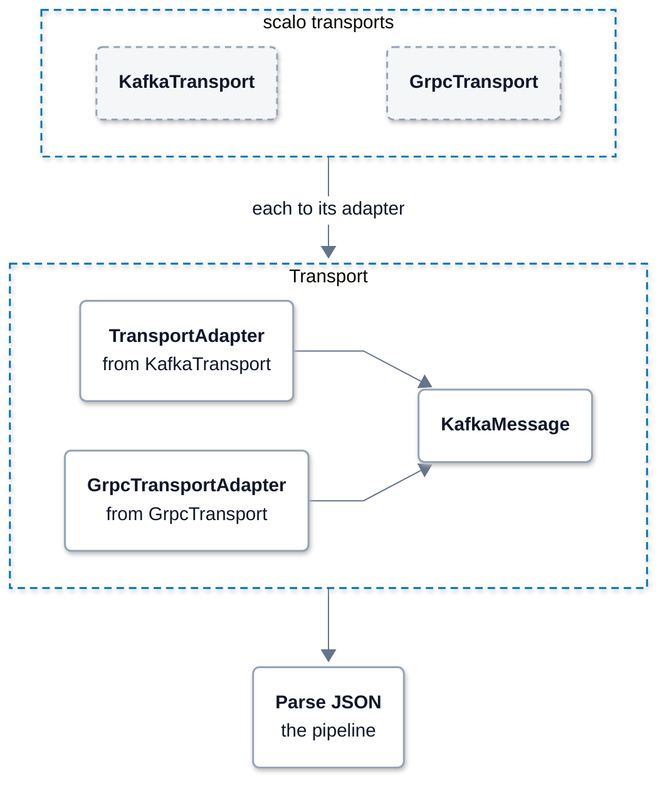

<!--
  Project:      dfe-loader
  File:         docs/transport/README.md
  Purpose:      Index for the transport layer docs (Kafka, gRPC)
  Language:     Markdown

  License:      BUSL-1.1
  Copyright:    (c) 2026 HYPERI PTY LIMITED
-->

# Transport

The transport is how records reach [dfe-loader](../architecture.md): scalo's Kafka or gRPC transport, adapted so the pipeline sees one message type.

| | |
|---|---|
| Repo | [hyperi-io/dfe-loader](https://github.com/hyperi-io/dfe-loader) |
| Image and chart | `ghcr.io/hyperi-io/dfe-loader`, and the thin chart released beside it |
| Config reference | `transport`, `kafka` and `grpc` in [config-schema.yaml](../config-schema.yaml) |
| Endpoints | gRPC Push on port 6000 with `transport: grpc`. `/metrics`, `/livez` and `/readyz` on 9090 |
| Metrics | `messages_received_total`, `kafka_offsets_committed_total`, `pipeline_retries_total`, in [operations.md](../operations.md#observe) |

The loader doesn't implement either transport. A Memory transport exists behind the `transport-memory` cargo feature for unit tests only.

*Figure 1. L4 Detail -- Transport adapters. Dashed boxes are scalo's.* Up: [L3 Components -- dfe-loader](../architecture.md).

## How it works

1. scalo's `KafkaTransport` consumes the configured topics, or its `GrpcTransport` serves Push on `grpc.listen`, port 6000 by default.
2. Each transport's adapter turns every record into the same `KafkaMessage`, with its topic, partition and offset.
3. The pipeline's parse step takes it from there, and nothing after it knows which transport a record came on.

## Interfaces

Kafka: the topics in `kafka.topics` or `kafka.topic_regex`, read as consumer group `kafka.group`. gRPC: scalo's Push on port 6000, which the deployment contract declares only when `transport: grpc`. The loader is a gRPC server only and never sends.

## Scaling and failure

A transport that can't start, such as Kafka with no broker reachable, is retried with backoff and counted in `pipeline_retries_total{stage="transport_start"}`. Until ClickHouse answers, the loader joins no consumer group and opens no gRPC listener. On gRPC a held batch is answered `UNAVAILABLE`, and the sender retries it.

## Key metrics

- `messages_received_total`: records in, on either transport.
- `kafka_offsets_committed_total`: flat on gRPC, which has no broker offsets.
- `pipeline_retries_total{stage="transport_start"}`: a transport that won't start.

## Related

- [grpc.md](grpc.md) -- the gRPC listener: how it answers a Push, the proto, its config and the deployment contract's port.
- [common-header.md](common-header.md) -- the header columns every table starts with, and what the loader writes into each.

See [../architecture.md](../architecture.md) for where the transport layer sits in the overall system.
