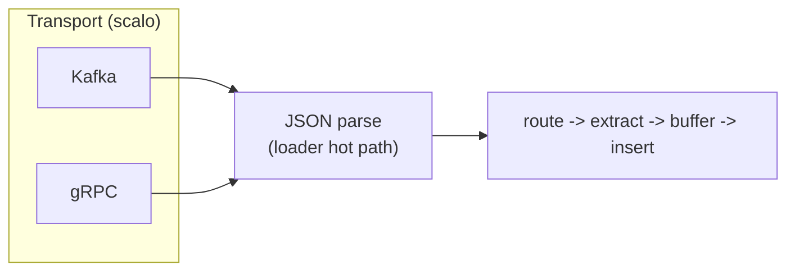

<!--
  Project:      dfe-loader
  File:         docs/transport/README.md
  Purpose:      Index for the transport layer docs (Kafka, gRPC)
  Language:     Markdown

  License:      BUSL-1.1
  Copyright:    (c) 2026 HYPERI PTY LIMITED
-->

# Transport

The transports, Kafka and gRPC, are scalo's. The loader does not implement them: it takes what scalo's `Transport` receives and feeds it into its parse stage, then on through routing, extraction and the per-table insert path. Whichever transport delivers a message, the bytes converge on the same hot path: refuse anything not JSON, parse, route to `db.table`, promote schema columns, and buffer for insert. A Memory transport exists behind the `transport-memory` cargo feature for unit tests only.

## In this section

- [grpc.md](grpc.md) -- the gRPC listener: how it answers a Push, the proto, its config and the deployment contract's port.
- [common-header.md](common-header.md) -- the header columns every table starts with, and what the loader writes into each.

See [../architecture.md](../architecture.md) for where the transport layer sits in the overall system.
