<!--
  Project:      dfe-loader
  File:         docs/transport/common-header.md
  Purpose:      The common header every record in every DFE table starts with
  Language:     Markdown

  License:      BUSL-1.1
  Copyright:    (c) 2026 HYPERI PTY LIMITED
-->

# Common header

Every record in every DFE table starts with the common header, whatever the source sends. The loader fills it before insert, whichever transport the record arrived on (a Kafka topic or a gRPC push). The rest of the stack keys on it: row-level security on `_org_id`, time windows and partitions on its timestamps, and the console's time and organisation filters on the same columns. A change to a header field reaches every table the engine's schema phase creates and every query that filters on it, which is why the header moves only with its schema version.

The header's DDL belongs to dfe-schemas: its column types, ORDER BY, partitioning, codecs, indexes and TTL come from the `timeseries`, `minimal` and `passthrough` profiles under [`common-header/`](https://github.com/hyperi-io/dfe-schemas/tree/main/common-header), rendered by dfe-schemas and applied by dfe-engine's schema phase. dfe-schemas' [profile reference](https://github.com/hyperi-io/dfe-schemas/blob/main/docs/meta-schema.md#common-header-profiles) describes them, and `make render` in a dfe-schemas clone prints the DDL a deployment gets. This page covers what the loader writes into each column.

## The header is the base of every table

In the `timeseries` profile the landing table holds the common header and nothing else, and every other table holds the same header plus data columns.

```mermaid
---
config:
  theme: base
  look: neo
  fontFamily: Inter, -apple-system, Segoe UI, Roboto, Helvetica, Arial, sans-serif
  flowchart:
    curve: linear
    nodeSpacing: 40
    rankSpacing: 64
    padding: 18
    wrappingWidth: 280
    htmlLabels: true
  elk:
    preset: modelOrder
  themeVariables:
    fontSize: 15px
    lineColor: "#64748B"
    primaryTextColor: "#0F172A"
    clusterBorder: "#0072B2"
    edgeLabelBackground: "#FFFFFF"
  themeCSS: >-
    p{margin:0}
    .node[data-look] rect,.node[data-look] path,.node[data-look] polygon,.node[data-look] .outer-path{filter:drop-shadow(0 1px 2px rgba(15,23,42,.10)) drop-shadow(0 6px 14px rgba(15,23,42,.10))}
    .node rect{rx:10px;ry:10px}
    .cluster rect{rx:16px;ry:16px}
    .node .label div{min-width:150px}
    .node.decision .label div{min-width:0}
    .cluster[data-look] rect{filter:none}
    .nodeLabel{line-height:1.35}
    .nodeLabel b{font-weight:600;font-size:15px;letter-spacing:-0.01em}
    .nodeLabel span{font-size:12.5px;font-weight:400;color:#334155}
    .cluster-label span.nodeLabel{display:inline-block;background:#FFFFFF;color:#0B2A3F;border:1.5px solid #0072B2;border-radius:999px;padding:2px 12px;font-size:11.5px;font-weight:700;letter-spacing:.09em;text-transform:uppercase}
    .flowchart-link{stroke-width:1.75px}
    .labelBkg{background:transparent!important}
    span.edgeLabel{display:inline-block;background:#FFFFFF!important;color:#1E293B;border:1px solid #94A3B8;border-radius:999px;padding:2px 10px;font-size:12px;font-weight:500}
    span.edgeLabel p{background:transparent!important}
    .label-icon{width:20px;height:20px;vertical-align:-4px;margin-right:6px}
    .ingest .label-icon{color:#0E8A7D}
    .xform .label-icon{color:#7B4FB0}
    .load .label-icon{color:#0072B2}
    .bus .label-icon{color:#A8517F}
    .store .label-icon{color:#00785A}
    .ui .label-icon{color:#D9480F}
    .ext .label-icon{color:#64748B}
---
flowchart LR
    accTitle: L4 Detail -- Common header against a complete table schema
    accDescr: The landing table dfe.main holds the common header alone. Every other table, such as dfe.auth, holds the same common header plus its data columns.

    subgraph landing["Landing table dfe.main"]
        h1["<b>Common header</b><br/><span>_timestamp, _org_id, ...</span>"]
    end

    subgraph other["Non-default table dfe.auth"]
        direction LR
        h2["<b>Common header</b><br/><span>_timestamp, _org_id, ...</span>"]
        d2["<b>Data columns</b><br/><span>user_id, action, ip, ...</span>"]
        h2 ~~~ d2
    end

    landing ~~~ other
  classDef ext fill:#F4F6F8,stroke:#94A3B8,stroke-width:1.5px,stroke-dasharray:5 4,color:#0F172A
  classDef ingest fill:#FFFFFF,stroke:#0E8A7D,stroke-width:3px,color:#0F172A
  classDef xform fill:#FFFFFF,stroke:#7B4FB0,stroke-width:3px,color:#0F172A
  classDef load fill:#FFFFFF,stroke:#0072B2,stroke-width:3px,color:#0F172A
  classDef bus fill:#FFFFFF,stroke:#A8517F,stroke-width:3px,color:#0F172A
  classDef store fill:#FFFFFF,stroke:#00785A,stroke-width:3px,color:#0F172A
  classDef ui fill:#FFFFFF,stroke:#D9480F,stroke-width:3px,color:#0F172A
  classDef decision fill:#FFFFFF,stroke:#9A6700,stroke-width:3px,color:#0F172A
  classDef error fill:#FFFFFF,stroke:#C2410C,stroke-width:3px,color:#0F172A
  classDef control fill:#FFFFFF,stroke:#334155,stroke-width:3px,color:#0F172A
  classDef part fill:#FFFFFF,stroke:#94A3B8,stroke-width:1.5px,color:#0F172A
  class h1,h2 part
  class d2 store
  style landing fill:none,stroke:#0072B2,stroke-width:1.5px,stroke-dasharray:6 4
  style other fill:none,stroke:#0072B2,stroke-width:1.5px,stroke-dasharray:6 4
```



*Figure 1. L4 Detail -- Common header against a complete table schema. The `timeseries` header (blue) is the same in each table, and non-default tables add data columns (green).* Up: [Transport](README.md).

- The landing table is `dfe.main` by default, another with `routing.default_table`. It is the catch-all for unrouted records.
- A profile decides which header columns a table gets. It never defines the data columns, which come from the table's schema in dfe-schemas.
- Every header column starts with `_`, so it cannot collide with a `timestamp`, `id` or `tags` field the source sends.

The loader creates no table, the landing table included. It reads the schema the deployment created and holds records for a table that does not exist yet in its pending-schema buffer.

## What the loader writes

Types are the `timeseries` profile's as dfe-schemas renders them. The loader reads the live types from `system.columns` and encodes against those.

| Column | Type | What the loader writes |
|---|---|---|
| `_timestamp_load` | `DateTime64(3,'UTC') DEFAULT now64(3)` | Nothing: the INSERT leaves it out and ClickHouse fills the load time |
| `_timestamp` | `DateTime64(3,'UTC')` | The column's directive, `first(timestamp/@timestamp/_timestamp) \| now()`: the first of those fields present, held to `timestamp_dq`, else the ingest time. A column with no directive reads `timestamp`, then `_timestamp` |
| `_timestamp_received` | `DateTime64(3,'UTC')` | The first hop's `_timestamp_received` stamp, then the fields the column's directive names, then the ingest time |
| `_uuid` | `Nullable(UUID) DEFAULT generateUUIDv7()` | Nothing: ClickHouse generates a time-ordered UUID |
| `_org_id` | `LowCardinality(String)` | The `routing.org_id_field` value (default `_org_id`), else `routing.default_org_id`. No directive or sender field can change where it is read |
| `_source` | `LowCardinality(Nullable(String))` | The column's directive, `first(_source) \| topic_name`: the record's `_source`, else the source its topic names |
| `_raw` | `Nullable(String)` | A raw field the record sent (`raw` or `_raw`) under `full`, the whole payload under `raw_only`, else NULL |
| `_json` | `JSON(max_dynamic_paths=2048)` | The received payload under `full` and `json_only`, spliced from the bytes as they arrived. A directive on the column, as on the DLQ table's `@source: _json`, fills it from the field it names under every mode |
| `_tags` | `JSON` | The column's directive, `first(_tags/tags/meta/metadata.tags)`, wrapped in an object (below) |

[capture-modes.md](../pipeline/capture-modes.md) covers `_json` and `_raw`, and [routing.md](../pipeline/routing.md) covers `_org_id` and the topic's source.

A numeric epoch is read by magnitude as seconds, milliseconds, microseconds or nanoseconds. A zoned text value, `2026-09-07T15:53:53.385+10:00` say, is rewritten as the UTC instant it names (`2026-09-07T05:53:53.385Z`), every fraction digit kept, so the offset is applied rather than dropped. The same rewrite applies to any `DateTime` or `DateTime64` column the header pass fills. `timestamp_dq` holds `_timestamp` to `max_future_seconds` (default 600) and `max_past_seconds` (default 0, no lower bound). A value outside them, or one that does not parse once `correct_known_bad` has tried the known bad forms, becomes the ingest time.

## JSON columns take an object

A ClickHouse `JSON` column accepts only an object at the top level, so the loader turns every value it writes into one, `_tags` included, whichever rule filled it and on both insert formats:

- An object is stored as it is.
- An array is stored under a `list` key: ECS ships `tags` as an array, so `["forwarded"]` lands as `{"list": ["forwarded"]}` and queries read it as `_tags.list`.
- A scalar, and text that does not parse as JSON, is stored under a `value` key. Text that holds JSON is stored as the document it holds.

```sql
SELECT _tags.list.:`Array(Nullable(String))` AS tags
FROM dfe.main
WHERE arrayExists(x -> x = 'filebeat', _tags.list.:`Array(Nullable(String))`)
```

An object source passes through untouched, so `_tags` holding `{"list": [...]}` cannot be told apart from a source that sent that key itself.

## When the header pass promotes nothing

A payload the header pass cannot read -- not JSON, not a JSON object, or a valid object matching no column in the table -- goes to the DLQ rather than landing as a row of type defaults with no `_source` and no `_tags`. Each rejection is counted in `dfe_loader_header_pass_skipped_total`, and an ERROR names the table and the reason at most once a minute. The table name stays out of the metric's labels: it comes from a payload field with no allowlist, so labelling it would let untrusted input grow the label set without bound.

Under `full` or `json_only`, a table with a `_json` column and no directive on it keeps the whole payload, so a field no column holds is still stored. A table without one, such as dfe-hyperdx's tables, keeps its columns and nothing else. Each top-level field that lands nowhere counts `dfe_loader_fields_unstored_total`, and a WARN names the table and the fields at most once a minute. DFE's `_` header fields are not counted. A `raw_only` or `extracted_only` table with a `_json` column counts nothing either, because the check asks whether the table has the column, though `_json` is not written there.

## The profiles

| Profile | Columns | Use case |
|---|---|---|
| `timeseries` (default) | 9 | Full record ingestion |
| `minimal` | 5: no `_timestamp_received`, `_source`, `_raw` or `_tags` | High-volume structured data |
| `passthrough` | 4: `_timestamp_load`, `_uuid`, `_org_id`, `_json` | A transparent bridge, no `_timestamp` |

The profile YAML reaches the loader only as deployed ClickHouse columns, never as a file. See [schemas.md](../deployment/schemas.md).

| File | Purpose |
|---|---|
| `src/transform/extractor.rs` | Fills the header columns on the default `json_primary` path |
| `src/clickhouse/schema.rs` | Caches the deployed columns from `system.columns` |
| `src/column_meta/mod.rs` | Parses the `@directive` annotations out of column comments |
| `src/schema/mod.rs` | Parses table `COMMENT` tags |
