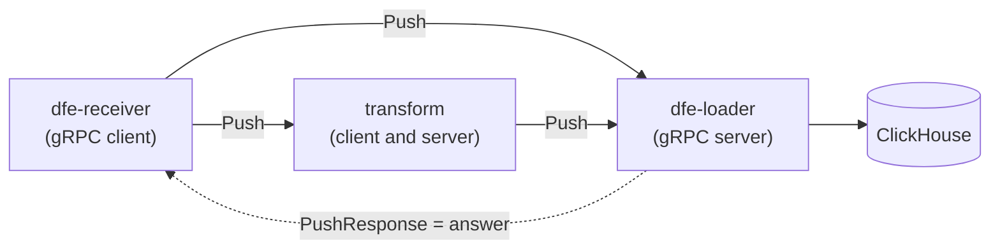

<!--
  Project:      dfe-loader
  File:         docs/transport/grpc.md
  Purpose:      gRPC transport design: proto, config, modes, K8s integration
  Language:     Markdown

  License:      BUSL-1.1
  Copyright:    (c) 2026 HYPERI PTY LIMITED
-->

# gRPC transport

The transports themselves -- Kafka, gRPC, Memory -- live in scalo. The loader does not implement them. It wires scalo's `GrpcTransport` into its pipeline through `GrpcTransportAdapter` in `src/kafka/transport.rs`, which turns each received record into the `KafkaMessage` the rest of the pipeline reads.

With `transport: grpc` the loader runs a gRPC server, and dfe-receiver and the transforms push batches to it directly. That is the path without Kafka.

The wire is gRPC (Protobuf over HTTP/2) through `tonic`, at the version scalo-rs's `Cargo.toml` pins, behind scalo's `transport-grpc` feature. The loader is a server only: the adapter sets no `endpoint`, so it never sends over gRPC.

## How the loader answers a Push

The gRPC response is the acknowledgement. There is no protocol on top of it.

With `grpc.acknowledgements.enabled` (the default) the listener answers a Push only once every row built from it is in ClickHouse, in the DLQ with the DLQ's confirmation, or dropped. A failed insert answers `UNAVAILABLE` and the sender retries from its own copy. Rows whose sender waits on them flush at 200 ms (`EARLY_FLUSH_AGE` in `src/pipeline/orchestrator.rs`) rather than at `buffer.flush_age_secs`. A Push still unanswered after `grpc.max_hold_ms`, shortened by the sender's own deadline, is answered `UNAVAILABLE` as well. Its rows may still land, so the retry can write them twice.

Rows ClickHouse rejects for good go to the DLQ, and their Push is answered once the DLQ confirms that write on its own (`Dlq::write_confirmed`). A Push whose rows have all landed is answered before that write. A refused write is retried with jittered backoff, 100 ms to 1 s, each retry counted in `pipeline_retries_total{stage="dlq"}`, while the Pushes it holds wait and intake stops. The retry ends 1 s (`HOLD_ANSWER_MARGIN`) before the earliest of their hold deadlines, and they are answered `UNAVAILABLE`, as they are at once when the DLQ or the loader shuts down. Records that fail processing (unparseable, unroutable, a pre-route reject) take the same path.

A row no DLQ backend can ever hold is answered as a drop, since a retry would fail the same way at every hop: no working DLQ at all (`reason="dead_letter"`), or larger than a Kafka-only DLQ's ceiling (`reason="too_large"`). It is logged at `error` and counted in `pipeline_dead_letters_dropped_total{reason}` and `dfe_loader_rows_lost_total`.

A message whose table schema is not cached waits in the pending-schema buffer (`src/pipeline/pending_schema.rs`). On gRPC a full buffer (`schema.pending_max_per_table`, `schema.pending_max_total`) stops intake rather than shedding to the DLQ, and a message past `schema.pending_max_age_secs` is answered `UNAVAILABLE`.

With `grpc.acknowledgements.enabled: false` a Push is answered once queued and the loader holds the only copy. A failed insert or refused DLQ write is retried while intake stops (`src/pipeline/unsettled.rs`), and a loader stopped while it holds a batch loses it.

The listener also refuses a Push before it reaches the pipeline (`src/transport/grpc/mod.rs` in scalo-rs):

| Status | When |
|---|---|
| `UNAVAILABLE` | The self-regulation governor's shared pressure holds, so memory pressure reaches the sender before the loader admits another record |
| `RESOURCE_EXHAUSTED` | The receive buffer (`grpc.recv_buffer_size`) is full |
| `RESOURCE_EXHAUSTED` | Held answers have reached the held-byte ceiling, a quarter of the memory guard's limit |

## Proto

The service is scalo's own, defined in scalo-rs `proto/scalo/transport/v1/transport.proto`:

| RPC | What it carries |
|---|---|
| `Push(PushRequest) returns (PushResponse)` | One payload (`bytes`), a `Format` hint and a `metadata` string map |
| `RouteBatch(Batch) returns (BatchAck)` | A whole batch of records, payloads as opaque bytes, each with a key, headers, a timestamp and a format hint |
| `HealthCheck` | `SERVING` or `NOT_SERVING` |

A sender names the topic in the Push metadata key `topic`. The adapter uses it as the routing key, and falls back to `grpc.default_topic` when the sender sets none.

## Configuration

The loader's `grpc` block is `GrpcConfig` in `src/config/kafka.rs`, which `GrpcTransportAdapter::new` maps onto scalo's own `GrpcConfig` (scalo-rs `src/transport/grpc/config.rs`). The defaults are in its `Default` impl.

| Key | Meaning |
|---|---|
| `listen` | Server address. The default binds port 6000, the push port the deployment contract declares |
| `recv_buffer_size` | Messages buffered from incoming RPCs before a Push is refused |
| `recv_timeout_ms` | How long a receive waits for messages, 0 for non-blocking |
| `max_message_size` | Largest message in bytes, sent or received |
| `compression` | gzip on gRPC messages |
| `default_topic` | Routing key for a Push that names no topic |
| `acknowledgements.enabled` | Answer a Push when its rows land (`true`) or when they are queued (`false`) |
| `max_hold_ms` | Longest a Push waits for its answer before it is told to retry. Keep it below the sender's send timeout and above the flush delay |

The block carries no TLS settings.

The deployment contract (`src/config/loader.rs`) declares the `push` port 6000 only when `config.transport` is `grpc`, bound from `grpc.listen`, with `appProtocol: kubernetes.io/h2c`. Liveness and readiness are scalo's `/livez` and `/readyz` on the metrics port, not the gRPC health protocol. The contract's KEDA block comes from `KedaConfig` (`src/config/pipeline.rs`) with the Kafka lag trigger off, because raw consumer-group lag rises when a downstream stage breaks.

The listener's behaviour is tested in `src/kafka/transport.rs`, `tests/unit/transport.rs`, `tests/integration/transport.rs`, `tests/integration/grpc_startup.rs` and `tests/integration/grpc_outage.rs`.
